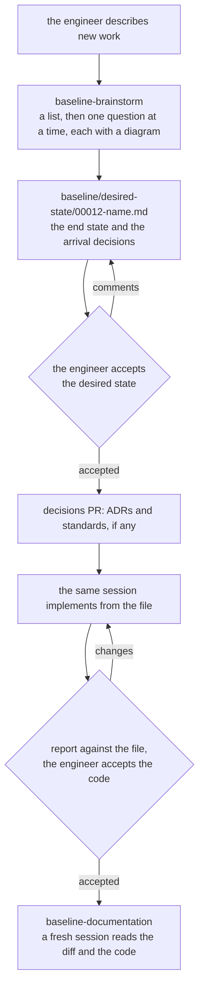

# Instructions for working in baseline-framework

This repository is the baseline: four Agent Skills in `skills/` that put ADRs and coding standards in front of coding agents, run a questions protocol before the code and write the documentation after it. It installs with `npx skills add chandanbsd/baseline-framework`, and it is built the way it asks other repositories to work.

The Software Engineer is Chandan. They decide here, and the baseline is built for them: an engineer taking on the work of a lead, a principal and an architect, with agents writing most of the code. [working-with-the-engineer.md](docs/agents/working-with-the-engineer.md) lists what they decide and what you decide yourself. If they say something different in the conversation, the conversation wins for that task.

## The rules that stand

1. **Nothing merges, deploys or publishes unless the Software Engineer asks.** Opening a PR is publishing, so it waits for their yes. Because: merging, deploying and publishing are their calls.
2. **Add no attribution lines** to commits or PR descriptions: no co-author trailer and no "generated with" line. Because: they do not want them, and Claude Code adds them by default, so the rule has to be stated.
3. **Agents propose standards and never write them silently.** Propose the rule in the chat with its reason in their words and its scope, and write it only after they approve ([standards.md](docs/agents/standards.md)). Because: a standard steers every later generation of code, so an unapproved rule would steer it wrongly and no one would notice.
4. **A rule whose reason is gone is removed.** If you meet one, say so in your report and let the Software Engineer decide. Because: a rule without a living reason is an unexplained constraint on every later task.

## How work is done here

*Two gates, both explicit acceptances by the engineer: the desired state before any code, and the code before any documentation.*

1. **New work with questions** goes through the `baseline-brainstorm` skill, in the main session and never a subagent. It writes `baseline/desired-state/<number>-<name>.md`, and nothing is coded before the Software Engineer accepts it.
2. **Decisions** go in a decisions PR: an ADR ([adrs.md](docs/agents/adrs.md)) or a standard ([standards.md](docs/agents/standards.md)), written from the templates in `skills/baseline-init/assets/kit/baseline/` into `baseline/adr/` and `baseline/standards/`.
3. **A decision during coding that differs from the accepted file** needs the Software Engineer's explicit confirmation, and then you amend the file ([stacks.md](docs/agents/stacks.md) says how the PRs above it are rebased).
4. **The code** is yours to cut into PRs ([stacks.md](docs/agents/stacks.md)). Describe each PR as [pr-descriptions.md](docs/agents/pr-descriptions.md) says.
5. **Documentation** is the `baseline-documentation` skill, run in a fresh session or subagent only after the Software Engineer accepts the code.

## The playbooks

They are in `docs/agents/`. Read the one that fits when its subject comes up.

| Playbook | Read it when |
|---|---|
| [working-with-the-engineer.md](docs/agents/working-with-the-engineer.md) | At the start of every task, when you are unsure whose choice it is, before you put a question to them or write a report |
| [stacks.md](docs/agents/stacks.md) | You open, grow, amend or repair a stack, or are asked for a small change |
| [pr-descriptions.md](docs/agents/pr-descriptions.md) | You open a PR, write a description or change the stack |
| [adrs.md](docs/agents/adrs.md) | You make a decision and must tell whether it needs an ADR, or write one |
| [standards.md](docs/agents/standards.md) | You notice a preference, before you generate code, or when generated code is wrong |

## The repo map

- `skills/` holds the four Agent Skills. `baseline-init`, `baseline-brainstorm` and `baseline-documentation` are built, and `baseline-refactor` is a stub. The kit that `baseline-init` copies into a project is in `skills/baseline-init/assets/kit/`.
- `tests/` and `tools/` hold the unit tests of the skills' scripts, run with `python3 -m unittest discover -s tests -p '*_test.py'` (Python 3.9, standard library only), and the script that sets one version across the four skills.
- `baseline/` is this repository's own baseline folder, so far only `desired-state/`. New ADRs and standards go in `baseline/adr/` and `baseline/standards/`.
- `docs/agents/` holds the playbooks above.
- `standard/`, `docs/adr/` (35 ADRs), `docs/architecture/`, `docs/course/`, `docs/deploy/`, `docs/features/`, `docs/standards/`, `docs/reader-profile.md` and the root `baseline.yml` are the first design, kept as an archive until `baseline-documentation` can reshape them. They are not rules. `standard/AGENTS.md` keeps its own instructions.
- `README.md` describes the project. It is a descriptive document: when something it says becomes untrue, say so in your report.

## Baseline

Before you generate code, read `baseline/adr/` and `baseline/standards/`.
The rest of the baseline's instructions are in `baseline/baseline.md`. Read it before your first task.
