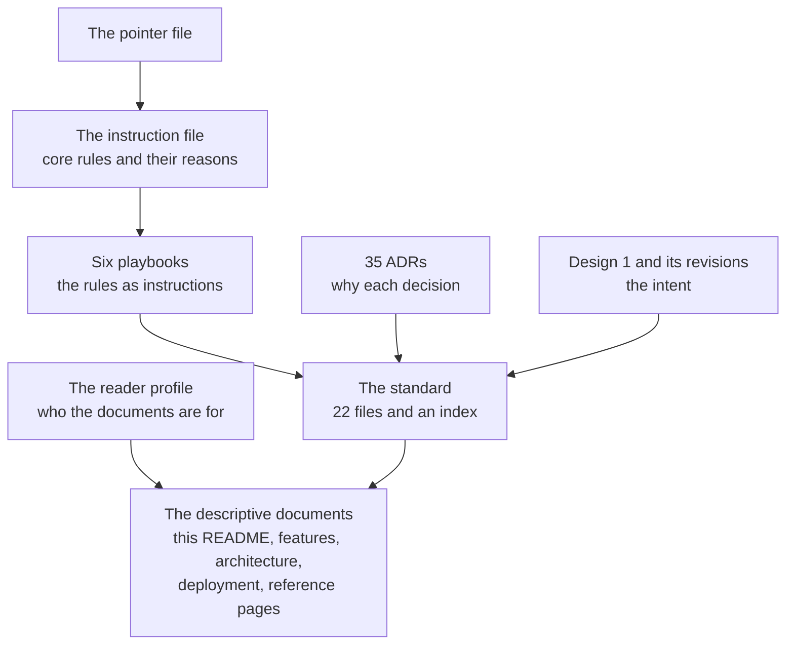
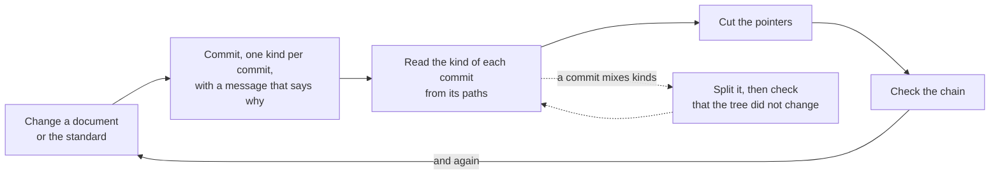

# baseline-framework

## What this is

This repository is the baseline: a standard for documenting and delivering a software project of any kind, in any technology. It exists for the **Software Engineer**, the person who decides on a project, whose goal is to behave as a Distinguished Engineer by taking on, rung by rung, the responsibilities of the Lead Engineer, the Principal Engineer and the Solutions Architect, while AI agents write most of the code. That ladder is the why of everything here ([standard/01-why-and-scope.md](standard/01-why-and-scope.md)).


*The Software Engineer climbs toward the Distinguished Engineer one responsibility at a time, and the one thing to notice is that each rung keeps its responsibility on the way up: the baseline gives a document or a workflow for each one.*

The baseline fixes which documents a project has and who writes them, how work is delivered through stacked pull requests (PRs), and how a project's approved preferences become the standards that drive code. At this tip it is text: the standard in `standard/`, the instruction file `AGENTS.md`, the standard folder's own `standard/AGENTS.md` and six playbooks in `docs/agents/` that state the standard's rules for agents, the repository's own reader profile and configuration, and 35 decision records. The kit, the checkers and the baseline's own skills that are to apply it automatically do not exist yet, so the standard is applied by hand, by following the playbooks.



*An agent reaches the standard through the instruction file and the playbooks, and the one thing to notice is that the descriptive documents, this README among them, sit at the end of every arrow: they are written from the standard and the decisions, never the other way round.*

## Where to go next

| You want to | Read |
|---|---|
| Understand what the baseline gives a project | [The feature docs](docs/features/README.md) |
| Understand how it is built | [The architecture reference](docs/architecture/README.md), then [the decision records](docs/adr/README.md) |
| Read the standard itself | [The standard's index](standard/README.md), in number order |
| Learn the codebase | [The guided course](docs/course/README.md) |
| Understand how the baseline works end to end | The system chapters, starting with [Why this exists](docs/course/system/01-why-this-exists.md) |
| Contribute to it | [`AGENTS.md`](AGENTS.md), then [the playbooks](docs/agents/working-with-the-engineer.md), starting with working with the Software Engineer |
| Operate it | [The deployment docs](docs/deploy/README.md): it is a repository on GitHub, and nothing is deployed |
| Look up a term or a file | [The file map](docs/course/reference/file-map.md), the [technical glossary](docs/course/reference/glossary.md) and the [product glossary](docs/features/glossary.md) |

The reading paths by role, generated from the reader profile, are in [docs/reader-profile.md](docs/reader-profile.md#reading-paths-by-role).

## Prerequisites

| Tool | Version this README was checked with | How to install it |
|---|---|---|
| git | 2.54.0 | From [git-scm.com](https://git-scm.com/downloads), or your system's package manager. |
| GitHub CLI, `gh` | 2.103.3 | From [cli.github.com](https://cli.github.com/). |
| The `gh stack` extension | 0.3.0 | `gh extension install github/gh-stack` |
| An AI agent harness | Claude Code is the primary harness; the standard does not depend on it | From Claude Code's documentation. |

**Not verified.** The install commands were not run: every tool was already installed on the machine where this README was written. The versions are those that `git --version`, `gh --version` and `gh stack --version` printed there on 2026-11-18.

**Accounts and access.** A GitHub account with access to the private repository `chandanbsd/baseline-framework`, to clone it and to read its PRs.

## Get it running

The baseline does not run: what you get running is a new project that follows it. No command does this yet, so these steps do by hand what the intake and the kit are to do: run the intake by hand ([standard/04-reader-profile.md](standard/04-reader-profile.md)), copy what the kit is to copy, and make the one commit that goes straight to `main` ([standard/22-tooling-requirements.md](standard/22-tooling-requirements.md), `/baseline:init`). The output below was captured on 2026-11-18 in an empty folder; where a line names the folder, it is written `<your folder>`.

1. **Check your tools.**

   ```bash
   git --version
   gh --version
   gh stack --version
   ```

   You should see:

   ```text
   git version 2.54.0 (Apple Git-157)
   gh version 2.103.3 (2026-10-26)
   https://github.com/cli/cli/releases/tag/v2.103.3
   gh stack version 0.3.0
   ```

2. **Clone the baseline next to where your project will be.**

   ```bash
   git clone git@github.com:chandanbsd/baseline-framework.git
   ```

   **Not verified.** The clone from GitHub was not run, and until the first stack is merged, `main` on GitHub holds only the bootstrap commit, not the standard or the playbooks. The steps below were run against a clone of the local repository at the top of its stack.

3. **Create your project's repository.**

   ```bash
   mkdir my-project && cd my-project
   git init -b main
   ```

   You should see:

   ```text
   Initialized empty Git repository in <your folder>/my-project/.git/
   ```

4. **Run the intake by hand, and write the reader profile.** Ask the Software Engineer, in this order: the project's name, kind and Software Engineer; the knowledge areas, with a level for each; the technologies already chosen, each with a level and a comparison setting; and once, whether to build standards from their preferences over time. Start from the baseline's own profile and replace its header and its "Read for this repository" list with the answers.

   ```bash
   mkdir -p docs/standards docs/agents
   cp ../baseline-framework/docs/reader-profile.md docs/reader-profile.md
   ```

5. **If the answer about standards was yes, create the standards folder with its README.** On a no, skip this step: there is no folder.

   ```bash
   cp ../baseline-framework/docs/standards/README.md docs/standards/README.md
   ```

6. **Copy the playbooks.** They are the files the kit is to copy, and they belong to the baseline.

   ```bash
   cp ../baseline-framework/docs/agents/*.md docs/agents/
   ls docs/agents
   ```

   You should see:

   ```text
   adrs.md
   docs-agent.md
   pr-descriptions.md
   stacks.md
   standards.md
   working-with-the-engineer.md
   ```

7. **Write `baseline.yml`, `AGENTS.md` and `CLAUDE.md`.** `baseline.yml` holds the four keys of [standard/05-project-layout.md](standard/05-project-layout.md), with your stack folders in place of `web` and `api`:

   ```yaml
   baseline_version: 0.1.0
   standards_enabled: true
   artifact_map:
     spec: ["docs/superpowers/specs/**"]
     plan: ["docs/superpowers/plans/**"]
     other: []
   # Folders whose changes are code for PR-kind purposes, apart from each folder's own README.md and AGENTS.md
   stack_folders: [web, api]
   ```

   `AGENTS.md` holds the four parts of [standard/15-agents-md-and-playbooks.md](standard/15-agents-md-and-playbooks.md): who and what, the seven core rules, the playbooks and the repo map. This repository's [`AGENTS.md`](AGENTS.md) is a real example to start from; rewrite its "Who and what" and its repo map for your project. `CLAUDE.md` is the two lines of this repository's [`CLAUDE.md`](CLAUDE.md).

8. **Make the bootstrap commit, the one commit that goes straight to `main`, and check it.**

   ```bash
   git add .
   git commit -q -m "chore: bootstrap the repository with its reader profile, standards folder and baseline.yml"
   git show --stat --format=%s HEAD
   ```

   You should see:

   ```text
   chore: bootstrap the repository with its reader profile, standards folder and baseline.yml

    AGENTS.md                                | 102 +++++++++++
    CLAUDE.md                                |   2 +
    baseline.yml                             |   8 +
    docs/agents/adrs.md                      | 156 +++++++++++++++++
    docs/agents/docs-agent.md                | 283 ++++++++++++++++++++++++++++++
    docs/agents/pr-descriptions.md           | 237 +++++++++++++++++++++++++
    docs/agents/stacks.md                    | 287 +++++++++++++++++++++++++++++++
    docs/agents/standards.md                 | 129 ++++++++++++++
    docs/agents/working-with-the-engineer.md | 168 ++++++++++++++++++
    docs/reader-profile.md                   |  78 +++++++++
    docs/standards/README.md                 |  71 ++++++++
    11 files changed, 1521 insertions(+)
   ```

   The line counts are those of the copied files before you edit them. The check that proves the bootstrap worked is that `git log --oneline` shows exactly one commit on `main`, and `git show --stat` lists these files.

From here the first stack follows the playbooks: the spec as PR 1, the plan as PR 2, the build, and the docs section on top ([docs/agents/stacks.md](docs/agents/stacks.md)). The CI workflow and the PR template that the kit is also to copy do not exist in the baseline yet, so there is nothing to copy for them.

## The daily loop

Work in this repository is itself delivered as a stack. There is no build, no test suite, no formatter and no linter, because the product is text and the tooling does not exist; the commands you repeat are the git commands of the stack.

| What you do | The command |
|---|---|
| See the commits of the stack and the paths each touches | `git log --reverse --name-only --format='%h %s' main..HEAD` |
| See which paths a PR touches, to read its kind | `git diff --name-only <lower branch> <upper branch>` |
| Cut a pointer at the end of a PR's commits | `git branch <topic>/<nn>-<slug> <commit>` |
| Check that every branch contains the one below it | `git merge-base --is-ancestor <lower> <upper>`, for each neighbouring pair; it exits with status 0 |
| Check that a split or a move changed no file | `git diff <the tip you noted> HEAD` prints nothing |



*The loop runs from a change to a checked chain of branches, and the one thing to notice is the dotted side trip: a commit that mixes kinds is split before any pointer is cut, so that the stack can be cut with pointers alone.*

## Repo map

```text
baseline-framework/
  README.md               this file
  AGENTS.md               the primary instruction for agents
  CLAUDE.md               a two-line pointer to AGENTS.md
  baseline.yml            the baseline's configuration for this repository
  standard/               the standard: 22 files, its index and its AGENTS.md
  docs/
    reader-profile.md     who the documents are written for
    features/             what the baseline gives a project, in plain language
    architecture/         how the baseline is built
    deploy/               where it lives and how it reaches readers
    course/               the guided course and its reference pages
    adr/                  the 35 decision records
    agents/               the six playbooks
    standards/            the project's approved preferences, none yet
    superpowers/          design 1, its decision trail and revisions, and the plan, as the skills wrote them
```

| Folder | Its README | Its AGENTS.md |
|---|---|---|
| `standard/` | [standard/README.md](standard/README.md), the standard's index | [standard/AGENTS.md](standard/AGENTS.md): no commands, because nothing in the folder is built or run, its layout, and the rule for links between its numbered files |
| `docs/features/` | [docs/features/README.md](docs/features/README.md) | None |
| `docs/architecture/` | [docs/architecture/README.md](docs/architecture/README.md), the generated index | None |
| `docs/deploy/` | [docs/deploy/README.md](docs/deploy/README.md) | None |
| `docs/course/` | [docs/course/README.md](docs/course/README.md), the generated course index | None |
| `docs/adr/` | [docs/adr/README.md](docs/adr/README.md), the generated index | None |
| `docs/standards/` | [docs/standards/README.md](docs/standards/README.md) | None |
| `docs/agents/`, `docs/superpowers/` | None | None |

## How we work

Work is delivered as one stack of PRs: the spec as PR 1, the plan as PR 2, decision drafts in small PRs of their own, the code in slices, and the descriptive documents last, in a docs section written by a fresh docs agent from the finished tip. Each PR holds one kind of change, thinking, code or description, because each is easier to review on its own. Nothing merges, deploys or publishes unless the Software Engineer asks, and in this repository opening a stack's PRs is publishing, so it waits for their yes too ([docs/agents/stacks.md](docs/agents/stacks.md)).

AI agents write most of the work. They follow `AGENTS.md` and the six playbooks: [working-with-the-engineer.md](docs/agents/working-with-the-engineer.md) for who decides what, [stacks.md](docs/agents/stacks.md), [pr-descriptions.md](docs/agents/pr-descriptions.md), [docs-agent.md](docs/agents/docs-agent.md), [adrs.md](docs/agents/adrs.md) and [standards.md](docs/agents/standards.md). An agent decides every call that is not the Software Engineer's and records it as `Ruling: what, why, cost if wrong`; a call that is the Software Engineer's it puts to them as a numbered decision, with its recommendation first.

## Configuration

Two files configure the baseline here: `baseline.yml`, which pins version `0.1.0`, lists `standard`, `kit`, `checkers`, `skills` and `examples` as the stack folders and maps the superpowers paths as the spec and the plan, and the YAML header of `docs/reader-profile.md`. Nothing needs to be configured to read or work in the repository. The full table of settings is in [docs/deploy/04-configuration-and-secrets.md](docs/deploy/04-configuration-and-secrets.md).

## Troubleshooting the first hour

| Error | Fix |
|---|---|
| A branch from a stack table, such as `standard/05-foundations`, is not in a clone from GitHub. | Only `main`, `standard/01-spec` and `standard/02-plan` are on GitHub until the stack is published (`git ls-remote --heads origin` listed those three on 2026-11-18). Read the other branches in the repository where the stack was built. |
| `gh stack view` prints `✗ current branch "standard/docs-21-reference" is not part of a stack`. | Expected for a stack made with `gh stack link`, which keeps no local record: check a published stack with `gh pr list --json number,headRefName,baseRefName,isDraft` instead ([docs/agents/stacks.md](docs/agents/stacks.md)). |
| A PR named by its place, such as PR 5, is a different PR when opened as #5 on GitHub. | The documents name a PR of the first stack by its place in the stack. GitHub gave number 3 to the stack itself, so from PR 3 up a PR's number is one more than its place, and PR 5 is #6 (`gh pr list --json number,headRefName`, run on 2026-11-20). The branch name carries the place: `standard/05-foundations` is PR 5. |
| `gh stack` is not a command. | Install the extension: `gh extension install github/gh-stack`. Not verified: the extension was already installed where this was written. |

## Help, contributing and licence

**Help.** Start with [`AGENTS.md`](AGENTS.md) and the playbook for your subject; each rule there has its reason beside it. For the standard's own words, use [its index](standard/README.md).

**Contributing.** Work as a stack and keep each PR to one kind. A change to `standard/` is a code PR, apart from its `README.md`, a description path, and its `AGENTS.md`, a thinking path; a change to the playbooks, `AGENTS.md`, the reader profile or an ADR is a thinking PR, and the descriptive documents, this README among them, are written only by a fresh docs agent from the finished tip. Add no attribution line to a commit or a PR description.

**Licence.** The repository has no licence file. It is a private repository.
