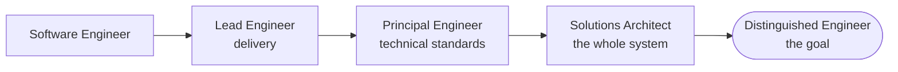
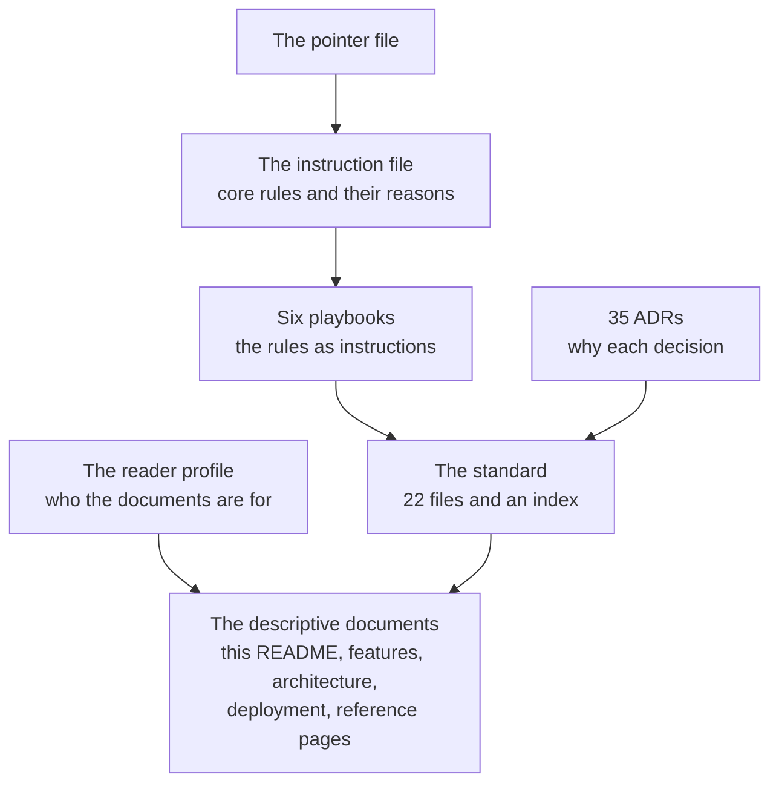
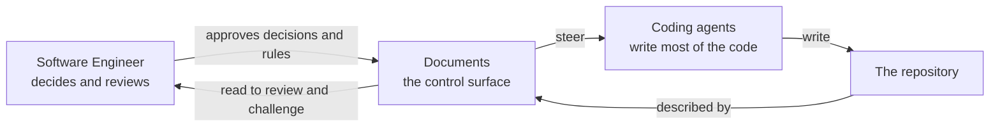
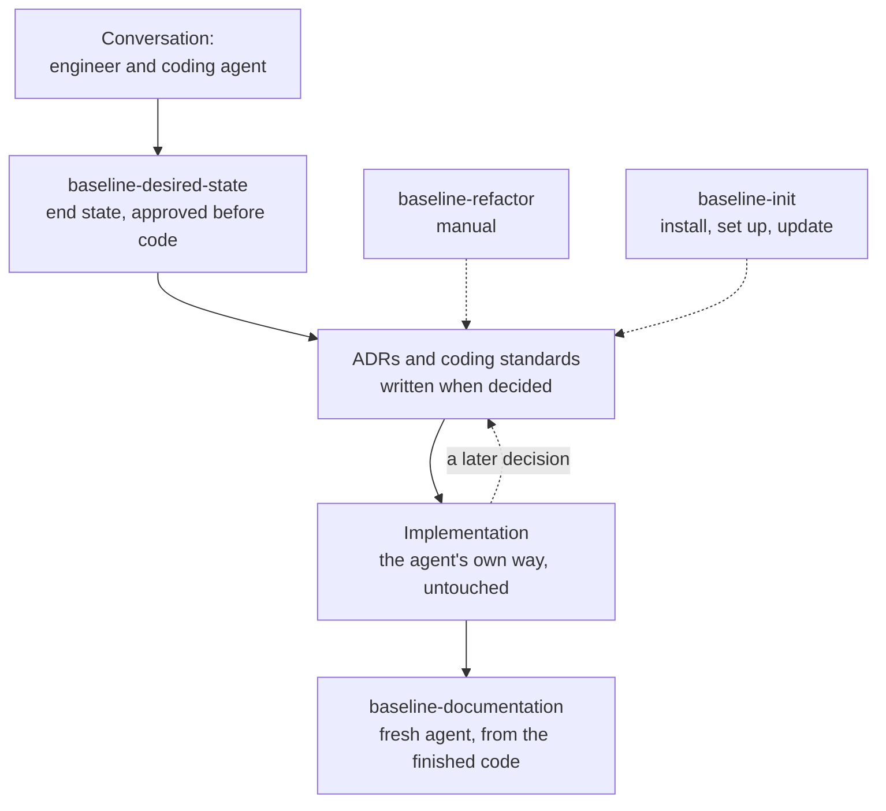
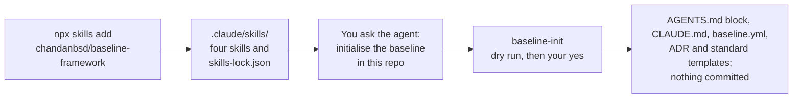
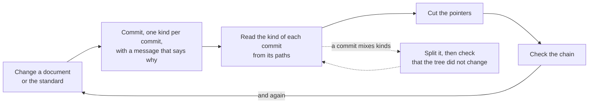

# baseline-framework

## What this is

This repository is the baseline: a standard for documenting and delivering a software project of any kind, in any technology. It exists for the **Software Engineer**, the person who decides on a project, whose goal is to behave as a Distinguished Engineer by taking on, rung by rung, the responsibilities of the Lead Engineer, the Principal Engineer and the Solutions Architect, while AI agents write most of the code. That ladder is the why of everything here ([standard/01-why-and-scope.md](standard/01-why-and-scope.md)).



*The Software Engineer climbs toward the Distinguished Engineer one responsibility at a time, and the one thing to notice is that each rung keeps its responsibility on the way up: the baseline gives a document or a workflow for each one.*

The baseline fixes which documents a project has and who writes them, how work is delivered through stacked pull requests (PRs), and how a project's approved preferences become the standards that drive code. At this tip it is mostly text: the standard in `standard/`, the instruction file `AGENTS.md`, the standard folder's own `standard/AGENTS.md` and six playbooks in `docs/agents/` that state the standard's rules for agents, the repository's own reader profile and configuration, and 35 decision records. A first skeleton of the skills is in `skills/`: `baseline-init` and `baseline-desired-state` are built, `baseline-documentation` and `baseline-refactor` are stubs, and the checks that are to enforce the standard do not exist yet, so most of the standard is still applied by hand, by following the playbooks.



*An agent reaches the standard through the instruction file and the playbooks, and the one thing to notice is that the descriptive documents, this README among them, sit at the end of every arrow: they are written from the standard and the decisions, never the other way round.*

## The problem it solves

When AI agents write most of the code, one engineer keeps control only if two things hold: what they approved reaches every agent session, and the documents they review from tell the truth about what was built. By default neither holds.



*The engineer steers agents through documents and checks their work through documents, and the one thing to notice is that both directions pass through the same documents: when they are missing or false, control is lost both ways.*

| What goes wrong | The baseline's answer |
|---|---|
| Decisions and preferences live in the chat, so the next session regenerates differently and wrong code gets patched instead of fixed at the source. | **ADRs and coding standards**, the only documents that steer code. The coding agent writes them when the decision is made and reads them before it generates code. When the code is wrong, the rule changes and the code is regenerated. |
| The agent starts coding before the engineer has agreed the end state. | **`baseline-desired-state`**: a short summary with diagrams, reviewed in a PR before any code. |
| Documents describe what was meant. The agent that built the code documents its intent, and one wrong sentence costs more than a missing one. | **`baseline-documentation`**: a fresh agent, after all coding, reads the code at the tip with the ADRs and standards and writes only what exists. |
| Good practice is scattered across projects and tied to one tool, so copies drift and updates never arrive. | **Four Agent Skills in one package**, installed with `npx skills add chandanbsd/baseline-framework`, for any agent that reads `SKILL.md` and `AGENTS.md`. **`baseline-init`** sets up a repo and updates it through checked-in migration scripts. |
| Code drifts from the rules over time. | **`baseline-refactor`**, manual only: review a branch against the ADRs and standards and decide, per violation, whether the rule or the code changes. |
| The first answer was too heavy to read: design 1 is 22 files and 77,367 words, 35 ADRs with every option explored, a three-tier course and 11 groups of checks. | **Thin by design**: steer code only through ADRs and standards, control the documentation tightly, lead with diagrams and snippets, and let CI check three things (required sections, diagrams render, links resolve). |



*The baseline touches only the steps around implementation, and the one thing to notice is that implementation itself is left alone: every new decision goes back to the decisions PR instead.*

**Not its problem.** How an agent implements the code (PR size, stack shape, order of work). Security, dependency, privacy and release policy, and coding style: these are per-project standards, approved one rule at a time, because the baseline cannot know a project's kind or goal. Whole-language tutorials, a hosted docs site, and controlling where other skills write.

**Where it stands.** `baseline-init` and `baseline-desired-state` are built and merged; `baseline-documentation` and `baseline-refactor` are stubs. **Verified on 2026-11-26**, in Claude Code on a real project: `npx skills add` finds the four skills, copies each folder whole into `.claude/skills/` (`scripts/`, `assets/`, `references/` and `migrations/` match the source byte for byte), the skills load, and the `baseline-init` dry run lists the five files it would create. **Not verified:** Codex and Copilot (Copilot's skills path is unconfirmed), the real write of `baseline-init` on a real project, `npx skills update`, and that each agent follows the `AGENTS.md` routing. Still to do: the two stub skills, the check script and its CI workflow, real migrations, and retiring `standard/` and the old playbooks.

**Where the design history lives.** The specs and plans that designed it were removed on 2026-11-26. They remain in git history at commit `3215c3b`, under `docs/superpowers/`.

## Where to go next

| You want to | Read |
|---|---|
| Use it in a project | [Get it running](#get-it-running) |
| Understand what the baseline gives a project | [The feature docs](docs/features/README.md) |
| Understand how it is built | [The architecture reference](docs/architecture/README.md), then [the decision records](docs/adr/README.md) |
| Read the standard itself | [The standard's index](standard/README.md), in number order |
| Learn the codebase | [The guided course](docs/course/README.md) |
| Understand how the baseline works end to end | The system chapters, starting with [Why this exists](docs/course/system/01-why-this-exists.md) |
| Contribute to it | [`AGENTS.md`](AGENTS.md), then [the playbooks](docs/agents/working-with-the-engineer.md), starting with working with the Software Engineer |
| Operate it | [The deployment docs](docs/deploy/README.md): it is a repository on GitHub, and nothing is deployed |
| Look up a term or a file | [The file map](docs/course/reference/file-map.md), the [technical glossary](docs/course/reference/glossary.md) and the [product glossary](docs/features/glossary.md) |

The reading paths by role, generated from the reader profile, are in [docs/reader-profile.md](docs/reader-profile.md#reading-paths-by-role).

## Prerequisites

| Tool | Version this README was checked with | How to install it |
|---|---|---|
| git | 2.54.0 | From [git-scm.com](https://git-scm.com/downloads), or your system's package manager. |
| GitHub CLI, `gh` | 2.103.3 | From [cli.github.com](https://cli.github.com/). |
| The `gh stack` extension | 0.3.0 | `gh extension install github/gh-stack` |
| An AI agent harness | Claude Code is the primary harness; the standard does not depend on it | From Claude Code's documentation. |
| Node.js | 26.13.0; the `skills` CLI needs 22.20 or later | From [nodejs.org](https://nodejs.org/), or your system's package manager. It brings `npx`. |
| Python 3 | 3.9.6; the `baseline-init` scripts need 3.9 or later and use only the standard library | From [python.org](https://www.python.org/downloads/), or your system's package manager. |
| The `skills` CLI | 1.9.0 | Nothing to install: `npx skills` fetches it on first use. |

**Not verified.** The install commands were not run: every tool was already installed on the machine where this README was written. The versions of git, `gh` and `gh stack` are those that `git --version`, `gh --version` and `gh stack --version` printed there on 2026-11-18; the versions of Node.js, Python and the `skills` CLI are those that `node --version`, `python3 --version` and `npx skills --version` printed on 2026-11-26.

**Accounts and access.** The repository is public, so installing the skills and cloning it need no account. A GitHub account is needed to open PRs.

## Get it running

The baseline is four Agent Skills. You install them into a project, then ask the agent to set the project up. The steps below were run on 2026-11-26 in Claude Code, on a real project, from the public repository at commit `d007083`. Codex and Copilot were not tried.



*Installing puts the skills in the project and setting up writes the project's files, and the one thing to notice is that between the two the agent only shows a dry run and waits for your yes, and it commits nothing.*

1. **Install the skills**, from the root of your project. `-a claude-code` installs for Claude Code and `--skill '*'` takes all four.

   ```bash
   npx skills add chandanbsd/baseline-framework --skill '*' -a claude-code -y
   ```

   You should see, shortened:

   ```text
   Installed 4 skills
   ✓ baseline-desired-state (copied)
   ✓ baseline-documentation (copied)
   ✓ baseline-init (copied)
   ✓ baseline-refactor (copied)
   ```

   `git status` then shows `.claude/` and `skills-lock.json` as untracked. `skills-lock.json` pins the commit the skills came from, so commit both and teammates and CI use the same version. The CLI sends telemetry unless `DISABLE_TELEMETRY=1` is set.

2. **Open a new agent session in the project**, because a session loads its skills when it starts. Ask which skills it has. You should see `baseline-desired-state`, `baseline-documentation`, `baseline-init` and `baseline-refactor`.

3. **Set the project up.** Ask: "initialise the baseline in this repo". `baseline-init` runs `python3 scripts/init.py <repo> --dry-run`, shows you its lines and waits. For a project with no `AGENTS.md` you should see:

   ```text
   create AGENTS.md
   create baseline.yml
   create CLAUDE.md
   create docs/adr/TEMPLATE.md
   create docs/standards/TEMPLATE.md
   dry run: nothing written
   ```

   It never overwrites a file: where `AGENTS.md` exists it appends its block and leaves the rest as it is. After your yes it runs the script again without `--dry-run`, and still commits nothing.

4. **Update later.** `npx skills update` moves the installed skills to the latest commit. Then ask the agent to update the baseline: `baseline-init` runs `scripts/update.py plan`, and applies each pending migration after your yes. No migration ships yet, so today the plan reports "up to date".

`baseline-documentation` and `baseline-refactor` are stubs: if invoked, each says it is not implemented yet and stops.

## The daily loop

Work in this repository is itself delivered as a stack. There is no build, formatter or linter. The skills' scripts have a test suite, one command moves the version of all four skills together, and the other commands you repeat are the git commands of the stack.

| What you do | The command |
|---|---|
| Run the 48 tests of the skills | `python3 -m unittest discover -s tests -p '*_test.py'` |
| Set one version for the four skills | `python3 tools/bump_version.py <new_version>` |
| See the commits of the stack and the paths each touches | `git log --reverse --name-only --format='%h %s' main..HEAD` |
| See which paths a PR touches, to read its kind | `git diff --name-only <lower branch> <upper branch>` |
| Cut a pointer at the end of a PR's commits | `git branch <topic>/<nn>-<slug> <commit>` |
| Check that every branch contains the one below it | `git merge-base --is-ancestor <lower> <upper>`, for each neighbouring pair; it exits with status 0 |
| Check that a split or a move changed no file | `git diff <the tip you noted> HEAD` prints nothing |



*The loop runs from a change to a checked chain of branches, and the one thing to notice is the dotted side trip: a commit that mixes kinds is split before any pointer is cut, so that the stack can be cut with pointers alone.*

## Repo map

```text
baseline-framework/
  README.md               this file
  AGENTS.md               the primary instruction for agents
  CLAUDE.md               a two-line pointer to AGENTS.md
  baseline.yml            the baseline's configuration for this repository
  LICENSE                 the Apache License, Version 2.0
  NOTICE                  the copyright notice
  standard/               the standard: 22 files, its index and its AGENTS.md
  skills/                 the four Agent Skills, installed with npx skills add
  tests/                  unittest suite: the skill rules, init, update and the version bump
  tools/                  bump_version.py, one version for the four skills
  docs/
    reader-profile.md     who the documents are written for
    features/             what the baseline gives a project, in plain language
    architecture/         how the baseline is built
    deploy/               where it lives and how it reaches readers
    course/               the guided course and its reference pages
    adr/                  the 35 decision records
    agents/               the six playbooks
    standards/            the project's approved preferences, none yet
```

| Folder | Its README | Its AGENTS.md |
|---|---|---|
| `standard/` | [standard/README.md](standard/README.md), the standard's index | [standard/AGENTS.md](standard/AGENTS.md): no commands, because nothing in the folder is built or run, its layout, and the rule for links between its numbered files |
| `skills/` | None | None |
| `tests/` | None | None |
| `tools/` | None | None |
| `docs/features/` | [docs/features/README.md](docs/features/README.md) | None |
| `docs/architecture/` | [docs/architecture/README.md](docs/architecture/README.md), the generated index | None |
| `docs/deploy/` | [docs/deploy/README.md](docs/deploy/README.md) | None |
| `docs/course/` | [docs/course/README.md](docs/course/README.md), the generated course index | None |
| `docs/adr/` | [docs/adr/README.md](docs/adr/README.md), the generated index | None |
| `docs/standards/` | [docs/standards/README.md](docs/standards/README.md) | None |
| `docs/agents/` | None | None |

## How we work

Work is delivered as one stack of PRs: the spec as PR 1, the plan as PR 2, decision drafts in small PRs of their own, the code in slices, and the descriptive documents last, in a docs section written by a fresh docs agent from the finished tip. Each PR holds one kind of change, thinking, code or description, because each is easier to review on its own. Nothing merges, deploys or publishes unless the Software Engineer asks, and in this repository opening a stack's PRs is publishing, so it waits for their yes too ([docs/agents/stacks.md](docs/agents/stacks.md)).

AI agents write most of the work. They follow `AGENTS.md` and the six playbooks: [working-with-the-engineer.md](docs/agents/working-with-the-engineer.md) for who decides what, [stacks.md](docs/agents/stacks.md), [pr-descriptions.md](docs/agents/pr-descriptions.md), [docs-agent.md](docs/agents/docs-agent.md), [adrs.md](docs/agents/adrs.md) and [standards.md](docs/agents/standards.md). An agent decides every call that is not the Software Engineer's and records it as `Ruling: what, why, cost if wrong`; a call that is the Software Engineer's it puts to them as a numbered decision, with its recommendation first.

## Configuration

Two files configure the baseline here: `baseline.yml`, which pins version `0.1.0`, lists `standard`, `kit`, `checkers`, `skills` and `examples` as the stack folders and leaves the artifact map empty, and the YAML header of `docs/reader-profile.md`. Nothing needs to be configured to read or work in the repository. The full table of settings is in [docs/deploy/04-configuration-and-secrets.md](docs/deploy/04-configuration-and-secrets.md).

## Troubleshooting the first hour

| Error | Fix |
|---|---|
| `gh stack view` prints `✗ current branch "standard/docs-21-reference" is not part of a stack`. | Expected for a stack made with `gh stack link`, which keeps no local record: check the stack with `gh pr list --state all --json number,headRefName,baseRefName,state` instead ([docs/agents/stacks.md](docs/agents/stacks.md)). |
| A PR named by its place, such as PR 5, is a different PR when opened as #5 on GitHub. | The documents name a PR of the first stack by its place in the stack. GitHub gave number 3 to the stack itself, so from PR 3 up a PR's number is one more than its place, and PR 5 is #6 (`gh pr list --state all --json number,headRefName`, run on 2026-11-20). The branch name carries the place: `standard/05-foundations` is PR 5. |
| `gh stack` is not a command. | Install the extension: `gh extension install github/gh-stack`. Not verified: the extension was already installed where this was written. |

## Help, contributing and licence

**Help.** Start with [`AGENTS.md`](AGENTS.md) and the playbook for your subject; each rule there has its reason beside it. For the standard's own words, use [its index](standard/README.md).

**Contributing.** Work as a stack and keep each PR to one kind. A change to `standard/` is a code PR, apart from its `README.md`, a description path, and its `AGENTS.md`, a thinking path; a change to the playbooks, `AGENTS.md`, the reader profile or an ADR is a thinking PR, and the descriptive documents, this README among them, are written only by a fresh docs agent from the finished tip. Add no attribution line to a commit or a PR description.

**Licence.** The repository is public and licensed under the Apache License, Version 2.0: the full text is in [LICENSE](LICENSE) and the copyright notice is in [NOTICE](NOTICE). Each of the four skills also names the licence in the `license` field of its `SKILL.md`.
