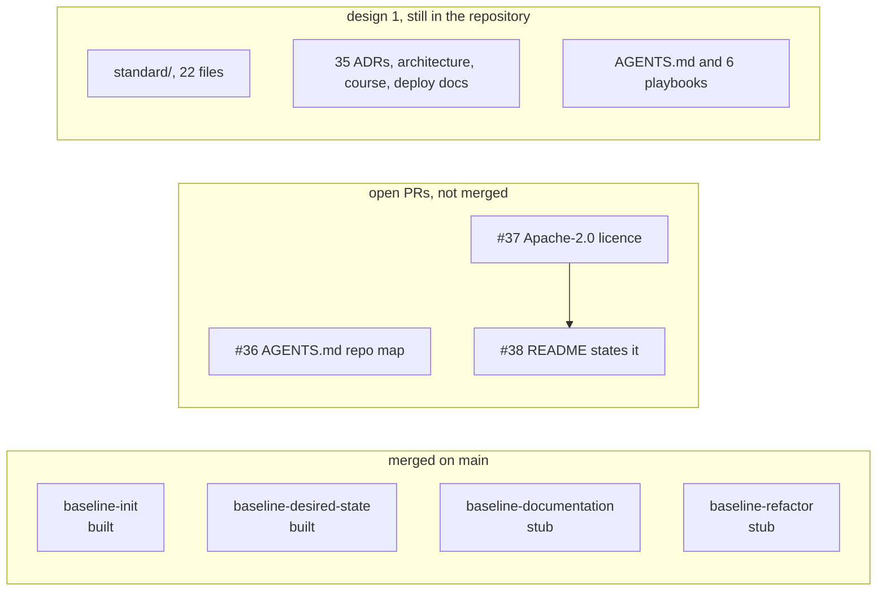
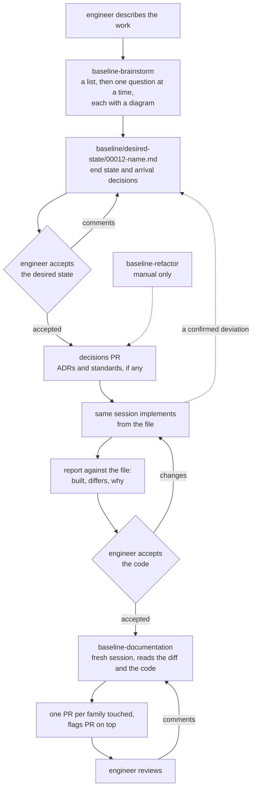
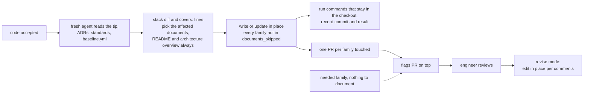

# 00001 Baseline v2: the `baseline/` folder, `baseline-brainstorm` and `baseline-documentation`

date: 2026-11-26

**Readers.** The engineer reviews this before any code. The coding agent that implements it gets it as its single context. It says what and why, never how: the implementation stays the agent's call. If something here is unclear or wrong, ask the engineer, and do not guess.

**Terms.** *Engineer*: the person who decides (in this repository, the Software Engineer). *Family*: one of the six kinds of document `baseline-documentation` writes. *Stack*: an ordered series of PRs, each based on the one below it. *Tip*: the last commit of the stack. *Gate*: a point where the engineer must explicitly accept before the work goes on.

## 1. State today



- The four skills install with `npx skills add chandanbsd/baseline-framework --skill '*' -a claude-code -y` (skills CLI 1.9.0). Verified in Claude Code on 2026-11-26. Codex and Copilot are not verified.
- `baseline-init` writes five files: `AGENTS.md` (a marked, hashed block: created, appended or replaced), `CLAUDE.md` (`@AGENTS.md`, only if absent), `baseline.yml` (the version only), `docs/adr/TEMPLATE.md` and `docs/standards/TEMPLATE.md`. Update runs migrations from `skills/baseline-init/migrations/` after a dry run and the engineer's approval. None ship yet.
- `baseline-desired-state` triggers at the end of the questions and writes `docs/desired-state/<date>-<topic>.md` (PR 1), then the ADRs and standards (PR 2).
- 48 tests: `python3 -m unittest discover -s tests -p '*_test.py'`. Python 3.9+, standard library only. Each `SKILL.md` carries `metadata.version` (0.2.0), set for all four by `tools/bump_version.py`.
- No repository has the new layout below, because `init` has only been dry-run on a real project. Nothing needs migrating.
- This document is the first file of `baseline/` in this repository.

## 2. End state

### 2.1 The flow



*The baseline touches only the boxes around implementation. Both gates are explicit acceptances by the engineer. A deviation from the file during implementation also needs the engineer's explicit confirmation, and the agent then amends the file (D29). Nothing merges, deploys or publishes unless the engineer asks.*

### 2.2 The `baseline/` folder

```
repo/
├─ AGENTS.md              the team's, plus a short pointer (the baseline's only edit here)
├─ CLAUDE.md              @AGENTS.md, created only if absent
└─ baseline/              the only place the baseline writes
   ├─ baseline.md         owned by the baseline, replaced whole on update
   ├─ baseline.yml        the project's: version, documents_skipped
   ├─ adr/                ADRs, with TEMPLATE.md
   ├─ standards/          coding standards, with TEMPLATE.md
   ├─ desired-state/      00012-short-name.md, one file per topic
   ├─ flags/              the current set, replaced on every documentation run
   └─ docs/               README.md · architecture/ · course/ · features/ · deploy/ · reference/
```

- The folder is a convention for what the baseline defines. It is not enforced: the coding agent may write anywhere the repository or the engineer wants (the root README, other documents, a note in a baseline document). There is no guard script and no diff check.
- The baseline never writes the root `README.md`. A flag suggests linking `baseline/docs/README.md`.
- The CI check looks only inside `baseline/`, so documents outside it can never fail it.

### 2.3 The pointer and `baseline.md`

The pointer `init` adds to `AGENTS.md` (appended once if absent, never touched by update):

```
## Baseline
Before you generate code, read baseline/adr/ and baseline/standards/.
The rest of the baseline's instructions are in baseline/baseline.md. Read it before your first task.
```

`baseline.md` holds, in a few lines each, with its version and hash on the first line:

- New work you have questions about: run `baseline-brainstorm`.
- A decision or a repeatable rule comes up: write an ADR or a standard from the `TEMPLATE.md` in its folder, in the decisions PR.
- An accepted file in `baseline/desired-state/` is the contract for the work. Re-read it after a compaction.
- The engineer accepts the code before documentation. Then run `baseline-documentation` in a fresh session.
- `baseline-refactor` only when the engineer asks.
- `baseline.yml` is the project's. This file is replaced on update.

### 2.4 The four skills

| Skill | Trigger | Does | State |
|---|---|---|---|
| `baseline-init` | The engineer asks to set up, adopt or update | Writes `baseline/` and the pointer, asks one question (D4), updates through migrations | Built for the old layout, to change |
| `baseline-brainstorm` | The engineer describes new work and there are questions | The questions protocol, the desired-state file, the handoff | New. It replaces `baseline-desired-state` |
| `baseline-documentation` | The engineer accepts the code | Writes and updates the six families | Stub |
| `baseline-refactor` | The engineer asks | Reviews a branch against the ADRs and standards | Stub, out of scope here |

### 2.5 `baseline-brainstorm`

The protocol, in the order the agent follows it:

1. A short list of the questions it has, with a proposed name for the file (for example `00012-order-refunds`).
2. One question at a time. Each has the diagram that fits it (a diagram is a must), plus text or a snippet when needed.
3. Stay on a question until the engineer says done.
4. When no question is left, write the desired-state file (2.6) and open it as PR 1 for review. Edit it until the engineer accepts.

The diagram guide the skill carries:

| The question is about | Diagram |
|---|---|
| A schema or data change | ER diagram, before and after |
| A flow between parts | Sequence diagram or flowchart |
| A status or lifecycle | State diagram |
| Which parts exist and how they depend | Component flowchart |
| Choosing between options | The options side by side, one box each |

The handoff prompt, given in the same session when the engineer accepts the file:

```
The engineer accepted baseline/desired-state/00012-order-refunds.md.
It is the intended result: implement it, following the ADRs and standards it lists.
If something in it is unclear or wrong, ask the engineer. Do not guess.
If the engineer decides something that differs from the file, get their explicit confirmation, then amend the file: change the arrival decision, keep the old option under "Not taken", and say so in one line.
When the code is done, report against the file: what was built, what differs, why, and the amendments made.
Ask the engineer to accept the code. Start baseline-documentation only after they do.
After any compaction, re-read the file.
```

Questions that come up during coding follow the same protocol: one at a time, each with the diagram that fits. A deviation is a decision that contradicts or changes something the file says. Where the file is silent, the agent decides and needs no confirmation.

### 2.6 The desired-state file

```
# 00012 Short title
date: YYYY-MM-DD

## End state
Diagrams and the expected result: what is true when this is done.

## Arrival decisions
### D1. One line: the decision
Why: the reason.
Not taken: an option, why it lost. Another option, why it lost.

## Settles
The ADRs and standards this leads to, as links, or "none".
```

The number is the highest on the branch's base plus 1. Two parallel branches may pick the same number, which is harmless because the names differ. Until the engineer accepts the code, the file is the contract, and a confirmed deviation amends it (D29). After that it is not maintained and may go out of sync with the code on purpose: it is a historical account.

### 2.7 `baseline-documentation`



Config, in `baseline/baseline.yml`:

```yaml
baseline_version: <version>
documents_skipped: []        # for example [deployment]
```

Each document carries one line naming the behaviour it describes:

```
covers: order creation, from POST /orders to the confirmation email
```

Required sections per family. The check enforces them. Other sections appear only when the code has them, and there are no "Not applicable" lines.

| Family | Required | Only when the code has it |
|---|---|---|
| README | What this is (diagram) · Prerequisites · Get it running · Repo map · Configuration · Troubleshooting | |
| Architecture | What the system is · Big picture (diagram) · Components · Key flows (a sequence diagram each) | Data · Interfaces · State machines · Failure model · Security · Quality · Known limits |
| Feature docs | An overview page. Per feature: What it is and why · Who can use it · What a person can do (journey diagram) · When things go wrong | Users and access (if the code has roles) · Limits today |
| Deployment | Topology (diagram) · Environments · Configuration and secrets · Pipeline · Deploying and rolling back · Troubleshooting | Infrastructure as code · Operations · Security · Cost |
| Reference | Glossary · File map, one row per folder | |
| Course, per flow | The flow (diagram) · Walkthrough (snippets, concepts taught where met) · Alternatives and why this one (labelled "inferred") · Pitfalls and failure modes · Practice | |

### 2.8 The check

One small Python script (3.9, standard library) run by CI. It reads only the state of `baseline/` and never asks who wrote what. With no `baseline/baseline.yml` it passes, because there is nothing to check. It fails when:

- a document that exists lacks a required section;
- a Mermaid block does not render;
- a link between baseline documents does not resolve;
- an `empty-family` flag exists whose family is neither in `documents_skipped` nor written.

A needed family that is not written yet is a notice, not a failure. Links to code and to outside URLs are not checked. Nothing else. (Amended by D30. As first accepted, it failed on any needed family that was not written.)

## 3. Expected result

- [ ] `npx skills add` of the repository installs four skills: `baseline-init`, `baseline-brainstorm`, `baseline-documentation`, `baseline-refactor` (the last may stay a stub).
- [ ] `baseline-init` on a fresh repository creates the `baseline/` layout (2.2) and the pointer (2.3), after a dry run the engineer approves, and asks the one question of D4. On a repository with an `AGENTS.md` it appends the pointer and touches nothing else outside `baseline/`. Update replaces `baseline.md` whole and runs migrations as before.
- [ ] `baseline-brainstorm` runs the protocol (2.5), writes the file (2.6), and hands off with the prompt. It replaces `baseline-desired-state`, which no longer exists.
- [ ] A decision during coding that deviates from the file is confirmed explicitly by the engineer, and the agent amends the file (D29). The gate-2 report lists the amendments.
- [ ] `baseline-documentation` writes and updates the six families in `baseline/docs/` as D2 to D14 say, with `covers:` lines, flags, revise mode and adopt.
- [ ] The check (2.8) passes on a repository documented this way and on a fresh repository with no documents yet. It fails on an unresolved `empty-family` flag, a document missing a required section, a Mermaid block that does not render and a broken link between baseline documents.
- [ ] All tests pass. Scripts are Python 3.9, standard library only. Each `SKILL.md` stays under 500 lines and passes the spec lint.
- [ ] No commit or PR description carries a co-author trailer or a "generated with" line.

Build order, each unit a PR with its own tests: the layout in `init` and `baseline.md`; `baseline-brainstorm`; `baseline-documentation`; the check and CI; then the rewrite of `AGENTS.md` and the playbooks (D26).

## 4. Arrival decisions

### A. The documentation run

**D1. Build `baseline-documentation` first.**
Why: `baseline-init` routes every initialised repository to it at the end of the flow, and it is a stub.
Not taken: `baseline-refactor`, which is manual only so nobody reaches it by accident. The check and CI, which check the documentation's output and so follow it.

**D2. A run updates in place, scoped by the stack's diff. The tip is the truth, and what is wrong outside the diff goes to flags.**
Why: small, reviewable PRs, and the documents always derive from the code.
Not taken: rewriting every document from the tip on each run, because every stack would churn every document, the course included, and the PR would be huge.

**D3. Each document carries one `covers:` line naming the behaviour it describes. The agent greps those lines, reads the diff and opens only the affected documents. The README and the architecture overview are always reopened.**
Why: the cost per run is one line per document, and a refactor does not break it.
Not taken: `files:` lists per document, because nearly every file affects every document, so the lists grow, rot and become reading everything. No index at all, because the cost grows with the documents and the course is the largest.

**D4. All six families are needed by default. A project declares the ones that do not apply, and `baseline-init` asks.**
Why: it is predictable, and the declaration is the engineer's.
Not taken: the agent deciding from the code which families apply, because the check could not then require that a family exists.

**D5. The declaration is `documents_skipped: []` in `baseline.yml`, a skip list.**
Why: a family added in a later version is needed by default, with no migration.
Not taken: an allow-list, because each new family would need a migration to be added. A second config file for it.

**D6. A needed family with nothing to document gets no page. One flag says so, and the check fails while that flag stands, unless the engineer has since skipped the family or written it (amended by D30). The agent never edits `documents_skipped`.**
Why: the failure forces the declaration to be fixed, and the declaration stays the engineer's.
Not taken: a short "nothing here" page, because hollow pages pass silently for ever. The agent adding the family to the skip list itself, because it would rewrite a declaration the engineer made. The check failing on any needed family that is not written, as first accepted: changed by D30, because it would turn a fresh repository and every code PR below the docs PRs red.

**D7. The flags folder holds the current set. Each run replaces it with the flags that are true at the tip, and git history is the record.** A flag is one of: a needed family with nothing to document; a document outside the diff that the tip contradicts; code that contradicts an ADR or a standard; a guessed reason in the course to confirm.
Why: flags derive from the tip like every document, so handled flags vanish without cleanup.
Not taken: a log of flags, because it collects duplicates and stale entries and nobody owns the cleanup. The cost of the choice: a flag the engineer rejects returns until its cause changes, for example by editing the standard it cites.

**D8. The course has one chapter per outcome, grouping the entries that serve it, across components and languages. The existing `covers:` lines are the flow list. A run adds a chapter only when the diff creates an outcome no chapter covers, and it never regroups unless the engineer asks.** Grouping is a judgement call, and the engineer corrects it in review.
Why: "one outcome" is what a reader follows end to end.
Not taken: one chapter per entry point, which gives 80 near-duplicate chapters for 80 endpoints. The engineer naming the flows, which is upkeep.

**D9. Revise mode: given the documentation PRs' review comments, the skill edits in place, keeps `covers:` right, and flags what the code at the tip cannot back instead of writing it.** Proposed by the agent, not objected to.
Why: the engineer reviews the output, not review layers inside the skill.
Not taken: review or verify loops inside the skill.

**D10. One PR per family the run touched, then a flags PR on top.**
Why: each is reviewable alone, and a comment lands on the right PR. A normal run touches one to three families.
Not taken: one docs PR, because a first run holds the whole set and a comment on the course would mean re-reviewing everything.

**D11. The agent runs commands that change nothing beyond the checkout (build, test, lint, dry runs) and records the commit and the result. Deploy, publish and migrate are never run and are labelled "not run". An environment failure becomes a flag.**
Why: the documents stay honest about what was checked.
Not taken: running nothing, which cannot catch rot or a missing prerequisite. Running everything including setup, which has side effects, is slow and needs an approval at every step.

**D12. There is no reader profile. The skills assume one reader: an engineer fluent in programming and new to the repository's languages and frameworks. The course teaches everything the code uses.**
Why: the only document a profile would change is the course, whose promise is that nothing the code uses goes untaught.
Not taken: a small profile in `baseline.yml` that lets the course skip basics, because a wrong or stale profile leaves gaps.

**D13. Adopt, the first run on a repository that has documents, never rewrites them. It writes the baseline's documents inside `baseline/docs/` and flags the overlaps. The team deletes superseded documents in review.**
Why: the baseline writes only inside its own folder (D16).
Not taken: rewriting existing documents at the family paths into the baseline shape. It was chosen first and reversed when the `baseline/` folder was decided, because it would write outside the folder.

**D14. The required sections are the table in 2.7. Other sections appear only when the code has them. Reference pages are a glossary and a file map with one row per folder.**
Why: a small enforced core, with no "Not applicable" filler.
Not taken: the old fixed lists (13 architecture sections, 11 deployment areas, 8 lesson parts), written every time.

### B. Layout and boundary

**D15. `baseline.md` replaces the marked, hashed block inside `AGENTS.md`. It is a whole file the baseline owns and replaces on update. `AGENTS.md` gets a short pointer that keeps the one must-see instruction inline.**
Why: `AGENTS.md` is the cross-agent file the team owns. Whole-file ownership removes the marker, hash and line-ending machinery, where the review found the riskiest bugs. No repository has the block yet, so there is no migration.
Not taken: keeping the block in `AGENTS.md`. A pointer alone, because the one instruction that must always be seen would then be a hop away. The cost: a reference is followed by choice, not always loaded. Claude Code can import it with `@`, and Codex and Copilot have to open it.

**D16. Everything the baseline writes lives in `baseline/`: `baseline.md`, `baseline.yml` (moved from the root), `adr/`, `standards/`, `desired-state/`, `flags/`, `docs/`.**
Why: one place says that the repository uses the baseline, other documentation skills cannot collide with it, and the check can be scoped to it.
Not taken: a root `baseline.md` beside a root `baseline.yml`. `baseline.yml` staying at the root, because the ownership argument for it was weak. `docs/adr` and `docs/standards` staying under `docs/`.

**D17. The baseline never writes the root `README.md`. The README family is `baseline/docs/README.md`, and a flag suggests linking it.**
Why: no write outside `baseline/` in every repository.
Not taken: a one-line root README created when none exists, because it is a write outside `baseline/` in every new repository.

**D18. The folder is organisational, not enforced. The coding agent may write anywhere the repository or the engineer wants. There is no guard script and no diff check.** This relaxes the old rule that only a fresh docs agent writes descriptive documents.
Why: strict checks must not hamstring the coding agent.
Not taken: a guard script that fails on any changed path outside `baseline/`.

### C. Brainstorm and the desired-state file

**D19. The questions protocol is a skill, `baseline-brainstorm`, and it replaces `baseline-desired-state`. Four skills remain. The protocol is 2.5.**
Why: it is worth a skill, and one skill owns it from the first question to the handoff. `baseline.md` keeps one routing line.
Not taken: lines in `AGENTS.md` or `baseline.md`. Leaving it in one agent's private memory, where it works for one person in one agent. A fifth skill in front of `baseline-desired-state`, because an agent can skip the first of two.

**D20. One file per topic, `baseline/desired-state/00012-short-name.md`: a five-digit number, a short name the agent proposes with its question list and the engineer may rename, and a `date:` line.**
Why: the number gives order and the name says what it is.
Not taken: a folder holding two documents. A date prefix. The engineer always naming it. The agent naming it silently.

**D21. The file holds the end state and the arrival decisions, not the Q&A. Each arrival decision has the decision, why, and the options not taken with a line on why each lost.**
Why: the engineer reads it before coding and the coding agent uses it as its single context, so it must be rich and stand alone.
Not taken: the decision and why only, because a cold agent would re-propose what was rejected. Storing the Q&A in a second document.

**D22. The file has two readers: the engineer, and the coding agent. `baseline-documentation` still does not read it.**
Why: the documentation describes the code, not the intent.
Not taken: engineer-only, which was the original design.

### D. Sessions and gates

**D23. The brainstorm and the implementation run in the main session, never in a subagent.**
Why: they need back and forth with the engineer, and Claude Code, Codex and Copilot have no good back and forth with subagents. The file is what survives a compaction.
Not taken: a fresh agent implementing from the file alone. No rule, which would behave differently in each agent.

**D24. Gate 1. When the engineer accepts the file, the skill hands off with the fixed prompt in 2.5.**
Why: the prompt names the file, so a compacted session can re-read it.
Not taken: handing off without a defined prompt.

**D25. Gate 2. When the code is done, the same session reports against the file (built, differs, why) and asks the engineer to accept the code. Changes loop back to implementation. `baseline-documentation` starts only after acceptance, in a fresh session or subagent that reads the diff and the code.**
Why: the code is known to meet expectations before documents describe it, and changes happen early.
Not taken: starting documentation as soon as coding is done.

### E. Decided the same day

**D26. Retirement is split. Rewrite `AGENTS.md` and the six playbooks around the new flow soon, keeping what still stands: nothing merges, deploys or publishes unless the engineer asks; no attribution lines; agents propose standards. `standard/`, the 35 ADRs and the old documents stay as an archive until `baseline-documentation` and adopt can reshape them.**
Why: `AGENTS.md` and the playbooks steer agents now and still say append-only ADRs, an ADR status, one kind per PR, a size guide and a reader profile. The rest is passive.
Not taken: retiring everything last. The rewrite is not started and needs the engineer's go-ahead.

**D27. Licence: Apache-2.0, with the copyright line in `NOTICE` in the engineer's full name as in the commits, and `license: Apache-2.0` in each `SKILL.md`. The licence text is not bundled inside each skill folder.** Open as #37 and #38.
Why: permissive, with a patent grant, for a package meant to be installed into other repositories.
Not taken: MIT. No licence. A handle or an organisation as the holder. Bundling the text in each skill, because installed copies then carry the licence name only, which is the usual practical setup.

**D28. Fix the `AGENTS.md` repo map now.** Open as #36.
Why: agents read it every session and it said `skills/` did not exist.
Not taken: waiting for the rewrite in D26.

### F. Added after the engineer accepted the file, the same day

**D29. A decision during coding that deviates from the file is confirmed explicitly by the engineer, and the coding agent then amends the file.** A deviation is a decision that contradicts or changes something the file says. Where the file is silent, the agent decides. The amendment changes the arrival decision or the end state, keeps the old option under "Not taken" with the reason it changed, and says so in one line. It goes into the desired-state PR, so the contract is current there. The gate-2 report lists the amendments.
Why: until the code is accepted the file is the contract, and a session that re-reads it after a compaction must find the decisions as they stand, not as they were.
Not taken: the agent amending without asking, which is silent drift. Listing deviations only in the gate-2 report, because a re-read after a compaction would restore the old decision. Freezing the file, which would leave the contract disagreeing with what the engineer chose.

**D30. The check reads only the state of `baseline/`. A needed family that is not written yet is a notice, and a missing family fails the check only through an `empty-family` flag that nothing has resolved. Links are checked between baseline documents only.** Confirmed by the engineer after they asked how CI would know the baseline was used, and whether it would fail code PRs. The first half (the flag) was the question they answered; limiting links to baseline documents was proposed in the same message. It amends 2.8, D6 and one checklist item.
Why: CI runs on every PR of a stack, and the code PRs sit below the docs PRs, so a rule that failed on any unwritten needed family would turn a freshly initialised repository and every code PR red, and each docs PR until the last family landed. A link from a document to a code file would fail a code PR that renames the file, and the `stale-doc` flag is the net for that.
Not taken: failing on any needed family that is not written, as first accepted in 2.8 and D6. Checking links to code or to outside URLs. Having the check know whether the baseline skill wrote a document, which it does not need.

## 5. Settles, not verified, open

**Settles.** No ADR or standard is written for this. The decisions are recorded here, and this repository has no `baseline/adr/` yet. If the engineer wants any of D15 to D18 as an ADR, they say so.

**Not verified.**
- Codex and Copilot: that they discover skills in `.agents/skills/`, and that they follow the `AGENTS.md` pointer to `baseline/baseline.md`.
- That Claude Code imports through `CLAUDE.md` to `AGENTS.md` to `baseline.md` with `@`. It is believed to chain up to five hops.
- That the Mermaid diagrams in this file render. They use only simple flowcharts.

**Open, left to the builder.**
- The path of each family under `baseline/docs/` and of `baseline/flags/`, and the format of a flag file.
- The layout of `baseline-documentation`: `SKILL.md` plus one reference file per family, loaded only when that family is written.
- How the check finds the required sections, and how CI finds the check.
- How the agent finds the accepted file after a compaction. The prompt names it, and `baseline.md` says to re-read it.
- An existing `CLAUDE.md` is kept untouched by `init`, so Claude Code would not see the pointer unless that file imports `AGENTS.md`. Decide at build whether `init` flags it.
- The eight deferred minors listed in PR #32.
- Descriptive documents that are stale (the file map, the deployment and architecture claims about non-Markdown files and a private repository). The documentation run owns them once it exists.
