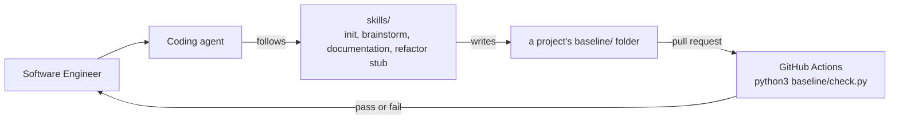
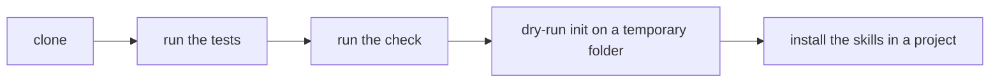

# baseline-framework
covers: the whole repository, how to run it and where things are

## What this is

The baseline is four Agent Skills in `skills/` that a coding agent follows in a project: `baseline-init` sets a project up (a `baseline/` folder, a check, a CI workflow, templates for ADRs and coding standards) and keeps it current, `baseline-brainstorm` asks the engineer questions one at a time and writes the agreed end state before any code, `baseline-documentation` writes the project's documents from the accepted code, and `baseline-refactor` is a placeholder. Most of it is instructions in `SKILL.md` files; the code is a few Python scripts (standard library only), one check and its tests. This repository is a project of its own baseline, so its `baseline/` folder is the output of `init.py`.



*The skills are read by the agent and write into a project; the one automatic gate is the check on the pull request.*

How it is built is in [the architecture overview](architecture/README.md); to learn it by following one outcome at a time, start at [the course](course/README.md); what it does for a person is in [the features](features/README.md); terms and folders are in [the glossary](reference/glossary.md) and [the file map](reference/file-map.md).

## Prerequisites

| Tool | Needed for | Checked with | How to install |
|---|---|---|---|
| Python 3.9 or later | the scripts, the check and the tests; standard library only | 3.9.6 (`python3 --version`) | from python.org or your package manager |
| git | the documentation skill's diff, and cloning | 2.54.0 (`git --version`) | from git-scm.com or your package manager |
| Node.js with `npx` | installing the skills into a project | v26.13.0 (`node --version`); the install was not run | from nodejs.org or your package manager |
| an agent that reads `SKILL.md` and `AGENTS.md` | using the skills | not checked here | per the agent's own documentation |
| `mmdc` (optional) | rendering Mermaid diagrams locally; CI installs it | not installed here | `npm install --global @mermaid-js/mermaid-cli@12`, the command the workflow runs (not run) |

No account is needed to run the scripts and the tests.

## Get it running



1. Clone the repository and change into it. Not run.
2. Run the tests, from the repository root.

   ```bash
   python3 -m unittest discover -s tests -p '*_test.py'
   ```

   Ran on 657d8be: `Ran 120 tests`, `OK`.

3. Run the check.

   ```bash
   python3 baseline/check.py
   ```

   Ran on fb31ddb with this README added: `0 errors`; one notice says the Mermaid blocks were not rendered because `mmdc` is not installed here.

4. See what setting up a project would write, without writing it.

   ```bash
   python3 skills/baseline-init/scripts/init.py "$(mktemp -d)" --dry-run
   ```

   Ran on 657d8be: eight `create` lines (`AGENTS.md`, `baseline/baseline.md`, `baseline/check.py`, `.github/workflows/baseline.yml`, `baseline/baseline.yml`, `CLAUDE.md`, `baseline/adr/TEMPLATE.md`, `baseline/standards/TEMPLATE.md`), then `dry run: nothing written`.

5. Install the skills into a project, from that project's root, and ask its agent to initialise the baseline there.

   ```bash
   npx skills add chandanbsd/baseline-framework
   ```

   Not run. The command is the one `AGENTS.md` gives.

## Repo map

```text
baseline-framework/
  AGENTS.md              instructions for agents working here
  CLAUDE.md              imports AGENTS.md
  README.md              the root README, the team's own
  baseline.yml           the first design's configuration
  .github/workflows/     baseline.yml: runs the check on pull requests
  baseline/              this repository's own baseline
    baseline.md          the baseline's instructions to agents (owned by the baseline)
    baseline.yml         version and skipped families
    check.py             the check CI runs (owned by the baseline)
    adr/  standards/     templates only so far
    desired-state/       accepted desired-state files
    docs/                these documents
    flags/               what the documentation agent could not settle
  skills/
    baseline-init/       init.py, update.py, kit.py, assets/kit/, migrations/
    baseline-brainstorm/ next_number.py, the template, two guides
    baseline-documentation/ covers.py, one guide per family, flags guide
    baseline-refactor/   placeholder
  tests/                 unittest suites and helpers.py
  tools/                 bump_version.py
  docs/agents/           playbooks for agents working here
  standard/, docs/adr|architecture|course|deploy|features|standards/
                         the first design, kept as an archive
```

The full list, one row per folder, is [the file map](reference/file-map.md).

## Configuration

Nothing here is a secret.

| Name | Purpose | Default | Where set |
|---|---|---|---|
| `baseline_version` | the version the project is at; `update.py` compares it with the installed one | the installed version (0.2.0) | `baseline/baseline.yml` |
| `documents_skipped` | document families that do not apply | `[]`; `[deployment]` in this repository | `baseline/baseline.yml`, from `init.py --skip` |
| `metadata.version` | the version of a skill; the four must match | `0.2.0` | each `skills/*/SKILL.md`, set by `python3 tools/bump_version.py VERSION` |
| `mmdc` on the `PATH` | when present, the check renders each Mermaid block | not installed | your environment |
| `CI` or `GITHUB_ACTIONS` | when set, the check starts the renderer's browser with `--no-sandbox` | unset | the CI runner |

## Troubleshooting

| Symptom | Check | Fix |
|---|---|---|
| `ModuleNotFoundError: No module named 'helpers'` when running a test file | you gave `unittest` a file path | run the `discover` command from step 2, from the repository root |
| `error: ... is already initialised (baseline/baseline.yml exists)` | the repository was set up before | use `update.py plan` instead; see [course 2](course/02-update-a-repository.md) |
| `error: ... missing section "## X"` from the check | the heading is not exactly that line, or is inside a code fence | see [course 3](course/03-check-the-baseline-folder.md) |
| `notice: mermaid: N block(s) not rendered` | `mmdc` is not on the `PATH` | nothing is wrong; CI renders them |
| `error: the repo is at X, newer than the installed skills` | the skills are older than the project | update the skills first |
| the agent does not see the baseline instructions | `AGENTS.md` lacks the pointer, or `CLAUDE.md` lacks `@AGENTS.md` | see [set up a repository](features/set-up-a-repository.md) |
