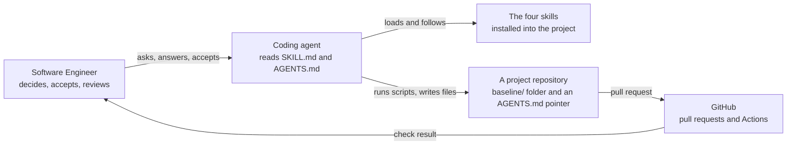
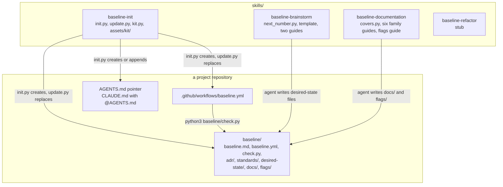
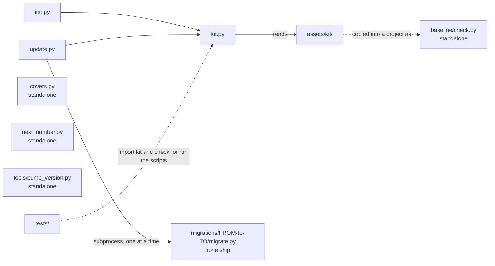
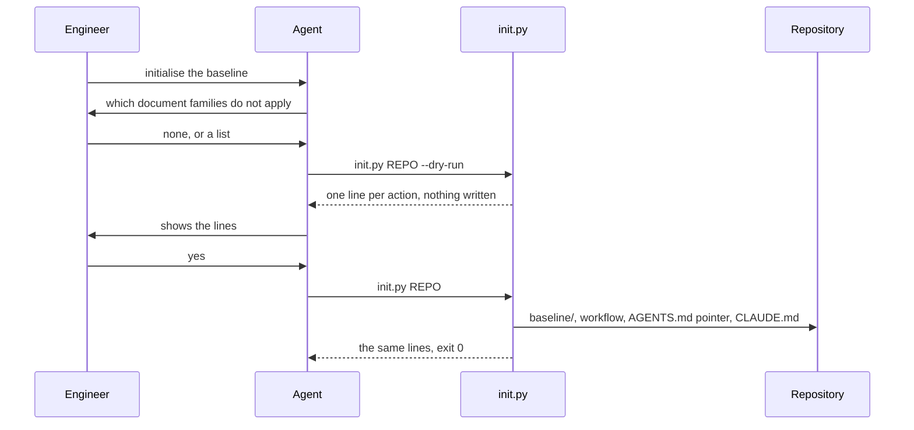
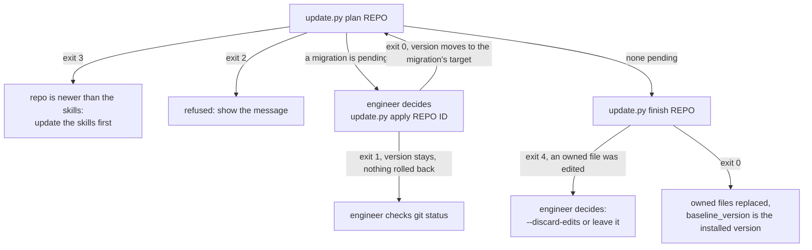
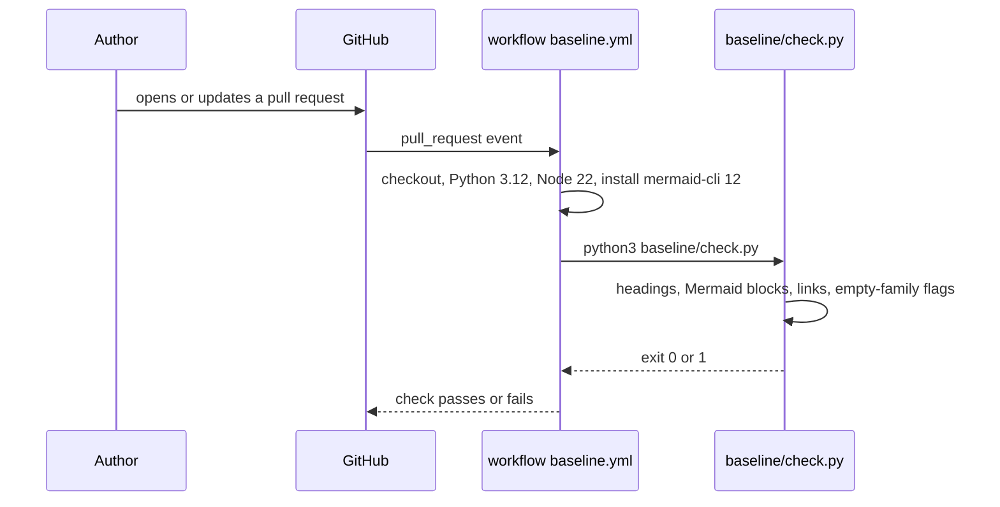
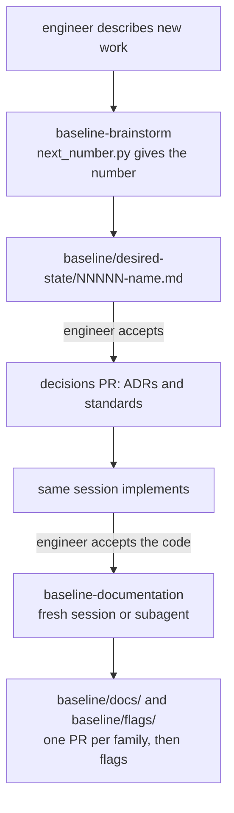
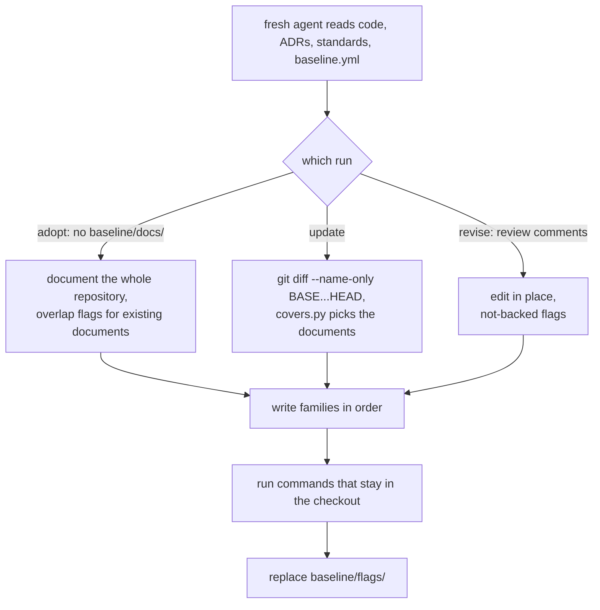
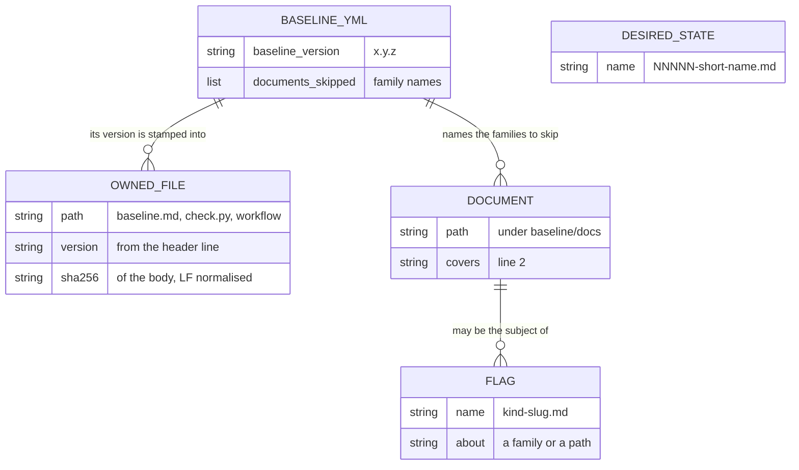
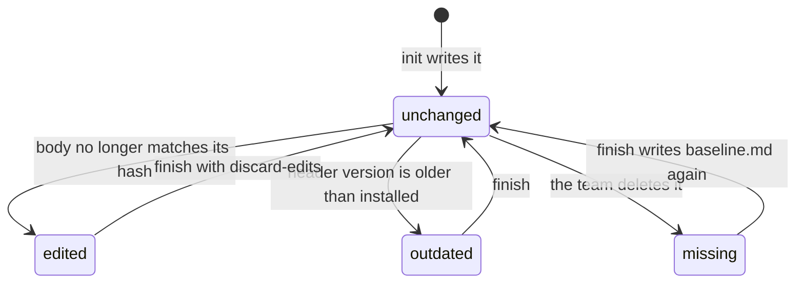

# Architecture
covers: how the baseline skills are built: the four skills, the files init puts in a project, the check CI runs, and the flows between them

## What the system is

The baseline is four Agent Skills in `skills/`. An agent installs them into a project (`npx skills add chandanbsd/baseline-framework`, per `AGENTS.md`; not run here) and they do three jobs: set up a `baseline/` folder in the project and keep it current (`baseline-init`), ask the engineer questions before code and write down the agreed end state (`baseline-brainstorm`), and write the project's documentation from the finished code (`baseline-documentation`). The fourth, `baseline-refactor`, is a stub that says it is not implemented. This repository is also a project of its own baseline: its `baseline/` folder is what `init.py` writes.

Most of the system is instructions an agent reads (`SKILL.md` files, reference guides, templates). The only code is a handful of small Python scripts and one check, plus a CI workflow.

| Choice | Where it shows | Why it matters to you |
|---|---|---|
| Python 3.9+, standard library only | every `scripts/*.py`, `baseline/check.py`, `tools/`, `compatibility:` in each `SKILL.md` | Nothing to install; a test asserts the `Python 3.9` claim. |
| The Agent Skills layout: a folder with `SKILL.md`, `scripts/`, `assets/`, `references/` | `skills/*/` | Any agent that reads `SKILL.md` can load a skill. |
| YAML read by regular expression, not by a YAML library | `baseline/baseline.yml`, `update.py`, `check.py` | The two keys (`baseline_version`, `documents_skipped`) must stay simple. |
| Mermaid for every diagram, checked by `check.py` | `baseline/check.py`, `.github/workflows/baseline.yml` | A diagram with an unknown type fails the check everywhere, and one the renderer rejects fails it in CI. |
| GitHub Actions, with Node 22 and `@mermaid-js/mermaid-cli@12` | `.github/workflows/baseline.yml` | CI renders diagrams; locally the check only tests their form. |

`baseline/adr/` and `baseline/standards/` hold only their `TEMPLATE.md` at this tip, so no choice above has an ADR to link.

## Big picture



*The engineer talks to the agent, not to the skills; the one gate outside the chat is the check that GitHub runs on the pull request.*



*Everything the baseline writes goes inside `baseline/`; outside it only the pointer, `CLAUDE.md` and the workflow, which GitHub reads from `.github/workflows/`.*

## Components



*Only the two `baseline-init` scripts share code, through `kit.py`; the skills share nothing with each other.*

| Module | Responsibility |
|---|---|
| `skills/baseline-init/scripts/init.py` | Writes the `baseline/` layout, the workflow and the pointer; never overwrites; `--dry-run` writes nothing. |
| `skills/baseline-init/scripts/update.py` | `plan`, `apply`, `finish`: moves a project to the installed version through migrations, then replaces the owned files. |
| `skills/baseline-init/scripts/kit.py` | The six family names, the three owned files, the header and hash, the `AGENTS.md` pointer, the shipped version. |
| `skills/baseline-init/assets/kit/` | The bodies init copies: `baseline.md`, `check.py`, the workflow, both templates, the pointer. |
| `skills/baseline-init/migrations/` | A contract in `README.md`; no migration ships at 0.2.0. |
| `skills/baseline-brainstorm/` | `SKILL.md` (the questions protocol), `scripts/next_number.py`, `assets/desired-state-template.md`, and two guides: which diagram fits a question, ADR or standard or neither. |
| `skills/baseline-documentation/` | `SKILL.md`, `scripts/covers.py` (lists each document's `covers:` line), one guide per family and one for flags. |
| `skills/baseline-refactor/` | `SKILL.md` only: a placeholder. |
| `baseline/check.py` | The check CI runs. Reads only `baseline/`. The shipped asset with a header line added. |
| `tools/bump_version.py` | Sets `metadata.version` in all four `SKILL.md` files. |
| `tests/` | `unittest` suites; `helpers.py` runs scripts the way an agent does. |
| `AGENTS.md`, `docs/agents/` | Instructions to agents working in this repository. |

The dependency rule is enforced by `tests/skill_spec_test.py`: no file inside a skill contains `../` or `skills/baseline-`, so each skill can be installed alone. The one coupling between skills is a test, not an import: `tests/documentation_test.py` fails if the headings in `baseline-documentation/references/*.md` differ from the ones `check.py` requires, or if a family named by `init.py` has no reference file.

An earlier design's documents (`standard/`, `docs/adr/`, `docs/architecture/`, `docs/course/`, `docs/deploy/`, `docs/features/`, `docs/standards/`) sit in the repository, and no script reads them.

## Key flows

### Init



*The dry run and the real run print the same lines, so what the engineer approved is what is written.*

### Update



*Migrations run one at a time and in order; the owned files are replaced only once none is pending.*

### The check on a pull request



*The workflow also runs on pushes to `main` and `master`.*

### New work to documentation



*Two acceptances gate the flow, and the documentation agent starts only after the second.*

### A documentation run



*The families are written in the order architecture, course, features, deployment, reference, readme, and any family in `documents_skipped` is left out.*

## Data



*There is no database: every record is a file in the project's repository.*

| File | Written by |
|---|---|
| `baseline/baseline.yml` | `init.py` creates it; `update.py` rewrites only the `baseline_version` line |
| `baseline/baseline.md`, `baseline/check.py`, `.github/workflows/baseline.yml` | `init.py` creates them, `update.py finish` replaces them whole |
| `baseline/adr/*.md`, `baseline/standards/*.md` | the agent, from the two templates |
| `baseline/desired-state/NNNNN-name.md` | the agent, from the template, after the engineer's answers |
| `baseline/docs/**`, `baseline/flags/*.md` | the documentation agent |
| `AGENTS.md` | `init.py` appends the pointer once; `update.py` never writes it |

## Interfaces and contracts

Each owned file starts with one header line that records the version and a SHA-256 of everything after that line, so `update.py` can tell an edit from an old version.

```text
<!-- baseline version=0.2.0 sha256=<64 hex digits> -->     baseline/baseline.md
# baseline version=0.2.0 sha256=<64 hex digits>            baseline/check.py and the workflow
```

| Command | Exit codes |
|---|---|
| `init.py TARGET [--skip a,b] [--dry-run]` | 0 done; 2 refused (not a directory, already initialised, unknown family, `baseline` is a file, `AGENTS.md` not UTF-8) |
| `update.py plan REPO` | 0 ok; 1 the next migration's dry run failed; 2 refused; 3 repo newer than the skills |
| `update.py apply REPO ID [--dry-run]` | 0 ok; 1 the migration (or its dry run) failed; 2 not the next pending migration; 3 repo newer than the skills |
| `update.py finish REPO [--discard-edits] [--dry-run]` | 0 ok; 2 migrations pending; 3 repo newer than the skills; 4 an owned file was edited |
| `check.py [REPO] [--no-render]` | 0 passed; 1 failed; 2 not a directory |
| `covers.py REPO` | 0 ok; 2 not a directory |
| `next_number.py REPO` | 0 ok; 2 not a directory |
| `bump_version.py VERSION [--root PATH]` | 0 ok; 2 not a version like 1.2.3 |

A migration is a folder `migrations/FROM-to-TO/` with `migrate.py` (`REPO --dry-run` prints and changes nothing; `REPO --confirm` applies; non-zero on failure) and an optional `MIGRATION.md`. `update.py` runs only the ones with `FROM` at or above the repo's version and `TO` at or below the installed version, in order of `FROM`.

## State machines

An owned file is in one state, reported by `update.py plan`.



*`check.py` and the workflow stay missing when deleted; only `baseline.md` is written again.*

## Failure model

- `init.py` decides every refusal before it writes the first file, and never overwrites: an existing file is reported as `keep`.
- `update.py apply` leaves `baseline_version` where it was when a migration exits non-zero, and rolls nothing back; the engineer checks `git status`.
- `update.py finish` stops with exit 4 before writing anything when an owned file was edited. A missing header counts as an edit.
- `check.py` reads files with `errors="replace"`, so an unreadable byte does not crash it. A renderer that cannot run, or takes longer than 180 seconds on a block, is an error for that block. With no `mmdc` on the `PATH` it checks each block's form and says so in a notice.
- Nothing retries, and no script runs in parallel.

## Security

- `update.py apply` runs `migrate.py` with the current Python interpreter. The rule that the engineer approves the dry run first is in `SKILL.md`; the script does not enforce it.
- The header hash has no secret, so it detects an edit and does not prove who made it.
- `check.py` reads only `baseline/`. The one thing it runs on that content is the Mermaid renderer, over each diagram block.
- In CI the workflow installs `@mermaid-js/mermaid-cli` at major version 12 and, when `CI` or `GITHUB_ACTIONS` is set, starts the renderer's browser with `--no-sandbox`. Actions are pinned to `@v7`.

## Quality

`python3 -m unittest discover -s tests -p '*_test.py'` ran on 657d8be: 120 tests, OK (init 29, update 25, check 33, documentation 14, skill rules 9, brainstorm 6, version bump 4). The tests build their repositories in temporary directories and compare file snapshots to prove that dry runs and the read-only scripts write nothing. The check's Mermaid rendering is tested with a fake `mmdc`, so the real renderer is exercised only in CI (not run here).

## Known limits

- `baseline-refactor` does nothing yet.
- No migration ships, so `update.py` can only replace the owned files and move the version.
- `update.py` cannot record that the team keeps an edit to an owned file: `plan` keeps reporting it as edited (`SKILL.md` says recording an override is not built).
- `check.py` verifies required headings, diagram form, links inside `baseline/` and `empty-family` flags. It does not check the `covers:` line, the flag files other than `empty-family`, or any document outside `baseline/`.
- A heading counts only when it is the whole line and outside a code fence.
