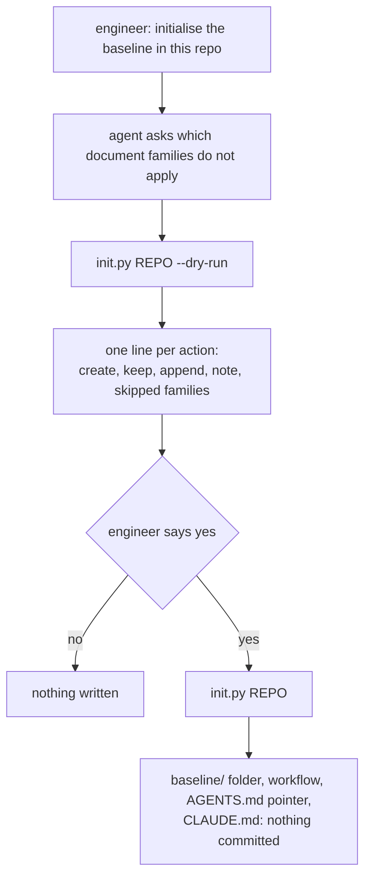

# Set up a repository
covers: setting up a repository for the baseline with init.py, from the engineer's request to the eight files written and nothing committed

## The flow



*The same script runs twice with the same arguments, so the lines the engineer approves are the lines that are executed. Everything lands inside `baseline/` except the pointer, `CLAUDE.md` and the workflow.*

## Walkthrough

Snippets are shortened, and a comment after `#` that is not in the source is added for you.

**1. The agent's part.** `skills/baseline-init/SKILL.md` ("Init") tells the agent to ask one question (which of the six families do not apply, usually none), run the dry run, show the lines and run again only after a yes. `SKILL.md` is the skill's entry point: a YAML header (`name`, `description`, `compatibility`, `metadata.version`) that an agent reads to decide when to load it, then Markdown instructions.

**2. Arguments.** `init.py` is a plain Python script. `argparse` reads `target`, `--skip` and `--dry-run`; `pathlib.Path` is a path object where `/` joins parts.

```python
# skills/baseline-init/scripts/init.py
parser.add_argument("target", type=Path, help="the repository to set up")
parser.add_argument("--skip", default="", help="document families that do not apply, ...")
parser.add_argument("--dry-run", action="store_true", help="print what would happen and write nothing")
```

`--skip` goes through `kit.parse_skip`, which accepts only the names in `kit.FAMILIES = ("readme", "architecture", "course", "features", "deployment", "reference")` and returns them in that order, so `--skip course,deployment` and `--skip deployment,course` give the same `baseline.yml`.

**3. Refusals come first.** Before anything is planned the script returns exit code 2 (a script's exit code is the number `main()` returns to `sys.exit`) when the target is not a folder, the family is unknown, `baseline/baseline.yml` exists, `baseline` is a file, or `AGENTS.md` is not UTF-8.

**4. The file list.** `kit.kit_files(version, skipped)` returns a dictionary from relative path to content. Three of the files are owned by the baseline: `kit.OWNED` names them, and `render_owned` puts a header line in front of the shipped body.

```python
# skills/baseline-init/scripts/kit.py
text = template % (version, _digest(body)) + "\n" + body   # header, then the shipped body
```

A header reads `<!-- baseline version=0.2.0 sha256=<hash of the body> -->` in Markdown and `# baseline version=... sha256=...` in the two other files. `hashlib.sha256` hashes the body after line endings are turned into `\n`, so a file checked out with Windows line endings is not seen as edited. `version` comes from `kit.installed_version()`, which reads `metadata.version` out of the skill's own `SKILL.md` with a regular expression.

**5. Keep, create, append.** For each file the script prints `keep` when the path exists and `create` when it does not, and queues only the creates. `AGENTS.md` has three outcomes.

```python
# skills/baseline-init/scripts/init.py
verb = "keep" if kit.has_pointer(current) else "append"      # the file exists
...
current, verb = NEW_AGENTS_MD, "create"                      # it does not
```

`has_pointer` looks for the text `baseline/baseline.md`. `with_pointer` appends the four-line `AGENTS.pointer.md` after a blank line and uses the file's own line endings (`newline_of`). Files are opened with `newline=""` so Python does not translate line endings.

**6. Write.** Only after every check does the loop at the end create parent folders and write. `CLAUDE.md` is created with the single line `@AGENTS.md` when it is absent; when it exists without that line the script prints a `note:` and does not touch it.

A dry run on a new folder (ran on 657d8be, with `--skip course,deployment`):

```text
create AGENTS.md
create baseline/baseline.md
create baseline/check.py
create .github/workflows/baseline.yml
create baseline/baseline.yml
create CLAUDE.md
create baseline/adr/TEMPLATE.md
create baseline/standards/TEMPLATE.md
skipped families: course, deployment
dry run: nothing written
```

## Alternatives and why this one

- **Overwrite files that exist, or keep them.** It keeps them (`test_an_existing_workflow_is_kept`). Reason, `inferred`: a project's own `AGENTS.md` and workflow must survive an install.
- **Put the workflow's source under `assets/kit/.github/`.** It is in `assets/kit/github-workflow/`. Reason, stated in a comment in `kit.py`: an asset is never in a hidden folder, so every installer copies it.
- **Copy `check.py` into the project, or run it from the skill's folder.** It is copied to `baseline/check.py` and the workflow runs `python3 baseline/check.py`. Reason, `inferred`: CI in the project should not need the skills installed.
- **Write the instructions into `AGENTS.md`, or a short pointer to a file.** A pointer to `baseline/baseline.md`. Reason: `baseline.md` says it is "replaced whole when the baseline is updated", and `update.py` never writes `AGENTS.md`, so the pointer can stay put.
- **A YAML or hash manifest for the owned files, or a header in each.** A header. Reason, `inferred`: a file carries its own version and hash wherever it is moved.

## Pitfalls and failure modes

| What happens | How it shows | What to do |
|---|---|---|
| The repository was initialised before | `error: ... is already initialised (baseline/baseline.yml exists); use the update mode`, exit 2 | Use `update.py` (chapter 2). |
| A typo in `--skip` | `error: unknown document family 'nope'; the families are ...`, exit 2 | Use the six names. |
| `CLAUDE.md` exists without `@AGENTS.md` | `note: CLAUDE.md does not import AGENTS.md ...` | Add the line, after the engineer agrees. |
| `AGENTS.md` is not UTF-8 | `error: AGENTS.md is not UTF-8 text ...`, exit 2 | Fix the file by hand. |
| Something is already at the path of a template | `keep <path>` instead of `create` | Nothing: it is never overwritten. |

Init commits nothing and opens no pull request.

## Practice

1. Run `python3 skills/baseline-init/scripts/init.py "$(mktemp -d)" --dry-run --skip deployment,course`. Which line names the skipped families, and in what order? *`skipped families: course, deployment`: family order, not the order typed.*
2. Initialise a temporary folder for real, then run the same command on it again. What happens? *Exit 2 with the "already initialised" error, and no file changes.*
3. Find where the hash in `baseline/baseline.md` is computed, and why CRLF does not change it. *`_digest` in `kit.py`, over `_lf(body)`, which replaces `\r\n` with `\n` first.*
