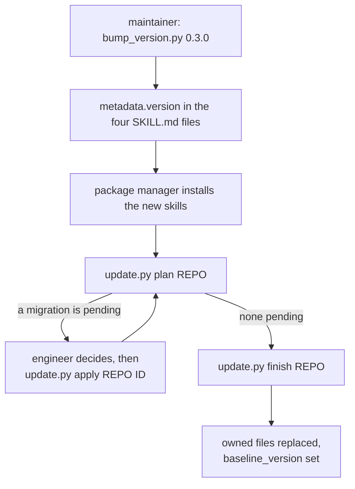

# Update a repository
covers: moving a project to the installed baseline version with update.py (plan, apply, finish), and the version bump that starts it

## The flow



*The installed version is whatever `SKILL.md` says, and the project's version moves only when `apply` or `finish` succeeds.*

## Walkthrough

Snippets are shortened, and a comment after `#` that is not in the source is added for you.

**1. One version for four skills.** `tools/bump_version.py` finds each `skills/*/SKILL.md`, locates the end of the YAML header with `lines.index("---", 1)` and rewrites the indented `version:` line inside it. A line like that in the body is left alone. `kit.installed_version()` reads the same line back, so the version a project is updated to is the one in `skills/baseline-init/SKILL.md`.

**2. Read both versions.** `update.py` keeps the project's version in `baseline/baseline.yml`. A regular expression (`CURRENT_RE`) finds the `baseline_version:` line and tolerates quotes, a trailing comment and CRLF. Versions are compared as tuples of integers, because strings sort `"0.10.0"` before `"0.9.0"`.

```python
# skills/baseline-init/scripts/update.py
def vtuple(version: str) -> Tuple[int, ...]:
    return tuple(int(part) for part in version.split("."))
```

**3. Find the pending migrations.** `scan` lists folders named `FROM-to-TO` (`MIGRATION_NAME_RE`) in `skills/baseline-init/migrations/`, keeps those inside the range, and orders them by `FROM`. None ships, so the list is empty.

```python
if not (vtuple(frm) >= vtuple(current) and vtuple(to) <= vtuple(installed)):
    continue
```

**4. `plan`.** It prints both versions, then dry-runs only the first pending migration by starting its `migrate.py` as a child process.

```python
r = subprocess.run([sys.executable, str(migration.script), str(repo), mode], capture_output=True)
```

`sys.executable` is the Python that is running `update.py`; the child's output is decoded with `errors="replace"`, so odd bytes do not crash the parent. Then, for each owned file, `owned_status` prints one of `missing`, `edited`, `outdated` or `unchanged` (a header whose hash does not match the body is `edited`), and whether the `AGENTS.md` pointer is there. When nothing is pending and everything matches, it prints `up to date`.

**5. `apply`.** Only the next pending migration is accepted. The script runs `migrate.py REPO --confirm`; on exit 0 `write_current` changes only the version in `baseline.yml`; otherwise it raises `Stop`, an exception that carries an exit code, which `main` turns into `error: ...` and that code.

```python
class Stop(Exception):
    def __init__(self, message: str, code: int):
        super().__init__(message)
        self.code = code
```

**6. `finish`.** It refuses while migrations are pending (exit 2) and, when an owned file is `edited` and `--discard-edits` is absent, exits 4 before writing. Then it rewrites the owned files from `assets/kit/` with a new header and sets `baseline_version`.

```python
to_write = [spec for spec in kit.OWNED if (repo / spec.path).exists() or spec.recreate]
```

Only `baseline/baseline.md` has `recreate=True`, so a `check.py` or workflow the team deleted stays deleted. A file's own line endings are kept.

Recorded on 657d8be (output shortened), after appending a line to `baseline/baseline.md` of a freshly initialised temporary repo:

```text
$ update.py plan REPO                       baseline.md: edited      (exit 0)
$ update.py finish REPO --dry-run           error: baseline.md was edited; run again with --discard-edits ...   (exit 4)
$ update.py finish REPO --discard-edits --dry-run
would replace baseline/baseline.md, baseline/check.py, .github/workflows/baseline.yml and set baseline_version to 0.2.0
```

## Alternatives and why this one

- **Merge into the owned files, or replace them whole.** Whole (`baseline.md` says so). Reason, `inferred`: a hash over the whole body can tell an edit from an old version only if the file is not merged.
- **Dry-run every pending migration, or only the next.** Only the next. Reason, stated in `migrations/README.md`: a later one may depend on what the earlier one changes.
- **Migrations as scripts, or as instructions.** Scripts, with an optional `MIGRATION.md` for changes a script cannot make (`migrations/README.md`).
- **Skip a declined migration, or stop.** It stops, and `SKILL.md` forbids skipping or recording an override. Reason, `inferred`: a later migration may assume the earlier one ran.
- **Write `AGENTS.md` on update.** `update.py` never does (its docstring says so). Reason, `inferred`: the file belongs to the team.
- **Per-skill versions, or one.** One, set by `bump_version.py` and asserted by `test_one_version_everywhere`. Reason, `inferred`: the four skills are installed as one package.

## Pitfalls and failure modes

| What happens | How it shows | What to do |
|---|---|---|
| The project is newer than the installed skills | `error: the repo is at 0.9.0, newer than the installed skills (0.2.0)`, exit 3 | Update the skills first. |
| A migration fails | exit 1; `baseline_version` stays; nothing is rolled back | Check `git status`. |
| An owned file was edited | `finish` exit 4, naming the file | Show the diff; `--discard-edits` replaces it. Keeping the edit is not supported yet. |
| `baseline_version` is missing or not `1.2.3` | exit 2 with the reason | Fix the line by hand. |
| A migration folder has no `migrate.py` | `ignored NAME: no migrate.py`, and it never runs | Add the script. |
| `AGENTS.md` pointer missing | `AGENTS.md pointer: missing` | Show `assets/kit/AGENTS.pointer.md` to the engineer; append after a yes. |

`--installed-version` and `--migrations-dir` exist so the tests can fake both; do not use them on a real repository.

## Practice

1. In a temporary repo made by `init.py`, run `update.py plan REPO` and read the last line. *`up to date`.*
2. Append a line to its `baseline/baseline.md` and run `update.py finish REPO --dry-run`. What is the exit code, and what changes it? *4; add `--discard-edits`.*
3. Set `baseline_version: 0.9.0` in that repo's `baseline/baseline.yml` and run `plan`. *Exit 3, and the repo's files are not touched.*
4. Copy `skills/` into a temporary folder and run `python3 tools/bump_version.py 0.3.1 --root FOLDER`. How many files are reported? *Four `updated skills/<name>/SKILL.md` lines.*
