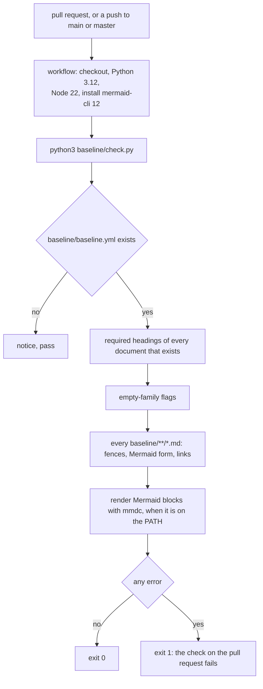

# Check the baseline folder
covers: the check CI runs on every pull request: required headings, Mermaid blocks, links between baseline documents and empty-family flags

## The flow



*The check reads only `baseline/`. A family that is needed and not written yet is a notice, never an error.*

## Walkthrough

Snippets are shortened, and a comment after `#` that is not in the source is added for you.

**1. The workflow.** `.github/workflows/baseline.yml` is GitHub Actions configuration: `on:` says when it runs, a job is a list of `steps`, a step either `uses:` a published action or `run:`s a shell command.

```yaml
on:
  pull_request:
  push:
    branches: [main, master]
steps:
  - uses: actions/checkout@v7
  - uses: actions/setup-python@v7
  - uses: actions/setup-node@v7
  - run: npm install --global @mermaid-js/mermaid-cli@12
  - run: python3 baseline/check.py
```

Node and `mermaid-cli` are there only to provide `mmdc`, the command that turns Mermaid text into an image.

**2. What a document must contain.** `REQUIRED` maps each family to a file pattern under `baseline/docs/` and the exact headings it needs.

```python
# baseline/check.py
"course": [
    ("course/README.md", (), ["## Chapters"]),
    ("course/*.md", ("course/README.md",), ["## The flow", "## Walkthrough", ...]),
],
```

`Path.glob` expands the pattern; the middle element lists paths the pattern must skip (the index is not a chapter; `features/users-and-access.md` is not a feature page). A family counts as written when any file matches.

**3. Prose against code.** `scan` walks the lines once and splits them into prose and fenced blocks, tracking the open fence marker. A heading is present only if some prose line, with trailing spaces removed, equals it, so a heading shown inside a code fence does not count and `## Walkthrough (draft)` does not match `## Walkthrough`.

**4. Mermaid form.** `mermaid_problem` skips blank lines, `%%` comments and a `---` front matter, then requires the first word of the next line to be a known diagram type from the `DIAGRAMS` set. That tests the form only; it does not parse the diagram.

**5. Links.** `LINK_RE` finds Markdown links after inline code is removed. `link_target` ignores anchors (`#...`), `//...` and anything with a scheme (`https:`, `mailto:`), strips a `#fragment` or `?query`, and resolves the rest from the document's folder. A link is an error only when it points inside `baseline/` at something that does not exist, so links to code elsewhere in the repository are not followed.

**6. Rendering.** With `mmdc` found by `shutil.which`, each block is written to a temporary `.mmd` file and rendered to SVG with a 180-second limit; any non-zero exit is an error that shows the renderer's first useful lines without its stack frames (`error_detail`). When the environment variable `CI` or `GITHUB_ACTIONS` is set, a small browser config with `--no-sandbox` is passed. Without `mmdc` the blocks are not rendered and one notice says how many.

**7. Empty-family flags.** For each `baseline/flags/empty-family-*.md`, the check reads `about:`; the flag is an error while that family is neither in `documents_skipped` nor written. This is how a documentation run tells the engineer to either skip a family or fill it.

**8. Result.** Lines start with `error:` or `notice:`, the last line counts both, and the exit code is 0, 1 or 2 (2 when the repository argument is not a folder).

Recorded on 657d8be (output shortened): a temporary repo from `init.py` with an architecture page that has only `## What the system is` and a link to `missing.md`:

```text
error: baseline/docs/architecture/README.md: missing section "## Big picture"
error: baseline/docs/architecture/README.md: missing section "## Components"
error: baseline/docs/architecture/README.md: missing section "## Key flows"
error: baseline/docs/architecture/README.md:6: the link to missing.md does not resolve
notice: mermaid: 1 block(s) not rendered because mmdc is not on the PATH; their form was checked
baseline check: 4 errors, 6 notices
```

## Alternatives and why this one

- **Check the whole repository, or only `baseline/`.** Only `baseline/` (the module docstring and `test_documents_outside_baseline_are_never_read`). Reason, `inferred`: a team's own documents must never fail a check they did not opt into.
- **Fail when `mmdc` is missing, or check the form and say so.** Form and a notice. Reason, `inferred`: the check must run on a laptop without Node.
- **Parse headings with a Markdown library, or compare whole lines.** Whole lines, outside fences. Reason, `inferred`: the standard library has no Markdown parser, and an exact line is unambiguous.
- **Fail on a missing family, or notice.** A notice, and an error only through an `empty-family` flag. Reason, `inferred`: a repository that has just been initialised has nothing written and must still pass.
- **Check that `covers:` exists.** Not checked; `covers.py` lists the lines and shows `(no covers line)`.

## Pitfalls and failure modes

| What happens | How it shows | What to do |
|---|---|---|
| A required heading has another level or extra words | `missing section "## ..."` | Make the line exactly the heading. |
| The heading is only inside a code fence | the same error | Put it outside the fence. |
| A link to a document inside `baseline/` is wrong | `the link to X does not resolve` with the line number | Fix the path. Anchors are not checked. |
| `mmdc` is not installed locally | a notice, exit 0 | The diagrams were not rendered; CI renders them. |
| A diagram has a syntax error `mmdc` rejects | `Mermaid block does not render: ...` | Fix it; only CI sees this without `mmdc` locally. |
| An unclosed fence | `unclosed code fence` | Close it. |
| `documents_skipped` names something that is not a family | an error naming the six families | Use the six names. |
| An `empty-family` flag whose `about:` is not a family | an error | Write `about:` followed by the family key, for example `deployment`. |

## Practice

1. Make a temporary repo with `init.py`, write `baseline/docs/architecture/README.md` containing only the line `## What the system is`, and run `python3 baseline/check.py REPO`. How many errors? *Three: the three other required headings.*
2. Add a Mermaid block whose first line is `flowchart LR` and run it again with `--no-render`. Is there a notice about rendering? *No: `--no-render` skips the renderer and its notice.*
3. Add `[x](missing.md)` on line 6. What does the error say? *The path of the document, `:6:` and `the link to missing.md does not resolve`.*
4. Create `baseline/flags/empty-family-course.md` containing `about: course`. Why does the check fail, and what two things end the failure? *The family is neither skipped nor written; list `course` in `documents_skipped`, or write a course document.*
