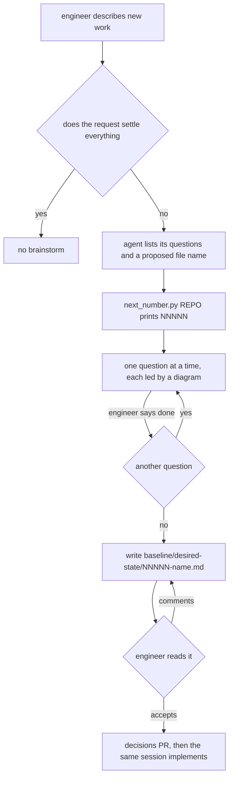

# Agree the end state before code
covers: turning new work into an accepted desired-state file with the baseline-brainstorm questions protocol and next_number.py, before any code is written

## The flow



*Nothing is written until the last question is answered, and no code starts until the engineer accepts the file.*

## Walkthrough

Only one piece of this chapter is code, `next_number.py`; the rest is instruction text that `skills/baseline-brainstorm/SKILL.md` gives the agent. An agent skill is a folder whose `SKILL.md` header (`name`, `description`) tells the agent when to load it.

**1. When.** The skill runs when the engineer describes new work and the agent has questions, and again when a decision during coding deviates from the accepted file. It runs in the main session, never in a subagent, because it needs back and forth with the engineer.

**2. The number.** The file name starts with five digits. `next_number.py` lists `baseline/desired-state/`, takes the highest number it finds plus one, and prints it padded to five digits.

```python
# skills/baseline-brainstorm/scripts/next_number.py
NUMBERED_RE = re.compile(r"^(\d{5})-")
...
return "%05d" % (max(used) + 1 if used else 1)
```

`^(\d{5})-` is a regular expression: exactly five digits at the start of a name, then a dash. A file and a folder both count, so a number is never reused. The agent then names the topic in two to four words, for example `00012-order-refunds`.

**3. One question at a time.** For each question the agent leads with a diagram chosen from `references/diagram-guide.md`: an ER diagram for a data change, a sequence diagram or flowchart for a flow, a state diagram for a lifecycle, a component flowchart for parts and dependencies, side-by-side boxes for options. One idea per diagram, about twelve nodes at most, one italic line under it. The agent gives the options, its recommendation first with one reason, and stays on the question until the engineer says done. It keeps notes and writes no file yet.

**4. The file.** `assets/desired-state-template.md` has three parts.

```markdown
## End state          diagrams first, then a checklist of what is true when this is done
## Arrival decisions  ### D1. the decision / Why: / Not taken: an option, why it lost
## Settles            the ADRs and standards this leads to, or "none"
```

**5. What to record.** `references/deciding-adrs-and-standards.md` separates three outcomes.

| The engineer said | Record |
|---|---|
| "Every payload type is a record." | a standard |
| "We will use Postgres, not DynamoDB." | an ADR |
| "Call that variable `total`." | neither |

**6. After acceptance.** The agent writes each listed ADR and standard from the templates in `baseline/adr/` and `baseline/standards/` in a decisions PR, then implements in the same session from a fixed prompt that says to ask when something is unclear and to report against the file when done.

**7. A deviation.** A decision that contradicts the file is put to the engineer with a before-and-after diagram. Only after an explicit yes does the agent amend the file, keeping the old option under "Not taken" with the reason it changed.

Recorded on 657d8be, in a temporary folder with `00001-a.md`, `00007-b.md` and a folder `00009-old` in `baseline/desired-state/`:

```text
$ python3 skills/baseline-brainstorm/scripts/next_number.py REPO
00010
```

## Alternatives and why this one

- **One question at a time, or a questionnaire.** One at a time, until the engineer says done. Reason, `inferred`: a diagram per question stays readable and each answer can change the next question.
- **Keep the decisions in the chat, or in a file.** A file, which `baseline.md` says to re-read after a compaction. Reason, `inferred`: the chat does not survive compaction and the file can be reviewed.
- **A subagent, or the main session.** The main session; `SKILL.md` gives the reason: it needs back and forth with the engineer.
- **Count the files, or take the highest number plus one.** The highest plus one, and a numbered folder counts too. `test_a_folder_with_a_number_counts_so_a_number_is_never_reused` names the reason.
- **Paste the Q&A into the file, or only the decisions.** Only the decisions and the options not taken. Reason, `inferred`: the file is the single context the coding agent gets, so it must stand alone and stay short.

## Pitfalls and failure modes

| What happens | How it shows | What to do |
|---|---|---|
| Nothing in code stops an agent from coding before acceptance | no error anywhere | The rule is in `SKILL.md` and `baseline.md`; the engineer's acceptance is the gate. |
| A name has six digits or no dash | `next_number.py` ignores it | Name files `NNNNN-name.md`. |
| The repository path is wrong | `error: ... is not a directory`, exit 2 | Pass the repository root. |
| The folder is empty or missing | it prints `00001` | Nothing: that is the first number. |
| A deviation is settled silently | the file no longer matches the code | Ask with a diagram, then amend the file. |
| Context is compacted mid-task | the agent forgets the file | Re-read the accepted file. |

## Practice

1. In a temporary folder, create `baseline/desired-state/00001-a.md`, `00007-b.md` and a folder `00009-old`, then run `next_number.py` on it. *`00010`.*
2. Add `1-short.md` and `000011-x.md` and run it again. *Still `00010`: neither name matches five digits and a dash.*
3. Which diagram does the guide choose for a question about the statuses an order passes through? *A state diagram (`stateDiagram-v2`).*
4. The engineer says "from now on every handler returns a result object". An ADR, a standard or neither? *A standard: a blanket rule about how code is written.*
