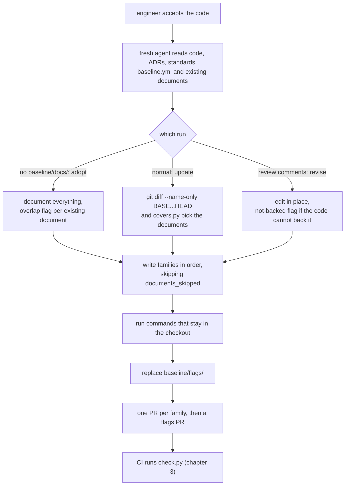

# Document the accepted code
covers: a fresh agent writing baseline/docs and baseline/flags from the code at the tip with baseline-documentation, in adopt, update and revise runs

## The flow



*The agent documents what exists at the tip and nothing it was told was intended: it never reads `baseline/desired-state/` or the conversation.*

## Walkthrough

Snippets are shortened, and a comment after `#` that is not in the source is added for you.

**1. What the agent is.** `skills/baseline-documentation/SKILL.md` says the agent is a new session or subagent, started after the engineer accepted the code. It reads the code, `baseline/adr/`, `baseline/standards/`, `baseline/baseline.yml` and the documents already in `baseline/docs/`, and writes only inside `baseline/docs/` and `baseline/flags/`.

**2. The six families.** One file in `references/` per family tells the agent where to write and which headings are required. `baseline.yml` can skip families.

| Order | Family | Where |
|---|---|---|
| 1 | `architecture` | `baseline/docs/architecture/README.md` |
| 2 | `course` | `baseline/docs/course/` |
| 3 | `features` | `baseline/docs/features/` |
| 4 | `deployment` | `baseline/docs/deploy/` |
| 5 | `reference` | `baseline/docs/reference/` |
| 6 | `readme` | `baseline/docs/README.md` |

The order lets later documents link to earlier ones.

**3. Picking documents.** In an update run the agent takes `git diff --name-only BASE...HEAD` (three dots: the changes on this branch since it left `BASE`) and runs `covers.py`. Every document's line 2 is `covers: <the behaviour it describes>`, so the agent matches changed code to documents by behaviour and not by file name.

```python
# skills/baseline-documentation/scripts/covers.py
with open(path, encoding="utf-8", newline="") as f:
    for _, line in zip(range(10), f):          # only the first ten lines
        match = COVERS_RE.match(line.rstrip("\r\n"))
```

`zip(range(10), f)` stops after ten lines of the file. The script prints `path`, a tab and the text; a file with no line prints `(no covers line)`, an unreadable one `(unreadable)`. It writes nothing.

**4. The headings are a contract.** Each reference lists its required headings under `## Required sections`, and `check.py` has the same headings in `REQUIRED` (chapter 3). `tests/documentation_test.py` parses both and fails if they differ, so an agent following a reference cannot write a page the check rejects.

**5. Commands.** The agent may run only commands that change nothing beyond the checkout (tests, lint, dry runs, `--help`) and records `ran on <short commit>: <result>` beside each. A deploy, publish or migrate command is written as `not run`. A command that fails for an environment reason becomes a `command-failed` flag.

**6. Flags.** `baseline/flags/` is deleted and rewritten on every run, one file per flag named `<kind>-<slug>.md`.

```markdown
# <one line: what is wrong>
kind: stale-doc
about: baseline/docs/architecture/README.md
```

The kinds are `empty-family`, `stale-doc`, `breaks-rule`, `inferred-reason`, `overlap`, `command-failed`, `not-backed` and `link-readme`. Only `empty-family` is read by code: `about:` must be the family key, because `check.py` fails while that family is neither skipped nor written (chapter 3). The agent never edits `documents_skipped`.

**7. Pull requests.** One PR per family in the order written, then a flags PR on top. The agent does not merge, deploy or publish. If the root `README.md` does not link `baseline/docs/README.md`, a `link-readme` flag says so.

## Alternatives and why this one

- **The agent that wrote the code documents it, or a fresh one.** A fresh one. `SKILL.md` gives the reason: `desired-state` and the conversation say what was meant, and a document says what exists.
- **Find documents by file name, or by a `covers:` line.** By `covers:`. `covers.py` says why: so a run can pick the documents a diff affects.
- **One document, or six families.** Six. Reason, `inferred`: how it is built, how to learn it, what it does for a user and what a term means are different questions, and a reader opens the page for theirs.
- **Flags in the PR conversation, or as files.** Files in `baseline/flags/`. Reason, `inferred`: they travel with the branch and `check.py` can read them.
- **Required headings in the reference only, or in the check too.** Both, and a test keeps them equal. Reason, `inferred`: the agent reads the reference and CI reads the check.

## Pitfalls and failure modes

| What happens | How it shows | What to do |
|---|---|---|
| `covers:` is below line 10 or has no text | `(no covers line)` in `covers.py` | Put it on line 2. |
| A heading differs from the reference | `check.py` says `missing section` | Copy the heading exactly. |
| A needed family has nothing to document | write `empty-family-<family>.md` with `about: <family>` and no page; the check fails until the engineer skips or fills it | Never edit `documents_skipped` yourself. |
| A document outside the diff is now false | a `stale-doc` flag; the document is not rewritten | The engineer decides. |
| A review comment asks for what the code cannot back | a `not-backed` flag; nothing written | Explain in the flag. |
| A reason in a chapter is a guess | the word `inferred` and one `inferred-reason` flag per chapter | The engineer confirms it. |
| A document outside `baseline/docs/` covers the same ground | an `overlap` flag in adopt runs | The team deletes the old one in review. |

## Practice

1. Run `python3 skills/baseline-documentation/scripts/covers.py .` in this repository. What does each line contain, and can a line say `(no covers line)`? *The path, a tab and the behaviour covered; it says `(no covers line)` only when the first ten lines have no non-empty `covers:`.*
2. In a temporary folder make `baseline/docs/a.md` with `covers: x` on line 12 and run `covers.py` on it. *`(no covers line)`.*
3. Which test fails if you add a required heading to `references/course.md` but not to `check.py`? *`test_the_checks_required_sections_match_the_references` in `tests/documentation_test.py`.*
4. A needed family has nothing at the tip. Which file do you write, and what does the check do until it is dealt with? *`baseline/flags/empty-family-<family>.md` with `about: <family>`; the check fails.*
