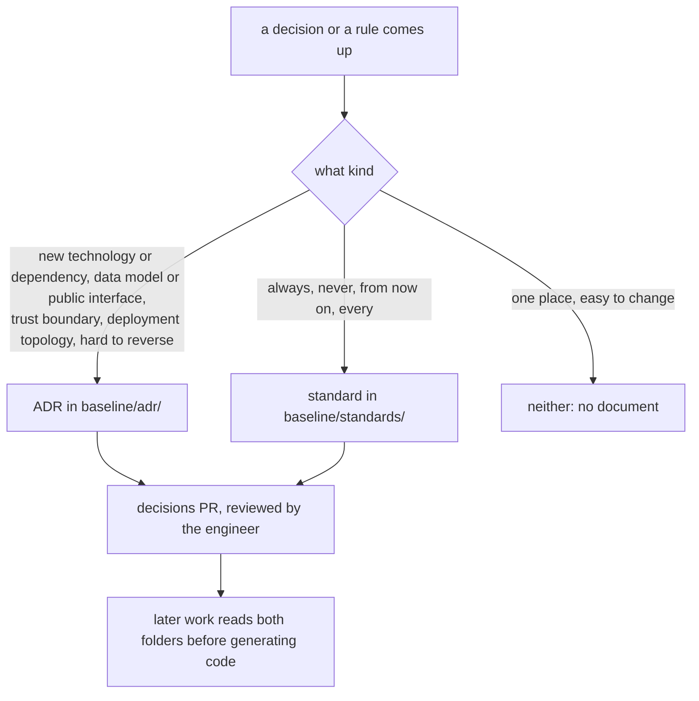

# Decisions and standards
covers: how a decision becomes an ADR and a repeatable rule becomes a coding standard that steers agent-written code

## What it is and why

Agents write most of the code, and what steers them is two kinds of short file: an ADR in `baseline/adr/` for a decision of impact, and a standard in `baseline/standards/` for a blanket rule about how code is written. Both start from a template, `baseline.md` tells every agent to read both folders before it generates code, and the engineer reviews them in a decisions PR before the code.

## Who can use it

The engineer decides; the agent writes the files. In this repository `AGENTS.md` adds that an agent proposes a standard in the chat, with its reason in the engineer's words and its scope, and writes it only after the engineer approves.

## What a person can do

*Only a decision of impact or a blanket rule gets a file.*

- **State a rule.** Say "every payload type is a record" and the agent treats it as a standard; say "we will use Postgres" and it is an ADR; say "call that variable `total`" and nothing is written.
- **Review the files.** An ADR holds the decision, one or two lines of why and an optional diagram; a standard holds the rule, the end result, snippets and exceptions.
- **Change a rule.** Edit the file. When generated code is wrong, the agent does not patch the code: it puts the corrected rule to the engineer and regenerates the code from the changed text (`docs/agents/standards.md`).

## When things go wrong

| What the person sees | What it means | What they can do |
|---|---|---|
| generated code ignores a rule | the rule is not written, or is vague | ask for it as a standard, with its scope |
| a rule written that the engineer never approved | an agent skipped the proposal | delete it and say so |
| an ADR that no longer holds | it will keep steering code | rewrite or delete it; git history is the record |

## Limits today

This repository's `baseline/adr/` and `baseline/standards/` hold only their `TEMPLATE.md`, so nothing steers yet. No code checks generated code against them: `baseline-refactor`, which is meant to, is a placeholder.
