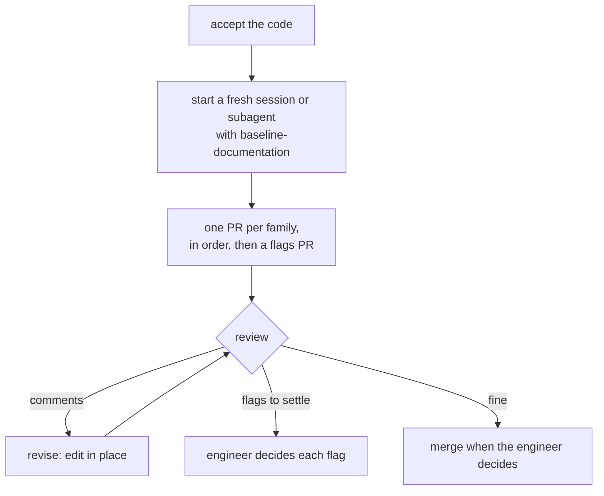

# Documentation from the code
covers: what the engineer gets when a fresh agent documents the accepted code: the documents, the flags and the pull requests

## What it is and why

After the engineer accepts the code, a fresh agent (a new session or a subagent, not the one that built it) reads the code, the ADRs, the standards and `baseline/baseline.yml`, and writes documents inside `baseline/docs/`. It reads neither the desired-state files nor the conversation, so it describes what exists and not what was meant. What it is unsure of or cannot write goes into `baseline/flags/`. The engineer reviews the result as pull requests.

## Who can use it

The engineer starts it, by telling an agent that has the `baseline-documentation` skill to run after the code is accepted. It writes only inside `baseline/docs/` and `baseline/flags/`, and does not merge, deploy or publish.

## What a person can do

*The agent's three kinds of run are adopt (no `baseline/docs/` yet), update (after a change) and revise (after review comments).*

- **Choose families.** All six are written unless `documents_skipped` names one: a `README`, an architecture overview, a course, feature pages, deployment documents and reference pages.
- **Read a PR description.** Each says what was documented, how it was checked (commands with `ran on <commit>: <result>` or `not run`) and what was not verified.
- **Read the flags.** One file per flag in `baseline/flags/`: `empty-family`, `stale-doc`, `breaks-rule`, `inferred-reason`, `overlap`, `command-failed`, `not-backed`, `link-readme`. A flag comes back on every run until its cause is gone.
- **Comment on a PR.** In a revise run the agent edits the document in place; a request the code cannot back becomes a `not-backed` flag and nothing is written.
- **See what a document covers.** Line 2 of every document is `covers:`, and `skills/baseline-documentation/scripts/covers.py REPO` lists them.

## When things go wrong

| What the person sees | What it means | What they can do |
|---|---|---|
| the check fails with `the empty-family flag for X stands` | a needed family has nothing at the tip | skip the family in `documents_skipped`, or fill it |
| an `overlap` flag | an older document covers the same ground | delete the older one in review |
| a `stale-doc` flag | an existing document says something the code contradicts | fix or remove it; the agent does not rewrite it |
| an `inferred-reason` flag | a reason in a course chapter is the agent's guess | confirm or correct it |
| a `command-failed` flag | a command failed for an environment reason | fix the environment and run again |
| a `link-readme` flag | the root README does not link `baseline/docs/README.md` | add the link |

## Limits today

The skill's output is not checked for truth: `check.py` verifies headings, diagrams and links, not claims. Diagrams are rendered only where `mmdc` is installed, which CI does.
