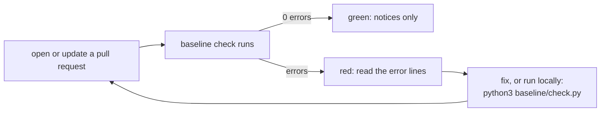

# The pull request check
covers: the baseline check a pull request shows, what it fails on, and how to run it locally

## What it is and why

Every pull request and every push to `main` or `master` runs `python3 baseline/check.py` through `.github/workflows/baseline.yml`, under the name `baseline check`. It looks only inside `baseline/` and fails on four things: a document that exists but lacks a required section, a Mermaid diagram that is malformed or does not render, a link between baseline documents that points at nothing, and an `empty-family` flag for a family that is neither skipped nor written. The required headings are the ones the documentation skill's references list, and a test keeps the two lists equal.

## Who can use it

Anyone who opens a pull request in a repository that has the workflow sees it. Anyone with Python 3.9 or later can run the same file locally.

## What a person can do

*The same command gives the same lines on a laptop and in CI, except that CI also renders the diagrams.*

- **Read the lines.** `error:` lines fail the check and name a file, and a line number for diagram and link errors. `notice:` lines never fail it: `not yet documented: course` says a needed family has no page yet.
- **Run it locally.** `python3 baseline/check.py` checks the repository it lives in; `python3 baseline/check.py REPO` checks another; `--no-render` skips the renderer.
- **See the diagrams checked.** With the Mermaid renderer (`mmdc`) installed the check renders each block and reports how many it rendered. Without it the check reads each block's form and says that the blocks were not rendered.
- **Skip a family.** List it in `documents_skipped` in `baseline/baseline.yml`; the check then stops noting it as not yet documented, and an `empty-family` flag for it stops failing.

## When things go wrong

| What the person sees | What it means | What they can do |
|---|---|---|
| `missing section "## X"` | a document lacks an exact heading line | add the heading as its own line, outside a code fence |
| `the link to X does not resolve` | a link inside `baseline/` points at a missing file | fix the path |
| `Mermaid block does not render: ...` | the renderer rejected the diagram | fix the syntax; run with `mmdc` to see it before CI |
| `unknown Mermaid diagram type` / `empty Mermaid block` | the first line of the block is not a known diagram type | start it with `flowchart`, `sequenceDiagram` and so on |
| `the empty-family flag for X stands` | the family has no page and is not skipped | write the family, or add it to `documents_skipped` |
| `documents_skipped names an unknown family` | a typo in `baseline.yml` | use the six names |

## Limits today

It reads nothing outside `baseline/`, does not check that a document has its `covers:` line, and follows only links that point inside `baseline/`. A local run without `mmdc` cannot say that a diagram renders.
