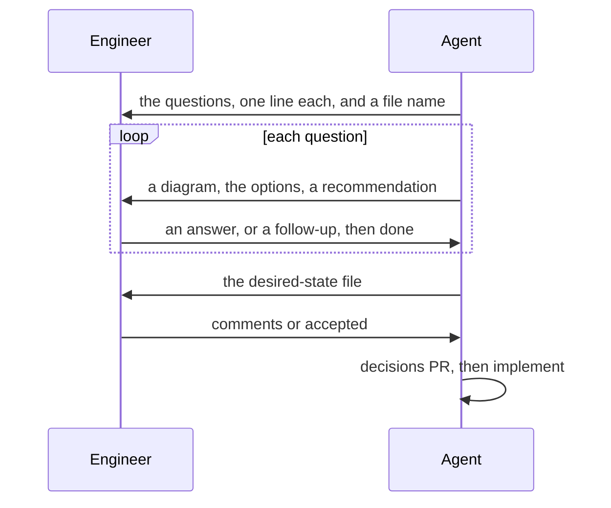

# Questions before code
covers: what the engineer goes through before any code for new work: the questions, the desired-state file and the acceptance

## What it is and why

When the engineer describes new work and the agent has questions, the `baseline-brainstorm` skill takes over. The agent lists its questions, then asks them one at a time, each with a diagram, and writes the answers into one file, `baseline/desired-state/NNNNN-name.md`. The engineer reads it and accepts it before any code starts. The file is both what the engineer reviews and the single context the coding agent works from.

## Who can use it

The engineer, in the main conversation: the skill is never handed to a subagent, because it needs back and forth with the engineer.

## What a person can do

*The agent stays on a question until the engineer says done, and the file is written only after the last one.*

- **Rename the file.** The agent proposes a name such as `00012-order-refunds`; the number is the highest in use plus one.
- **Answer with a recommendation in front of you.** Each question gives options, the agent's pick first, and one reason.
- **Read the file.** It has an end state (diagrams, then a checklist), arrival decisions (the decision, why, the options not taken) and the ADRs and standards it settles.
- **Comment, or accept.** Comments change the file and the agent waits again. After acceptance the agent writes the listed ADRs and standards in a decisions PR, then implements.
- **Confirm a deviation.** A decision during coding that contradicts the file is put to the engineer with a before-and-after diagram, and the file is amended only after an explicit yes.

## When things go wrong

| What the person sees | What it means | What they can do |
|---|---|---|
| the agent starts coding before accepting | nothing in code stops it; the rule is in the skill | say so; the file is the contract |
| the file and the code disagree | a deviation was not confirmed | ask for the file to be amended, or the code changed |
| the agent forgets the file after a compaction | context was trimmed | tell it to re-read the file; `baseline.md` already says so |
| questions about something the request already settled | the skill says to skip it when the request settles everything | say the request is complete |

## Limits today

The questions protocol is instructions an agent follows. The only script is `next_number.py`, which prints the next number, and no code checks that a desired-state file exists before work starts.
