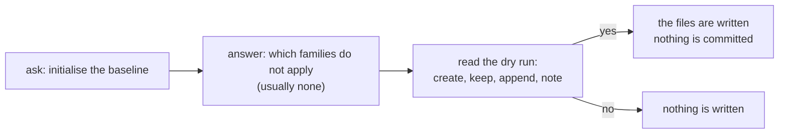

# Set up a repository
covers: what the engineer sees when an agent sets a repository up for the baseline, and what lands in it

## What it is and why

The engineer asks their agent to initialise the baseline in a repository. The agent asks which document families do not apply, shows a list of what it would write, and writes it after a yes. The repository then has a `baseline/` folder with the baseline's instructions, a check, templates for decisions and coding standards, a CI workflow, and a short pointer in `AGENTS.md` so every later agent session finds the instructions and reads the ADRs and standards before it writes code.

## Who can use it

The engineer, by asking an agent that has the `baseline-init` skill. There are no accounts or roles: anything that can run Python 3.9 or later on the repository can run the script.

## What a person can do

*Nothing is written until the second yes, and nothing is ever committed.*

- **Skip families.** The six are `readme`, `architecture`, `course`, `features`, `deployment` and `reference`. A skipped family is recorded in `baseline/baseline.yml`, so the check and the documentation skill leave it out.
- **Read the lines.** `create` is a new file, `keep` an existing one that stays as it is, `append` an `AGENTS.md` that gets the pointer added at its end.
- **See what was written.**

| File | What it is |
|---|---|
| `baseline/baseline.md` | the baseline's instructions to agents; replaced whole on update |
| `baseline/check.py` | the check CI runs |
| `.github/workflows/baseline.yml` | runs the check on pull requests |
| `baseline/baseline.yml` | the project's own settings: version and skipped families |
| `baseline/adr/TEMPLATE.md`, `baseline/standards/TEMPLATE.md` | where decisions and standards start |
| `AGENTS.md` | gets a four-line pointer to `baseline/baseline.md` |
| `CLAUDE.md` | created with `@AGENTS.md` when absent |

## When things go wrong

| What the person sees | What it means | What they can do |
|---|---|---|
| `already initialised (baseline/baseline.yml exists); use the update mode` | the repository was set up before | ask for an update instead |
| `unknown document family 'x'` | a typo in the skipped families | use the six names above |
| `note: CLAUDE.md does not import AGENTS.md ...` | Claude Code will not see the pointer | agree that the line `@AGENTS.md` is added |
| `AGENTS.md is not UTF-8 text` | the script will not guess | fix the file by hand |
| `keep` on a file they expected to be new | a file of that name exists | compare it by hand; it is never overwritten |

## Limits today

It does not commit, open a pull request or install the skills. An old root `baseline.yml` of an earlier layout is left alone.
