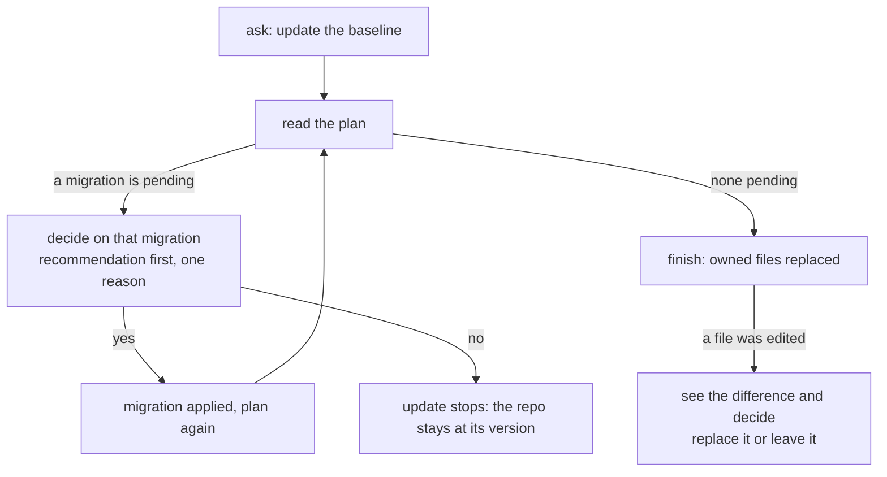

# Update a repository
covers: what the engineer sees when an agent brings a repository to the installed baseline version

## What it is and why

When the skills are updated by the package manager, a repository that already uses the baseline can be brought to the new version. The agent shows a plan, asks the engineer about each migration, and then replaces the files the baseline owns (`baseline/baseline.md`, `baseline/check.py` and the workflow) and moves `baseline_version` in `baseline/baseline.yml`. The files that belong to the project, such as ADRs and standards, change only through a migration the engineer has seen and approved.

## Who can use it

The engineer, through an agent with the `baseline-init` skill. A repository newer than the installed skills is refused.

## What a person can do

*A declined migration stops the update; the repository is never moved past it.*

The plan lists: the repository's version and the installed one, the next migration with its dry run, later ones by name, whether `baseline.md`, `check.py` and the workflow are `unchanged`, `outdated`, `edited` or `missing`, and whether the `AGENTS.md` pointer is there. It ends with `up to date` when nothing is left to do.

## When things go wrong

| What the person sees | What it means | What they can do |
|---|---|---|
| `the repo is at X, newer than the installed skills` (exit 3) | the skills are older than the repository | update the skills first |
| a migration fails (exit 1) | the version stays and nothing is rolled back | check `git status` |
| `... was edited; run again with --discard-edits` (exit 4) | an owned file differs from what the baseline shipped | read the difference; discard the edit or leave the file |
| `AGENTS.md pointer: missing` | update never writes `AGENTS.md` | show the pointer text, append it after a yes |
| `baseline_version` unreadable (exit 2) | the line is missing or not `1.2.3` | fix it by hand |

## Limits today

No migration ships, so an update replaces the owned files and moves the version. A kept edit to an owned file cannot be recorded: the plan keeps reporting it as `edited`, and the repository is not fully at the installed version. A deleted `check.py` or workflow stays deleted.
