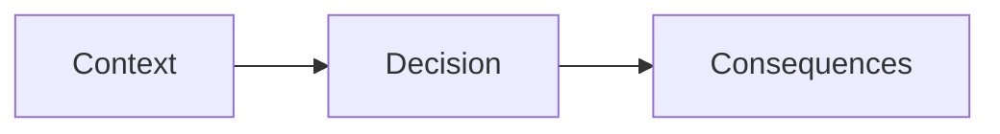
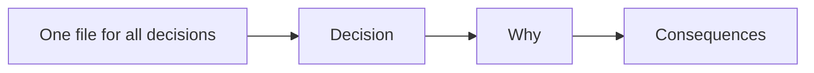
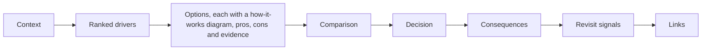
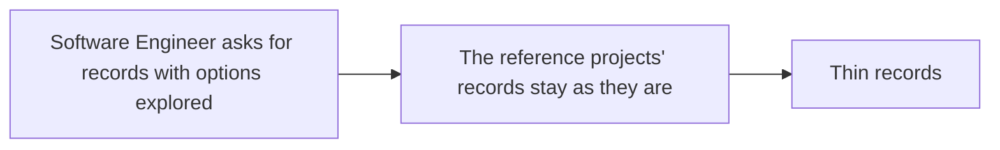
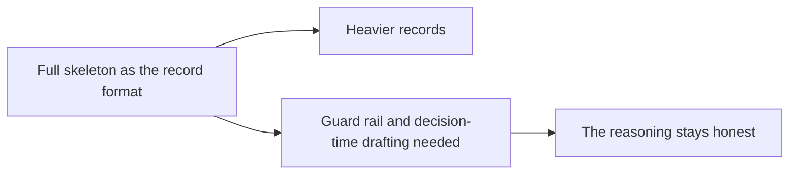

# 0001. Record decisions as ADRs with the options explored

Status: Proposed

Date: 2026-11-14

Deciders: the Software Engineer

## Context

The Software Engineer's first request names "architectural decision records documenting the technical decisions that were taken, options explored". The reference projects' records are thin. In the-way, the template is Context, Decision, Consequences, and its ADR 0003 is 15 lines. In my-quote, nine decisions sit in one file with Decision, Why, Consequences.

## Decision drivers

In the order the trail records them:

- Options and evidence must be visible.
- Records must be durable and reviewable by architects in the monthly read.

## Options

### Option 1: The-way's three-part template

Each decision is recorded in three parts: Context, Decision and Consequences.

*The-way's template runs from Context through Decision to Consequences; notice that no part holds alternatives.*

- **Pros:** Short.
- **Cons:** No alternatives.
- **Evidence:** Reading `docs/adr/0003-sqlite-as-the-database.md` and `docs/deployment/ARCHITECTURE_DECISIONS.md`; the trail records these two files as the evidence for the decision as a whole.

### Option 2: My-quote's one-file Decision and Why

All decisions are kept in one file, with Decision, Why and Consequences.

*My-quote's file keeps every decision in one place and records the why; notice that it still holds no alternatives.*

- **Pros:** Better on the why.
- **Cons:** Still no alternatives.
- **Evidence:** Reading `docs/adr/0003-sqlite-as-the-database.md` and `docs/deployment/ARCHITECTURE_DECISIONS.md`; the trail records these two files as the evidence for the decision as a whole.

### Option 3: A full skeleton

Each record has context, ranked drivers, options (each with a how-it-works diagram, pros, cons and evidence), a comparison, the decision, consequences, revisit signals and links.

*The full skeleton puts the options and their evidence between the drivers and the decision; notice that the decision comes only after the comparison.*

- **Pros:** Meets the Software Engineer's bar: "options explored".
- **Cons:** Heavier records, and the guard rail and decision-time drafting are needed to keep the reasoning honest (the trail records both as consequences of the pick).
- **Evidence:** Not recorded for the skeleton itself; the trail's evidence for the decision as a whole is the reading of two files, named under the-way's template and my-quote's file.

### Option 4: Do nothing

No new record format is added, and the reference projects' records stay as they are.

*Doing nothing keeps the reference projects' records as they are; notice that the Context calls them thin.*

- **Pros:** Not recorded.
- **Cons:** The reference projects' records are thin, which is the problem the Context states.
- **Evidence:** Not recorded.

## Comparison

| Option | Options and evidence must be visible | Durable and reviewable by architects in the monthly read | Other trade-offs recorded |
|---|---|---|---|
| The-way's three-part template | No alternatives | Not recorded. | Short |
| My-quote's one-file Decision and Why | Still no alternatives | Not recorded. | Better on the why |
| A full skeleton | Options, each with a how-it-works diagram, pros, cons and evidence, are part of it | Not recorded. | Heavier records; the guard rail and decision-time drafting are needed to keep the reasoning honest |
| Do nothing | Not recorded. | Not recorded. | The reference projects' records are thin |

## Decision

The Software Engineer picked the full skeleton. The recorded reason is the Software Engineer's bar: "options explored". The full skeleton beats the other two on that bar because both reference formats record no alternatives: the-way's template is short but has none, and my-quote's one-file record is better on the why but still has none.

## Consequences

Records get heavier, and the guard rail and decision-time drafting are needed to keep the reasoning honest.

*The full skeleton makes records heavier; notice that the guard rail and decision-time drafting are what keep the reasoning honest.*

## Revisit when

The skeleton proves too heavy for small decisions, which would move them to rulings.

## Links

- Design 1, Appendix A, 0001: [design 1](../superpowers/specs/2026-11-14-baseline-standard-design.md)
- Decision trail, entry 0001: [decision trail](../superpowers/specs/2026-11-14-baseline-decision-trail.md)
- Added at review: PR 9 of this stack (branch `standard/09-adrs-deployment-readme`), which writes the ADR template and its rules into `standard/11-adrs.md`.
- Added at review: the course chapter [A decision becomes an ADR](../course/system/03-decision-to-adr.md), which follows this decision at work in the repository.
