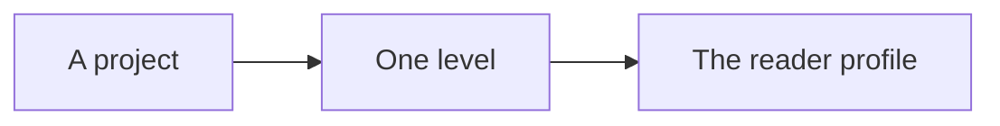
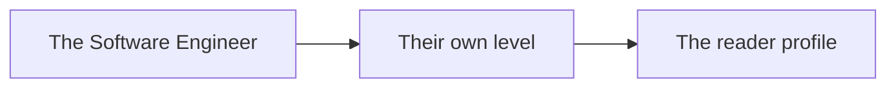
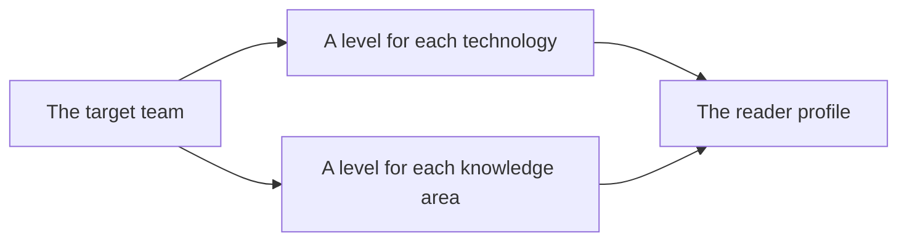
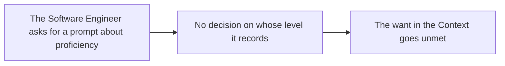
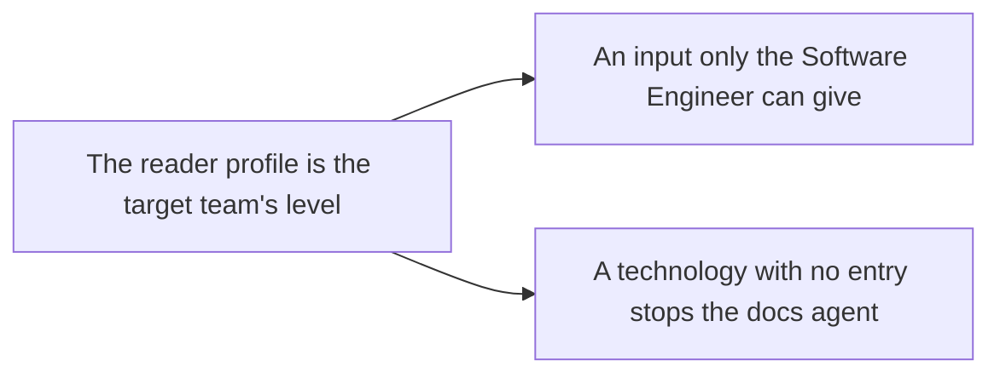

# 0004. The reader profile is the target team

Status: Proposed

Date: 2026-11-14

Deciders: the Software Engineer

## Context

The Software Engineer first asked for a prompt about proficiency "with the tech stack", then clarified: "the answers I give will be the basis on how I will select the team to execute the project long term", and "the skill level answered here is purely for building the docs, not to reduce the scope of the technical implementation itself."

## Decision drivers

In the order the trail records them:

- Teams vary.
- The profile doubles as a hiring bar.
- Implementation quality must never depend on it.

## Options

### Option 1: One level per project

The reader profile records one level for each project.

*One level is set for each project; notice that it is not split by technology or by knowledge area.*

- **Pros:** Not recorded.
- **Cons:** Not recorded.
- **Evidence:** Not recorded. The trail's one piece of evidence is for the decision as a whole and is given under the Software Engineer's own level.

### Option 2: The Software Engineer's own level

The reader profile records the Software Engineer's own level.

*The profile would hold the Software Engineer's own level; notice that the level is the Software Engineer's and not the target team's.*

- **Pros:** Not recorded.
- **Cons:** Not recorded.
- **Evidence:** The trail records one piece of evidence, for the decision as a whole and not tied to an option: my-quote's `AGENTS.md` section 1 ties code style to the Software Engineer's early-career level. It is given here because it names the Software Engineer's level.

### Option 3: The target team's level, per technology and per knowledge area

The reader profile records the target team's level, for each technology and for each knowledge area.

*The profile holds the target team's level for each technology and each knowledge area; notice that the level belongs to the team and not to the Software Engineer.*

- **Pros:** The profile is also the hiring bar (Appendix A), and it is docs-only (Appendix A): the Software Engineer said the skill level is "purely for building the docs, not to reduce the scope of the technical implementation itself."
- **Cons:** Not recorded.
- **Evidence:** Not recorded. The trail's one piece of evidence is for the decision as a whole and is given under the Software Engineer's own level.

### Option 4: Do nothing

The prompt about proficiency "with the tech stack" is left without a decision on whose level it records.

*Doing nothing leaves the prompt without an answer to whose level it records; notice that the Context says the answers are to be the basis for selecting the team.*

- **Pros:** Not recorded.
- **Cons:** The want in the Context goes unmet: a prompt about proficiency "with the tech stack", whose answers the Software Engineer said "will be the basis on how I will select the team to execute the project long term", and whose skill level is "purely for building the docs, not to reduce the scope of the technical implementation itself."
- **Evidence:** Not recorded.

## Comparison

| Option | Teams vary | The profile doubles as a hiring bar | Implementation quality must never depend on it | Other trade-offs recorded |
|---|---|---|---|---|
| One level per project | Not recorded. | Not recorded. | Not recorded. | Not recorded. |
| The Software Engineer's own level | Not recorded. | Not recorded. | Not recorded. | Not recorded. |
| The target team's level, per technology and per knowledge area | The target team, per technology and knowledge area (Appendix A) | Also the hiring bar (Appendix A) | Docs-only (Appendix A) | The profile is an input only the Software Engineer can give; a technology with no entry stops the docs agent (recorded as consequences) |
| Do nothing | Not recorded. | Not recorded. | Not recorded. | The want in the Context goes unmet, as quoted under Cons |

## Decision

The Software Engineer picked the target team's level, per technology and per knowledge area. The recorded reason is the Software Engineer's own, from the Context: "the answers I give will be the basis on how I will select the team to execute the project long term", and the skill level "is purely for building the docs, not to reduce the scope of the technical implementation itself." Appendix A adds that the profile is also the hiring bar and docs-only.

An earlier idea of the agent that was writing the design, tying code style to the reader's level (my-quote's "plain over clever" rule), was reversed. Why the pick beats one level per project and the Software Engineer's own level: Not recorded.

## Consequences

The profile is an input only the Software Engineer can give. A technology with no entry stops the docs agent.

*The profile becomes an input only the Software Engineer can give; notice that a technology with no entry stops the docs agent.*

## Revisit when

The team grows and areas get their own deciders.

## Links

- Design 1, Appendix A, 0004: [design 1](../superpowers/specs/2026-11-14-baseline-standard-design.md)
- Decision trail, entry 0004: [decision trail](../superpowers/specs/2026-11-14-baseline-decision-trail.md)
- Added at review: PR 6 of this stack (branch `standard/06-profile-and-layout`), which writes the reader profile and the intake into `standard/04-reader-profile.md`.
