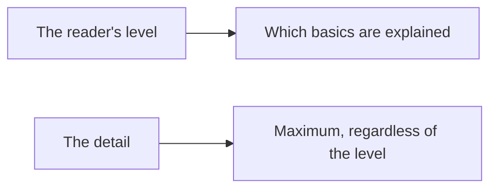
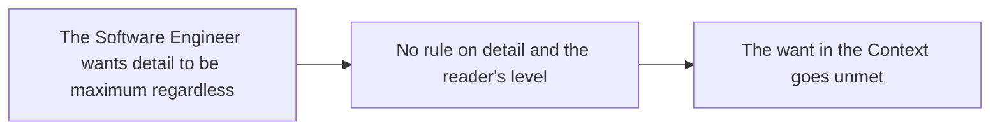
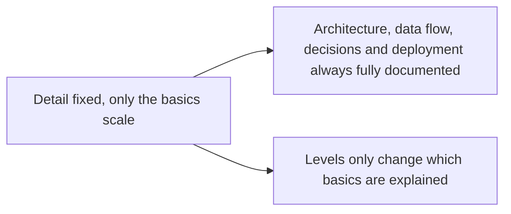

# 0005. Detail is always maximum

Status: Proposed

Date: 2026-11-14

Deciders: the Software Engineer

## Context

The Software Engineer said detail "should be maximum regardless". For an average reader, "a for loop need not be explained but the architecture of the code still need to be specified regardless".

## Decision drivers

Not recorded.

## Options

### Option 1: Scale detail to the level

The amount of detail scales with the reader's level.

*Detail itself moves with the reader's level; notice the contrast with the option that fixes the detail and scales only the basics.*

- **Pros:** Not recorded.
- **Cons:** Not recorded.
- **Evidence:** Not recorded.

### Option 2: Fix the detail and scale only the basics

The detail is fixed and only the basics scale: for an average reader, "a for loop need not be explained but the architecture of the code still need to be specified regardless".

*Only the basics follow the reader's level while the detail stays fixed; notice that the architecture of the code is specified whatever the level.*

- **Pros:** The architecture, data flow, decisions and deployment are always fully documented, and levels only change which basics are explained (both recorded as consequences).
- **Cons:** Not recorded.
- **Evidence:** Not recorded.

### Option 3: Do nothing

No rule is set on how detail relates to the reader's level.

*Doing nothing leaves the want without a rule; notice that the want is maximum detail regardless of the reader.*

- **Pros:** Not recorded.
- **Cons:** The want in the Context goes unmet: detail that "should be maximum regardless".
- **Evidence:** Not recorded.

## Comparison

| Option | What changes with the level | What stays fixed | Other trade-offs recorded |
|---|---|---|---|
| Scale detail to the level | The detail | Not recorded. | Not recorded. |
| Fix the detail and scale only the basics | Only which basics are explained | The detail: the architecture, data flow, decisions and deployment are always fully documented | Not recorded. |
| Do nothing | Not recorded. | Not recorded. | The want in the Context goes unmet, as quoted under Cons |

## Decision

The Software Engineer picked the option that fixes the detail and scales only the basics. The only reasoning the trail records is the Software Engineer's own, in the Context: detail "should be maximum regardless", and for an average reader "a for loop need not be explained but the architecture of the code still need to be specified regardless". Appendix A states the pick as: detail fixed, only basics scale. Why it beats scaling detail to the level, beyond those words: Not recorded.

## Consequences

The architecture, data flow, decisions and deployment are always fully documented. Levels only change which basics are explained.

*Fixing the detail means the architecture, data flow, decisions and deployment are always fully documented; notice that levels change only which basics are explained.*

## Revisit when

Not recorded.

## Links

- Design 1, Appendix A, 0005: [design 1](../superpowers/specs/2026-11-14-baseline-standard-design.md)
- Decision trail, entry 0005: [decision trail](../superpowers/specs/2026-11-14-baseline-decision-trail.md)
- Added at review: PR 5 of this stack (branch `standard/05-foundations`), which writes constraint C6 into `standard/01-why-and-scope.md`.
- Added at review: PR 6 of this stack (branch `standard/06-profile-and-layout`), which writes the levels into `standard/04-reader-profile.md`.
