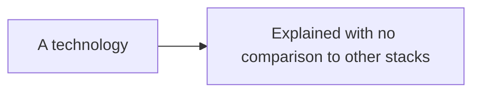
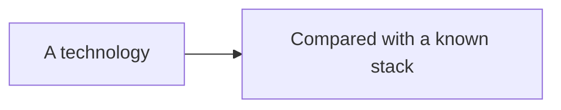
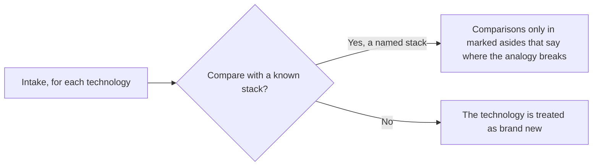
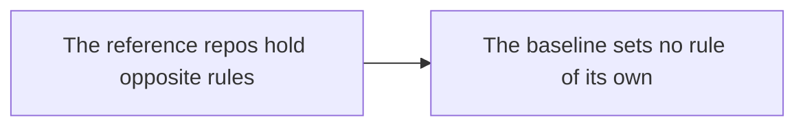
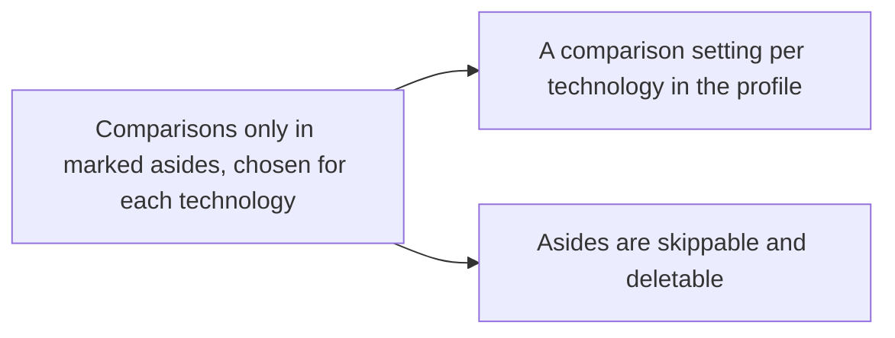

# 0006. Comparisons with a known stack

Status: Proposed

Date: 2026-11-14

Deciders: the Software Engineer

## Context

In the two reference repos, my-quote teaches Go and React through Angular and C# comparisons, while the-way says "Never compare with other stacks".

## Decision drivers

In the order the trail records them:

- The code must stay idiomatic to the stack.
- Comparisons must never replace the stack-native explanation.

## Options

### Option 1: Never compare

The documents never compare a technology with another stack.

*No technology is compared with another stack; notice that this is the-way's rule, "Never compare with other stacks".*

- **Pros:** Not recorded.
- **Cons:** Not recorded.
- **Evidence:** The trail's evidence for the decision as a whole is the two reference repos' opposite rules; the-way's rule is "Never compare with other stacks".

### Option 2: Always compare with a known stack

Every technology is compared with a known stack.

*Every technology is compared with a known stack; notice that there is no per-technology choice.*

- **Pros:** Not recorded.
- **Cons:** Not recorded.
- **Evidence:** The trail's evidence for the decision as a whole is the two reference repos' opposite rules; my-quote teaches Go and React through Angular and C# comparisons.

### Option 3: A per-technology choice at intake, with comparisons only in marked asides

At intake each technology gets a choice, either to compare with a named stack or to be treated as brand new, and comparisons appear only in marked asides that say where the analogy breaks.

*The choice is made for each technology at intake; notice that a comparison appears only in a marked aside that says where the analogy breaks.*

- **Pros:** The Software Engineer asked for exactly this prompt (recorded with the pick). The code stays idiomatic regardless (Appendix A), and asides are skippable and deletable (recorded as a consequence).
- **Cons:** Not recorded.
- **Evidence:** Not recorded. The trail's evidence for the decision as a whole is the two reference repos' opposite rules, given under the two options that match them.

### Option 4: Do nothing

The baseline sets no rule of its own on comparing with a known stack, and the only rules recorded in the Context are the two reference repos' opposite ones.

*Doing nothing leaves the baseline with no rule of its own; notice that the only rules on record are the two reference repos' opposite ones.*

- **Pros:** Not recorded.
- **Cons:** Not recorded.
- **Evidence:** Not recorded.

## Comparison

| Option | The code must stay idiomatic to the stack | Comparisons must never replace the stack-native explanation | Other trade-offs recorded |
|---|---|---|---|
| Never compare | Not recorded. | Not recorded. | Not recorded. |
| Always compare with a known stack | Not recorded. | Not recorded. | Not recorded. |
| A per-technology choice at intake, with comparisons only in marked asides | The code stays idiomatic regardless (Appendix A) | Not recorded. | A comparison setting per technology in the profile; asides are skippable and deletable (recorded as consequences) |
| Do nothing | Not recorded. | Not recorded. | Not recorded. |

## Decision

The Software Engineer picked a per-technology choice at intake, with comparisons only in marked asides. The Software Engineer asked for exactly this prompt: "whenever to compare and contrast with a known stack (the code should still be idiomatic to the stack regardless) this is just about the docs". Appendix A states the pick as: marked asides when the profile asks; code stays idiomatic regardless.

The trail's evidence is the two reference repos' opposite rules. Why it beats never comparing and always comparing, beyond the Software Engineer's words: Not recorded.

## Consequences

The profile has a comparison setting per technology. Asides are skippable and deletable.

*The choice lives in the profile as a setting for each technology; notice that the asides themselves are skippable and deletable.*

## Revisit when

Not recorded.

## Links

- Design 1, Appendix A, 0006
- Decision trail, entry 0006
- Added at review: PR 6 of this stack (branch `standard/06-profile-and-layout`), which writes the comparison setting into `standard/04-reader-profile.md`.
- Added at review: PR 8 of this stack (branch `standard/08-course`), which writes the marked aside into `standard/08-course-lessons.md`.
- Added at review: the course chapter [A project starts with the intake](../course/system/06-a-project-starts-with-the-intake.md), which follows this decision at work in the repository.
