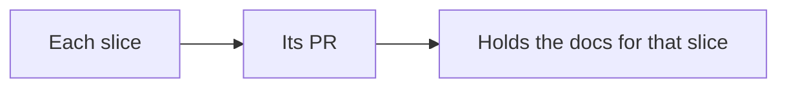
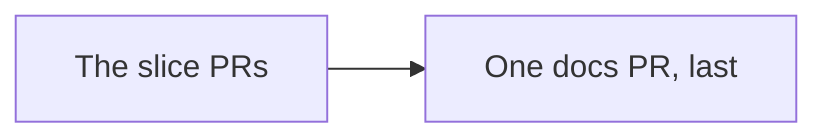
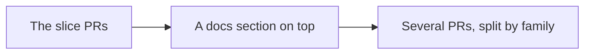
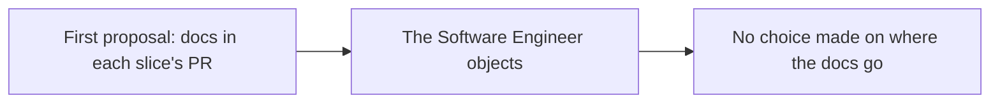
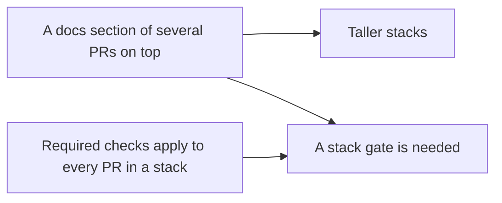

# 0007. Descriptive docs at the top of the stack

Status: Proposed

Date: 2026-11-14

Deciders: the Software Engineer

## Context

The agent that was writing the design first proposed docs in each slice's PR. The Software Engineer objected: "docs should capture what was built and not what is supposed to be built".

## Decision drivers

In the order the trail records them:

- Documents must describe the final built state.
- PRs must stay readable.

## Options

### Option 1: Docs in each slice's PR, as in the-way

The descriptive documents are written in each slice's PR, which is the-way's approach.

*The docs ride in each slice's PR; notice that this is the-way's approach and the one the Software Engineer objected to.*

- **Pros:** Not recorded.
- **Cons:** The Context records the Software Engineer's objection to it: "docs should capture what was built and not what is supposed to be built".
- **Evidence:** Not recorded. The trail's evidence is for the decision as a whole and is given under the pick.

### Option 2: One docs PR last, as in my-quote

All the descriptive documents go in one docs PR, placed last, which is my-quote's approach.

*All the docs sit in one PR that comes last; notice that this is my-quote's approach.*

- **Pros:** Not recorded.
- **Cons:** Not recorded.
- **Evidence:** Not recorded. The trail's evidence is for the decision as a whole and is given under the pick.

### Option 3: A docs section of several PRs on top, split by family

The descriptive documents form a docs section of several PRs on top of the stack, split by family.

*The docs section sits on top of the stack as several PRs; notice that the Software Engineer chose the top and the agent that was writing the design proposed the split by family.*

- **Pros:** Not recorded. The reason Appendix A gives for the pick is under Decision.
- **Cons:** Taller stacks, and a stack gate is needed because required checks apply to every PR in a stack (both recorded as consequences).
- **Evidence:** Recorded for the decision as a whole and placed here, with the pick: a real lesson is 1,195 to 1,558 lines of Markdown (`learn-rust` lessons 01 and 02) against a code slice of about 400 lines, so a per-slice lesson is three to four times the size of the code; my-quote's rebase conflicts were all on shared index and number lines.

### Option 4: Do nothing

The baseline makes no choice on where the descriptive documents go. The Context records the first proposal, docs in each slice's PR, and the Software Engineer's objection to it.

*Doing nothing leaves the objection unanswered; notice that the Context records the proposal and the objection but no replacement.*

- **Pros:** Not recorded.
- **Cons:** The problem the Context states stays: the Software Engineer objected that "docs should capture what was built and not what is supposed to be built".
- **Evidence:** Not recorded.

## Comparison

The trail records the drivers for the decision as a whole and does not say which option meets or misses which driver, so each driver column reads Not recorded.

| Option | Documents must describe the final built state | PRs must stay readable | Other trade-offs recorded |
|---|---|---|---|
| Docs in each slice's PR, as in the-way | Not recorded. | Not recorded. | The Software Engineer's objection in the Context, quoted under Cons |
| One docs PR last, as in my-quote | Not recorded. | Not recorded. | Not recorded. |
| A docs section of several PRs on top, split by family | Not recorded. | Not recorded. | Taller stacks; a stack gate is needed because required checks apply to every PR in a stack (recorded as consequences) |
| Do nothing | Not recorded. | Not recorded. | The problem the Context states, given under Cons |

## Decision

The Software Engineer chose the top of the stack, and the agent that was writing the design proposed splitting it by family: a docs section of several PRs on top. Appendix A states the pick as a docs section on top, split by family, and gives the reason that docs describe what was built, not what was meant. The Software Engineer's words in the Context, objecting to docs in each slice's PR, are: "docs should capture what was built and not what is supposed to be built".

The trail's evidence, recorded for the decision as a whole and given under the pick: a real lesson is 1,195 to 1,558 lines of Markdown (`learn-rust` lessons 01 and 02) against a code slice of about 400 lines, so a per-slice lesson is three to four times the size of the code; my-quote's rebase conflicts were all on shared index and number lines. The trail does not say which driver or option it bears on. Why the pick beats docs in each slice's PR and one docs PR last, beyond those words and that evidence: Not recorded.

## Consequences

Stacks get taller. A stack gate is needed, because required checks apply to every PR in a stack.

*The docs section makes stacks taller; notice that a stack gate is needed because required checks apply to every PR in a stack.*

## Revisit when

The stack gate cannot be made to work on GitHub's stacked-PR feature (design 1, V1).

## Links

- Design 1, Appendix A, 0007
- Decision trail, entry 0007
- Added at review: PR 5 of this stack (branch `standard/05-foundations`), which writes rule 7 of the stack into `standard/03-stack-model.md`.
- Added at review: PR 12 of this stack (branch `standard/12-docs-agent-standards-rules`), which writes the docs agent's PR order into `standard/18-docs-agent.md`.
- Added at review: the course chapter [A feature goes from brainstorm to merged stack](../course/system/02-brainstorm-to-merged-stack.md), which follows this decision at work in the repository.
- Added at review: the course chapter [The docs agent writes the docs section](../course/system/04-docs-agent-writes-the-docs-section.md), which follows this decision at work in the repository.
