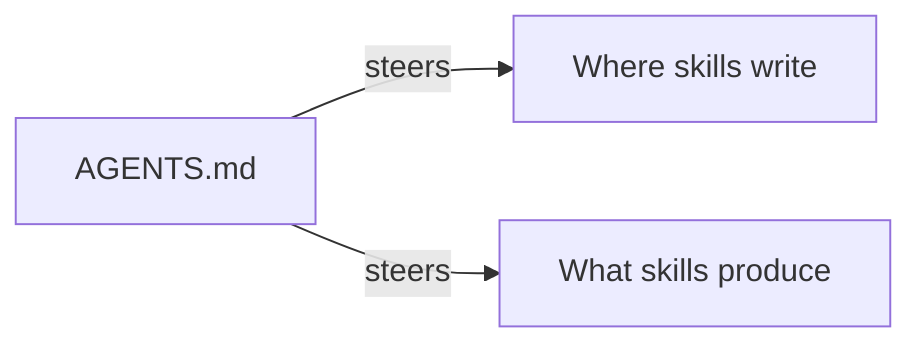
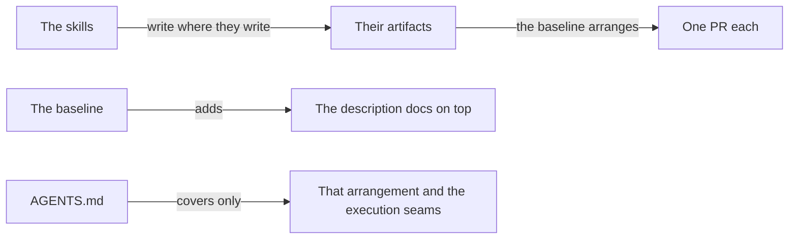
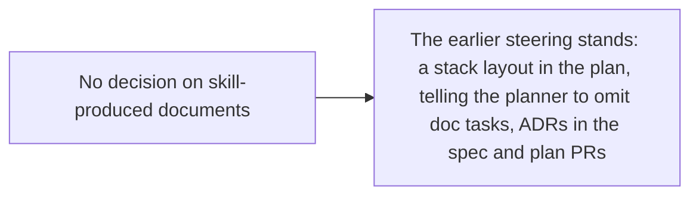
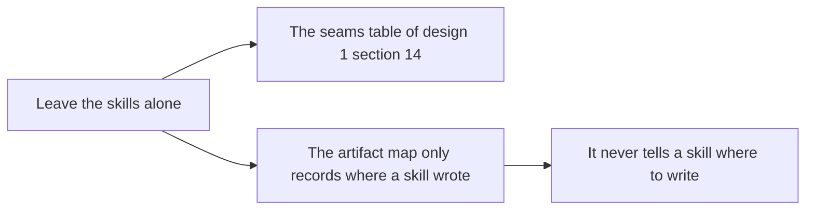

# 0010. Skill-produced artifacts

Status: Proposed

Date: 2026-11-14

Deciders: the Software Engineer

## Context

The Software Engineer: "We do not want to touch documents generated by those skills." The earlier steering of the agent that was writing the design (a stack layout in the plan, telling the planner to omit doc tasks, ADRs in the spec and plan PRs) was withdrawn. Later the Software Engineer pointed out that an earlier draft of the design said the baseline "decides where their output lands", which was misleading: superpowers can put its specs and plans wherever it wants, and the baseline only lists the additional documents that need to be built and how the PRs are arranged. The statement was corrected.

## Decision drivers

Not recorded.

## Options

### Option 1: Steer where skills write and what they produce through `AGENTS.md`

The baseline steers, through `AGENTS.md`, where the skills write and what they produce.

*AGENTS.md steers both where the skills write and what they produce; notice that the Context records the Software Engineer's words against touching the documents these skills generate.*

- **Pros:** Not recorded.
- **Cons:** The Context records the Software Engineer's words: "We do not want to touch documents generated by those skills."
- **Evidence:** Not recorded. The trail's evidence is for the decision as a whole and is given under the pick.

### Option 2: Leave the skills alone

The skills write where they write. The baseline arranges their output into one PR each and adds the description docs on top, and `AGENTS.md` covers only that arrangement and the execution seams.

*The skills write wherever they write and the baseline works around their output; notice that AGENTS.md covers only the arrangement and the execution seams.*

- **Pros:** Not recorded.
- **Cons:** The one friction the trail records, given in full under Evidence: `writing-plans` folds documentation steps into tasks, and an execution rule handles it.
- **Evidence:** Recorded for the decision as a whole and placed here, with the pick. In the superpowers 7.0.2 skill files, the spec and plan locations are overridable by user preference; `writing-plans` folds documentation steps into tasks (the one friction, handled by an execution rule); the execution skills log rulings and print "Rulings I made"; superpowers ranks `AGENTS.md` above its skills.

### Option 3: Do nothing

No decision is made on how the baseline treats the documents the skills generate, so the earlier steering of the agent that was writing the design stands: a stack layout in the plan, telling the planner to omit doc tasks, ADRs in the spec and plan PRs.

*Doing nothing leaves the earlier steering in place; notice that the Context records that steering as withdrawn.*

- **Pros:** Not recorded.
- **Cons:** The want in the Context goes unmet: "We do not want to touch documents generated by those skills."
- **Evidence:** Not recorded.

## Comparison

| Option | What the baseline does with the skills' artifacts | Recorded driver or trade-off |
|---|---|---|
| Steer where skills write and what they produce through `AGENTS.md` | Steers where the skills write and what they produce | The Software Engineer's words in the Context, quoted under Cons |
| Leave the skills alone | The skills write where they write; the baseline arranges their output into one PR each and adds the description docs on top; `AGENTS.md` covers only that arrangement and the execution seams | The one friction: `writing-plans` folds documentation steps into tasks, handled by an execution rule (given under Evidence) |
| Do nothing | Nothing is decided; the earlier steering stands | The want in the Context goes unmet, as given under Cons |

## Decision

The Software Engineer picked leaving the skills alone. The recorded reason is the Software Engineer's own, from the Context: "We do not want to touch documents generated by those skills." Appendix A states the pick as leaving the skills alone: they write where they write, and the baseline arranges their output into one PR each and adds the description docs on top; `AGENTS.md` covers only the PR arrangement and the execution seams.

The Context also records the Software Engineer's correction: superpowers can put its specs and plans wherever it wants, and the baseline only lists the additional documents that need to be built and how the PRs are arranged. The trail's evidence, recorded for the decision as a whole, is the superpowers 7.0.2 skill files, given under the pick. Why the pick beats steering through `AGENTS.md`, beyond those words and that evidence: Not recorded.

## Consequences

The decision leads to the seams table of design 1 section 14. The artifact map only records where a skill wrote; it never tells a skill where to write.

*Leaving the skills alone leads to a seams table and to an artifact map that only records; notice that the map never tells a skill where to write.*

## Revisit when

A skill changes where or how it writes its artifacts.

## Links

- Design 1, Appendix A, 0010: [design 1](../superpowers/specs/2026-11-14-baseline-standard-design.md)
- Decision trail, entry 0010: [decision trail](../superpowers/specs/2026-11-14-baseline-decision-trail.md)
- Added at review: PR 6 of this stack (branch `standard/06-profile-and-layout`), which writes the artifact map into `standard/05-project-layout.md`.
- Added at review: PR 13 of this stack (branch `standard/13-seams-tooling-index`), which writes the seams into `standard/21-skills-seams.md`.
