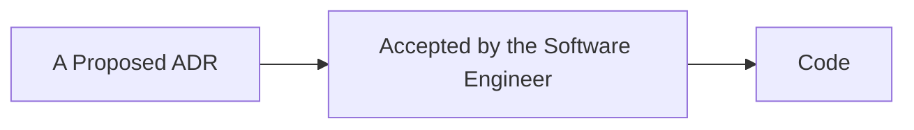
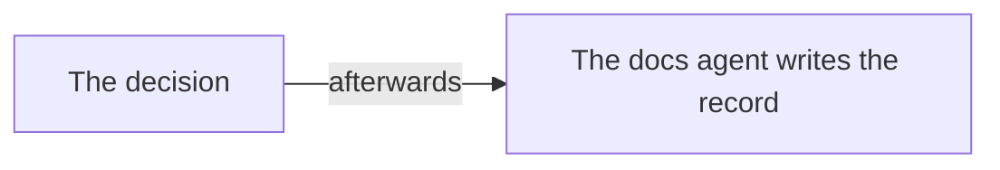
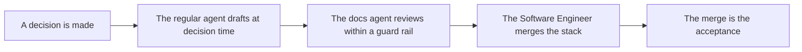
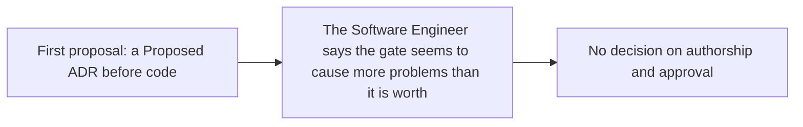
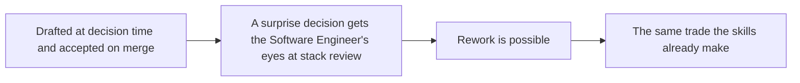

# 0011. ADR authorship and approval

Status: Proposed

Date: 2026-11-14

Deciders: the Software Engineer

## Context

The agent that was writing the design first proposed a gate (a Proposed ADR before code, accepted by the Software Engineer). The Software Engineer: "The ADR being a gate seems like it's causing more problems than it's worth it."

## Decision drivers

In the order the trail records them:

- The execution skills run continuously and settle conflicts as rulings.
- Decision-time content must not be backfilled.

## Options

### Option 1: An approval gate before code

A Proposed ADR comes before the code, and the Software Engineer accepts it.

*The gate puts the Software Engineer's acceptance before any code; notice that this is the first proposal, and the Context records the Software Engineer's reply to it.*

- **Pros:** Not recorded.
- **Cons:** The Context records the Software Engineer's words: "The ADR being a gate seems like it's causing more problems than it's worth it."
- **Evidence:** Not recorded. The trail's evidence is for the decision as a whole and is given under the pick.

### Option 2: A record written afterwards by the docs agent

The docs agent writes the record afterwards.

*The docs agent writes the record after the decision; notice that the record comes afterwards and not at the time of the decision.*

- **Pros:** Not recorded.
- **Cons:** Not recorded.
- **Evidence:** Not recorded. The trail's evidence is for the decision as a whole and is given under the pick.

### Option 3: The regular agent drafts at decision time and the docs agent reviews within a guard rail

The regular agent drafts the ADR at decision time, the docs agent reviews it within a guard rail, and the Software Engineer's merge of the stack is the acceptance.

*The draft is written at decision time and accepted on merge; notice that the Software Engineer proposed it and the agent that was writing the design added the guard rail, the draft numbering and the lifecycle.*

- **Pros:** Not recorded.
- **Cons:** A surprise decision gets the Software Engineer's eyes at stack review, so rework is possible, the same trade the skills already make (recorded as a consequence).
- **Evidence:** Recorded for the decision as a whole and placed here, with the pick: brainstorming already requires the approaches and the Software Engineer's pick; the execution skills stop only for irreversible or destructive actions, security-sensitive actions, outside side effects and a hopelessly broken plan.

### Option 4: Do nothing

No decision is made on how ADRs are authored and approved. The Context records only the first proposal, a gate, and the Software Engineer's reply to it.

*Doing nothing leaves the gate proposal and the reply to it as they stand; notice that the Context records no other way of authoring and approving ADRs.*

- **Pros:** Not recorded.
- **Cons:** The problem the Context states stays: "The ADR being a gate seems like it's causing more problems than it's worth it."
- **Evidence:** Not recorded.

## Comparison

The trail records the drivers for the decision as a whole and does not say which option meets or misses which driver, so each driver column reads Not recorded.

| Option | The execution skills run continuously and settle conflicts as rulings | Decision-time content must not be backfilled | Other trade-offs recorded |
|---|---|---|---|
| An approval gate before code | Not recorded. | Not recorded. | The Software Engineer's words in the Context, quoted under Cons |
| A record written afterwards by the docs agent | Not recorded. | Not recorded. | Not recorded. |
| The regular agent drafts at decision time and the docs agent reviews within a guard rail | Not recorded. | Not recorded. | A surprise decision gets the Software Engineer's eyes at stack review, so rework is possible, the same trade the skills already make (recorded as a consequence) |
| Do nothing | Not recorded. | Not recorded. | The problem the Context states, quoted under Cons |

## Decision

The Software Engineer picked the option in which the regular agent drafts at decision time, the docs agent reviews within a guard rail, and the Software Engineer's merge of the stack is the acceptance. The Software Engineer proposed it; the agent that was writing the design added the guard rail, the draft numbering and the lifecycle. Appendix A states the pick as the regular agent drafting at decision time, the docs agent reviewing within a guard rail, and acceptance on merge.

The recorded reason against the gate is the Software Engineer's own, from the Context: "The ADR being a gate seems like it's causing more problems than it's worth it." The trail's evidence, recorded for the decision as a whole and given under the pick: brainstorming already requires the approaches and the Software Engineer's pick; the execution skills stop only for irreversible or destructive actions, security-sensitive actions, outside side effects and a hopelessly broken plan. Why the pick beats a record written afterwards, beyond those words and that evidence: Not recorded.

## Consequences

A surprise decision gets the Software Engineer's eyes at stack review, so rework is possible. The skills already make the same trade.

*A surprise decision gets the Software Engineer's eyes at stack review; notice that rework is possible, the same trade the skills already make.*

## Revisit when

Mid-build decisions of impact prove frequent and costly.

## Links

- Design 1, Appendix A, 0011: [design 1](../superpowers/specs/2026-11-14-baseline-standard-design.md)
- Decision trail, entry 0011: [decision trail](../superpowers/specs/2026-11-14-baseline-decision-trail.md)
- Added at review: PR 9 of this stack (branch `standard/09-adrs-deployment-readme`), which writes the lifecycle and the guard rail into `standard/11-adrs.md`.
- Added at review: PR 14 of this stack (branch `standard/14-revision-1-decisions`), which records who records an acceptance (revision 1, D5).
- Added at review: PR 16 of this stack (branch `standard/16-revision-2-decisions`), which records who records a rejection, and that a status edit goes in a small PR (revision 2).
- Added at review: [ADR 0033](0033-adr-status-recording.md), which extends this decision with who records an acceptance and a rejection, in a small PR (revision 3, D2).
