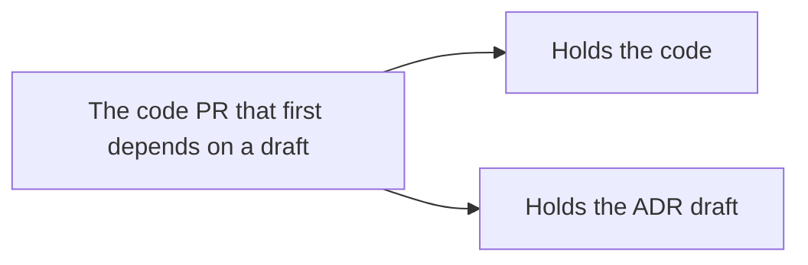
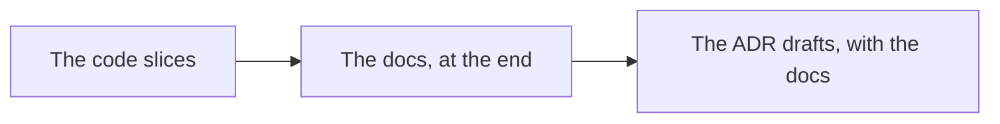
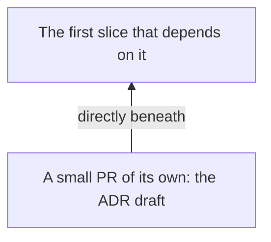
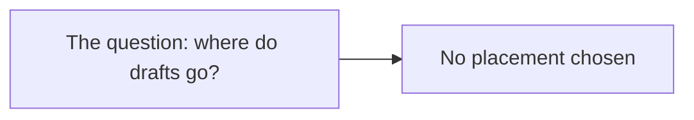
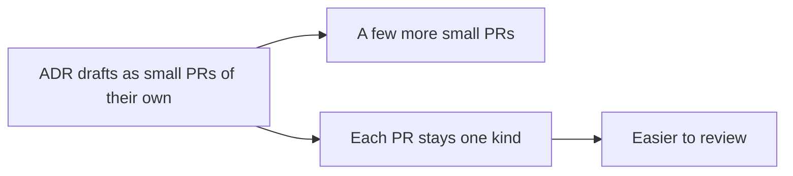

# 0012. ADR placement in the stack

Status: Proposed

Date: 2026-11-14

Deciders: the Software Engineer

## Context

After the decision on ADR authorship and approval (Appendix A, 0011), the question is where the drafts go.

## Decision drivers

Not recorded.

## Options

### Option 1: In the code PR that first depends on them

Each ADR draft goes in the code PR that first depends on it.

*The draft rides in the code PR that first depends on it; notice that the draft then shares a PR with the code.*

- **Pros:** Not recorded.
- **Cons:** Not recorded.
- **Evidence:** Not recorded.

### Option 2: At the end with the docs

The ADR drafts go at the end of the stack, with the docs.

*The drafts wait until the end and travel with the docs; notice that they come after the code slices.*

- **Pros:** Not recorded.
- **Cons:** Not recorded.
- **Evidence:** Not recorded.

### Option 3: As small PRs of their own directly beneath the first slice that depends on them

Each ADR draft is a small PR of its own, placed directly beneath the first slice that depends on it.

*The draft gets a small PR of its own directly beneath the first slice that depends on it; notice that the reviewer reads the thinking first.*

- **Pros:** Each PR stays one kind, which is easier to review (recorded as a consequence).
- **Cons:** A few more small PRs (recorded as a consequence).
- **Evidence:** Not recorded.

### Option 4: Do nothing

No placement in the stack is chosen for the drafts. The Context records only the question, where do drafts go.

*Doing nothing leaves the drafts without a place in the stack; notice that the Context records the question and no answer.*

- **Pros:** Not recorded.
- **Cons:** What stays unmet is the question in the Context: where do drafts go?
- **Evidence:** Not recorded.

## Comparison

| Option | Where the drafts go | Recorded driver or trade-off |
|---|---|---|
| In the code PR that first depends on them | In that code PR | Not recorded. |
| At the end with the docs | At the end of the stack, with the docs | Not recorded. |
| As small PRs of their own directly beneath the first slice that depends on them | In small PRs of their own, directly beneath the first slice that depends on them | A few more small PRs; each PR stays one kind, which is easier to review (recorded as consequences) |
| Do nothing | Not chosen | The question in the Context goes unanswered |

## Decision

The Software Engineer picked small PRs of their own directly beneath the first slice that depends on them. The recorded reason is the same reasoning as in Appendix A, 0009: the reviewer reads the thinking first. Appendix A states the pick as own small PRs below the slice and gives the same reason.

Why the pick beats putting the drafts in the code PR and putting them at the end with the docs, beyond that reasoning: Not recorded.

## Consequences

There are a few more small PRs. Each PR stays one kind, which is easier to review.

*Giving each draft its own PR adds a few small PRs; notice that each PR stays one kind, which is easier to review.*

## Revisit when

Not recorded.

## Links

- Design 1, Appendix A, 0012
- Decision trail, entry 0012
- Added at review: PR 5 of this stack (branch `standard/05-foundations`), which writes rule 4 of the stack into `standard/03-stack-model.md`.
- Added at review: PR 9 of this stack (branch `standard/09-adrs-deployment-readme`), which writes where a draft is committed into `standard/11-adrs.md`.
- Added at review: the course chapter [A feature goes from brainstorm to merged stack](../course/system/02-brainstorm-to-merged-stack.md), which follows this decision at work in the repository.
- Added at review: the course chapter [A decision becomes an ADR](../course/system/03-decision-to-adr.md), which follows this decision at work in the repository.
