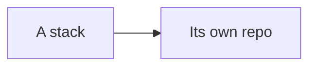
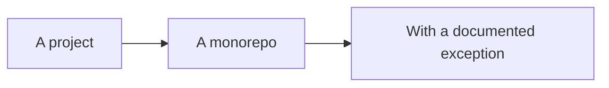
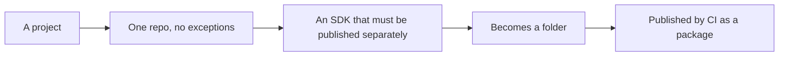
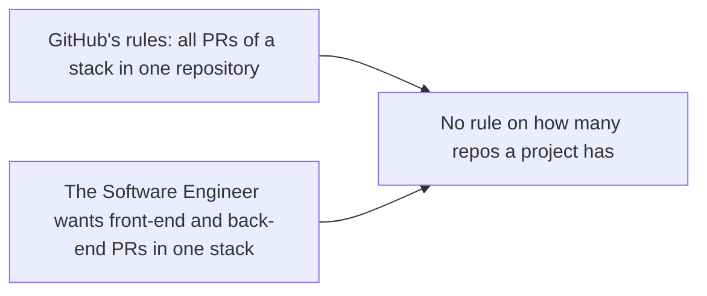
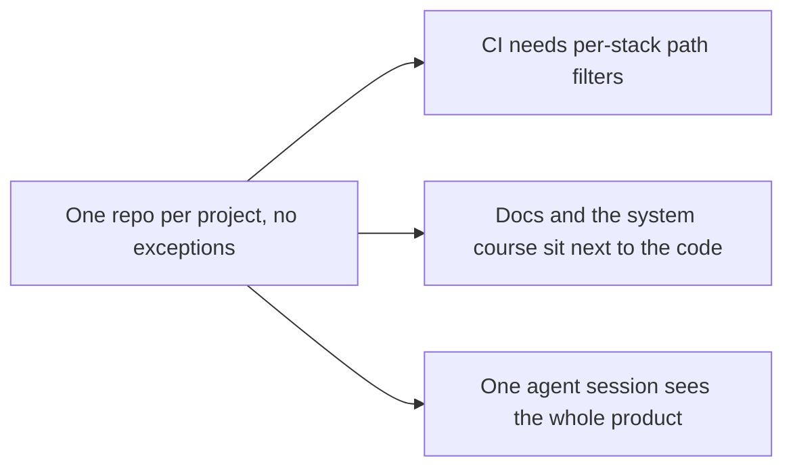

# 0013. One repo per project

Status: Proposed

Date: 2026-11-14

Deciders: the Software Engineer

## Context

GitHub's stacked-PR rules need all PRs of a stack in one repository, and the Software Engineer wants front-end and back-end PRs in one stack.

## Decision drivers

Not recorded.

## Options

### Option 1: One repo per stack

Each stack has its own repo.

*Each stack lives in its own repo; notice that the repo follows the stack and not the project.*

- **Pros:** Not recorded.
- **Cons:** Not recorded.
- **Evidence:** Not recorded. The trail's evidence is for the decision as a whole and is given under the pick.

### Option 2: A monorepo with a documented exception

The project is a monorepo, with a documented exception.

*The project is a monorepo with a documented exception; notice that the exception is what separates it from the pick, a monorepo with no exceptions.*

- **Pros:** Not recorded.
- **Cons:** Not recorded.
- **Evidence:** Not recorded. The trail's evidence is for the decision as a whole and is given under the pick.

### Option 3: A monorepo with no exceptions

There is only one repo per project, with no exceptions. An SDK that must be published separately becomes a folder published by CI as a package.

*The project keeps one repo even for an SDK that must be published separately; notice that CI publishes the SDK folder as a package.*

- **Pros:** One agent session sees the whole product (recorded as a consequence).
- **Cons:** CI needs per-stack path filters (recorded as a consequence).
- **Evidence:** Recorded for the decision as a whole and placed here, with the pick: GitHub's rules as recorded in the Software Engineer's `learn-rust` design (same repository, bottom-up merge, linear history, required checks per PR); my-quote is already a monorepo with `api/`, `app/` and `desktop/`.

### Option 4: Do nothing

No rule is set on how many repos a project has. The Context records two things: GitHub's stacked-PR rules need all PRs of a stack in one repository, and the Software Engineer wants front-end and back-end PRs in one stack.

*Doing nothing sets no rule on repos; notice that the Context records both a GitHub rule and the Software Engineer's want about stacks.*

- **Pros:** Not recorded.
- **Cons:** The want in the Context stays without a rule: the Software Engineer wants front-end and back-end PRs in one stack, and GitHub's stacked-PR rules need all PRs of a stack in one repository.
- **Evidence:** Not recorded.

## Comparison

| Option | What it means | Recorded driver or trade-off |
|---|---|---|
| One repo per stack | Each stack has its own repo | Not recorded. |
| A monorepo with a documented exception | One repo, with a documented exception | Not recorded. |
| A monorepo with no exceptions | One repo per project; an SDK that must be published separately becomes a folder published by CI as a package | CI needs per-stack path filters; docs and the system course sit next to the code; one agent session sees the whole product (recorded as consequences) |
| Do nothing | No rule on how many repos a project has | The want in the Context stays without a rule, as given under Cons |

## Decision

The Software Engineer picked a monorepo with no exceptions. The recorded reason is the Software Engineer's own: "There will only be one repo per project, and this is an intentional pattern and rule that we will not break apart from." An SDK that must be published separately becomes a folder published by CI as a package. Appendix A states the pick as one repo, no exceptions, and gives the reason that stacks cannot span repos and agents see the whole product.

The trail's evidence, recorded for the decision as a whole and given under the pick: GitHub's rules as recorded in the Software Engineer's `learn-rust` design (same repository, bottom-up merge, linear history, required checks per PR); my-quote is already a monorepo with `api/`, `app/` and `desktop/`. Why the pick beats one repo per stack and a monorepo with a documented exception, beyond those words and that evidence: Not recorded.

## Consequences

CI needs per-stack path filters. Docs and the system course sit next to the code. One agent session sees the whole product.

*One repo makes CI need per-stack path filters; notice that the docs and the system course sit next to the code and one agent session sees the whole product.*

## Revisit when

Not recorded.

## Links

- Design 1, Appendix A, 0013: [design 1](../superpowers/specs/2026-11-14-baseline-standard-design.md)
- Decision trail, entry 0013: [decision trail](../superpowers/specs/2026-11-14-baseline-decision-trail.md)
- Added at review: PR 5 of this stack (branch `standard/05-foundations`), which writes constraint C1 into `standard/01-why-and-scope.md`.
