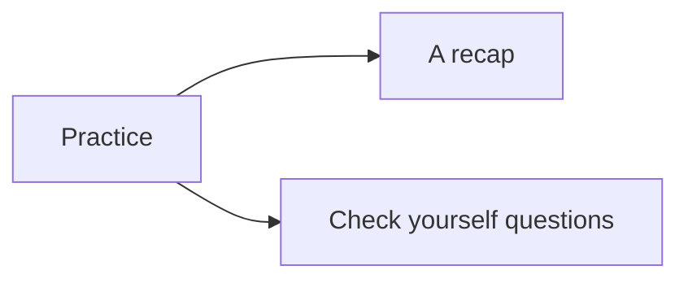
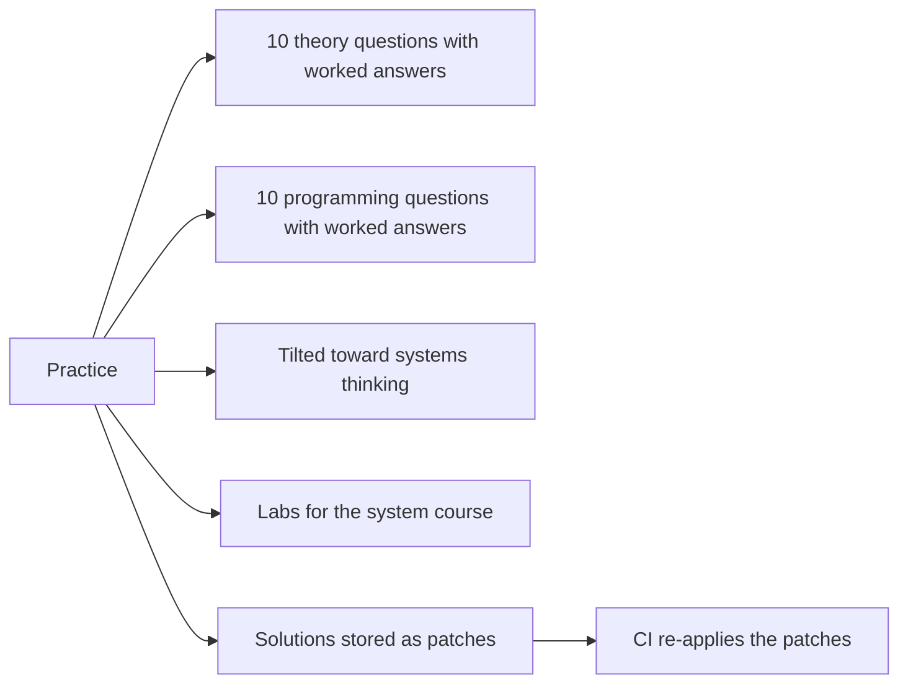
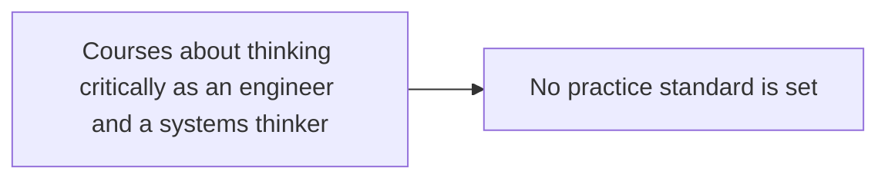
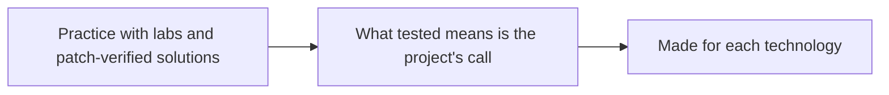

# 0016. Practice standard

Status: Proposed

Date: 2026-11-14

Deciders: the Software Engineer

## Context

The Software Engineer said the courses are "about getting the regular person to think critically as an engineer and a systems thinker", relevant to the code base "but also very systems critical thinking like".

## Decision drivers

Not recorded.

## Options

### Option 1: A recap with "check yourself" questions, as in my-quote

Practice is a recap with "check yourself" questions, as in my-quote.

*Practice is a recap with check-yourself questions; notice that the trail attributes this format to my-quote.*

- **Pros:** Not recorded.
- **Cons:** Not recorded.
- **Evidence:** Not recorded.

### Option 2: `learn-rust`'s 10 theory and 10 programming questions, tilted toward systems thinking, with labs and patch-verified solutions

Practice is `learn-rust`'s 10 theory and 10 programming questions with worked answers, tilted toward systems thinking, with labs for the system course and solutions stored as patches that CI re-applies.

*Practice is questions with worked answers plus labs; notice that solutions are stored as patches that CI re-applies.*

- **Pros:** The patch approach automates re-running solutions when the code changes (recorded with the evidence). The practice is anchored in the codebase (Appendix A).
- **Cons:** Not recorded.
- **Evidence:** The `learn-rust` lesson template, and a note in my-quote's exercises chapter that its solutions needed re-running when code changed, which the patch approach automates.

### Option 3: Do nothing

No practice standard is set for the courses.

*Doing nothing leaves the courses without a practice standard; notice that the Context records what the courses are about.*

- **Pros:** Not recorded.
- **Cons:** The aim in the Context stays without a practice standard: courses "about getting the regular person to think critically as an engineer and a systems thinker", relevant to the code base "but also very systems critical thinking like".
- **Evidence:** Not recorded.

## Comparison

| Option | Systems thinking | Anchored in the codebase | Solutions kept in step with the code | Other trade-offs recorded |
|---|---|---|---|---|
| A recap with "check yourself" questions, as in my-quote | Not recorded. | Not recorded. | Not recorded. | Not recorded. |
| `learn-rust`'s 10 theory and 10 programming questions, tilted toward systems thinking, with labs and patch-verified solutions | Tilted toward systems thinking (the option as put) | Anchored in the codebase (Appendix A) | The patch approach automates re-running solutions when the code changes | What "tested" means is the project's call per technology (recorded as a consequence) |
| Do nothing | Not recorded. | Not recorded. | Not recorded. | The aim in the Context stays without a practice standard, as quoted under Cons |

## Decision

The Software Engineer picked `learn-rust`'s 10 theory and 10 programming questions with worked answers, tilted toward systems thinking, with labs for the system course and solutions stored as patches that CI re-applies. The Software Engineer approved the mix: 3 predict, 3 diagnose, 2 design trade-offs, 2 systems reasoning. Appendix A states the pick as: 10 + 10 plus labs, anchored in the codebase.

The trail's evidence is the `learn-rust` lesson template and a note in my-quote's exercises chapter that its solutions needed re-running when code changed, which the patch approach automates. Why it beats the recap with "check yourself" questions, beyond that evidence: Not recorded.

## Consequences

What "tested" means is the project's call per technology.

*The meaning of tested is left to the project; notice that the call is made for each technology.*

## Revisit when

Not recorded.

## Links

- Design 1, Appendix A, 0016: [design 1](../superpowers/specs/2026-11-14-baseline-standard-design.md)
- Decision trail, entry 0016: [decision trail](../superpowers/specs/2026-11-14-baseline-decision-trail.md)
- Added at review: PR 8 of this stack (branch `standard/08-course`), which writes the practice standard and the labs into `standard/08-course-lessons.md` and `standard/09-course-system-chapters.md`.
