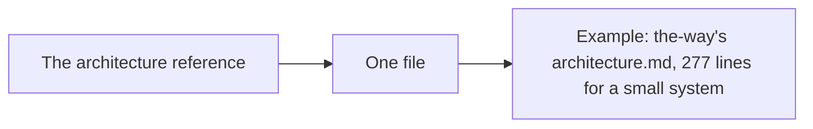
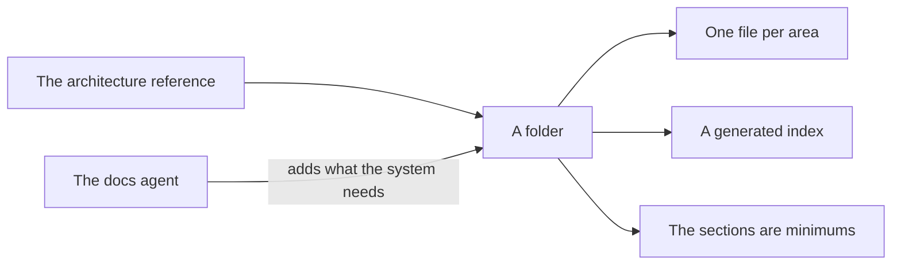
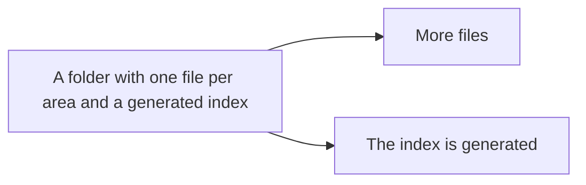

# 0017. Architecture reference form

Status: Proposed

Date: 2026-11-14

Deciders: the Software Engineer

## Context

Not recorded. The trail entry has no Context for this decision. The decision is the form that the architecture reference takes.

## Decision drivers

Not recorded.

## Options

### Option 1: One file, as in the-way

The architecture reference is one file, as in the-way's `architecture.md`, which is 277 lines for a small system.

*The whole reference is one file; notice that the trail's example, the-way's architecture.md, is 277 lines for a small system.*

- **Pros:** Not recorded.
- **Cons:** Not recorded.
- **Evidence:** Not recorded. The trail's evidence is for the decision as a whole and is given under the pick.

### Option 2: A folder with one file per area and a generated index

The architecture reference is a folder with one file per area and a generated index. The sections are minimums, and the docs agent adds what the system needs.

*The reference is a folder with a file for each area and a generated index; notice that the sections are minimums and the docs agent adds what the system needs.*

- **Pros:** Not recorded. The reason Appendix A gives for the pick is under Decision.
- **Cons:** Not recorded.
- **Evidence:** Recorded for the decision as a whole and placed here, with the pick: the-way's single file already mixes product information (the capability matrix, the page list) with technical content.

### Option 3: Do nothing

No form is chosen for the architecture reference, and because the trail entry has no Context the situation before the decision is not recorded.

*With no form chosen, nothing says how the architecture reference is laid out; notice that the trail records no Context for this decision.*

- **Pros:** Not recorded.
- **Cons:** Not recorded.
- **Evidence:** Not recorded.

## Comparison

The trail records no drivers for this decision, so the table has no driver columns. The consequences it records for the pick are given under Consequences; the trail does not call them advantages or drawbacks.

| Option | Form of the reference | Other trade-offs recorded |
|---|---|---|
| One file, as in the-way | One file; the-way's `architecture.md` is 277 lines for a small system | Not recorded. |
| A folder with one file per area and a generated index | One file per area and a generated index; the sections are minimums and the docs agent adds what the system needs | Not recorded. |
| Do nothing | No form chosen | Not recorded. |

## Decision

The Software Engineer approved the proposal to make the architecture reference a folder with one file per area and a generated index. The trail does not say who made the proposal. The recorded reason is that a line-by-line read and a PR review stay manageable. The sections are minimums, and the docs agent adds what the system needs. Appendix A states the pick as a folder, with the reason manageable reads and reviews.

The trail's evidence, recorded for the decision as a whole and given under the pick: the-way's single file already mixes product information (the capability matrix, the page list) with technical content. The trail does not say which option it bears on. Why a folder beats one file, beyond that reason and that evidence: Not recorded.

## Consequences

There are more files. The index is generated.

*The folder form means more files; notice that the index is generated.*

## Revisit when

Not recorded.

## Links

- Design 1, Appendix A, 0017
- Decision trail, entry 0017
- Added at review: PR 7 of this stack (branch `standard/07-feature-and-architecture`), which writes the architecture reference into `standard/07-architecture-reference.md`.
