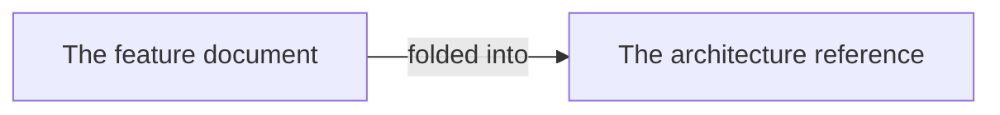
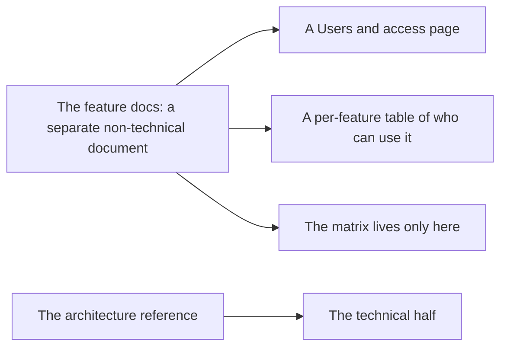
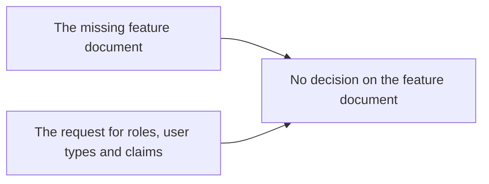
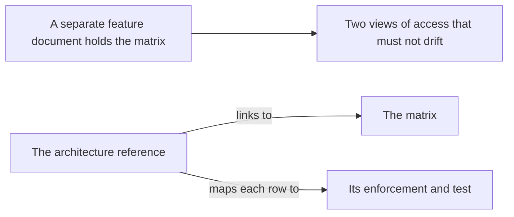

# 0018. Feature docs

Status: Proposed

Date: 2026-11-14

Deciders: the Software Engineer

## Context

The Software Engineer added the missing document: "the feature document is one that explains the system from the interactions point of view, something that is a non-technical document that explains what our application is capable of", then asked for roles, user types and claims.

## Decision drivers

Not recorded.

## Options

### Option 1: Fold the feature document into the architecture reference

The feature document is folded into the architecture reference.

*The feature document becomes part of the architecture reference; notice that it is then not a document of its own.*

- **Pros:** Not recorded.
- **Cons:** Not recorded.
- **Evidence:** Not recorded. The trail's evidence is for the decision as a whole and is given under the pick.

### Option 2: A separate non-technical document with a Users and access page and a per-feature "who can use it" table

The feature view is a separate non-technical document, with a Users and access page and a per-feature "who can use it" table. The technical half stays in the architecture reference. The matrix lives only in the feature docs.

*The feature docs and the architecture reference are separate documents; notice that the matrix lives only in the feature docs.*

- **Pros:** Not recorded.
- **Cons:** Not recorded.
- **Evidence:** Recorded for the decision as a whole and placed here, with the pick: the-way keeps its capability matrix inside `architecture.md`.

### Option 3: Do nothing

No decision is made on the feature document. The Context records that the Software Engineer added the missing document and then asked for roles, user types and claims, and with no decision both stay unmet.

*Doing nothing leaves the missing document and the request without an answer; notice that the Context records both.*

- **Pros:** Not recorded.
- **Cons:** The problem the Context states stays: the missing document, "the feature document is one that explains the system from the interactions point of view, something that is a non-technical document that explains what our application is capable of", has no decision, and the request for roles, user types and claims has no answer.
- **Evidence:** Not recorded.

## Comparison

The trail records no drivers for this decision, so the table has no driver columns. The consequences it records for the pick are given under Consequences; the trail does not call them advantages or drawbacks.

| Option | Where the feature view lives | Other trade-offs recorded |
|---|---|---|
| Fold the feature document into the architecture reference | Inside the architecture reference | Not recorded. |
| A separate non-technical document with a Users and access page and a per-feature "who can use it" table | In a separate non-technical document; the technical half stays in the architecture reference; the matrix lives only in the feature docs | Not recorded. |
| Do nothing | No decision is made | The problem the Context states, given under Cons |

## Decision

The Software Engineer picked a separate non-technical document, with a Users and access page and a per-feature "who can use it" table, and the technical half in the architecture reference. The matrix lives only in the feature docs. Appendix A states the pick as a separate non-technical document, with the access matrix living only there. Why the pick beats folding the feature document into the architecture reference, beyond those words: Not recorded.

The trail's evidence, recorded for the decision as a whole and given under the pick: the-way keeps its capability matrix inside `architecture.md`. The trail does not say which option it bears on.

## Consequences

There are two views of access that must not drift. The architecture reference links to the matrix and maps each row to its enforcement and test.

*The architecture reference links to the matrix and maps each row to its enforcement and test; notice that the two views of access must not drift.*

## Revisit when

Not recorded.

## Links

- Design 1, Appendix A, 0018
- Decision trail, entry 0018
- Added at review: PR 7 of this stack (branch `standard/07-feature-and-architecture`), which writes the feature docs into `standard/06-feature-docs.md`.
