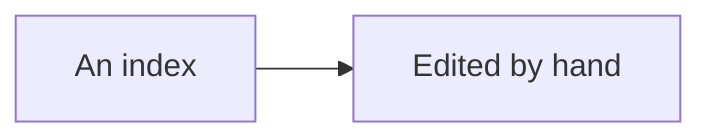
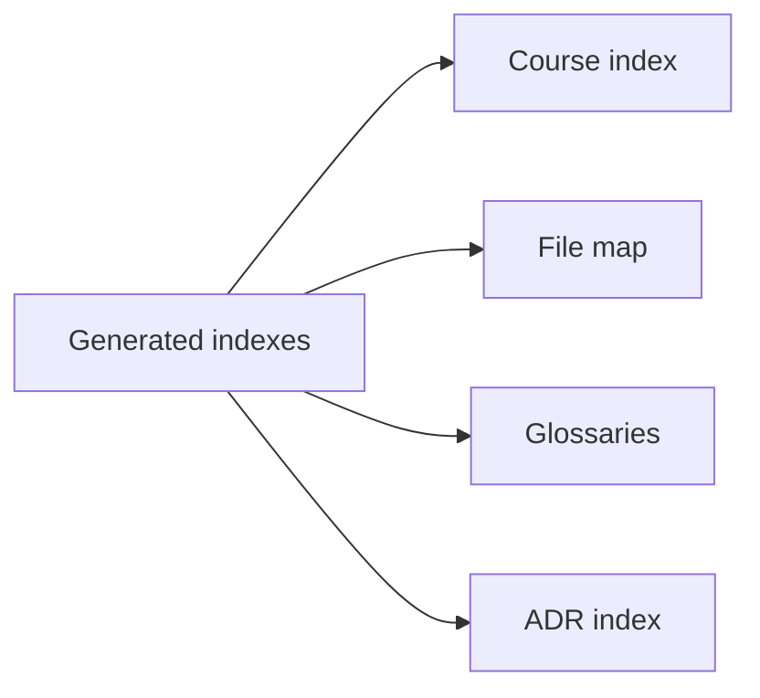
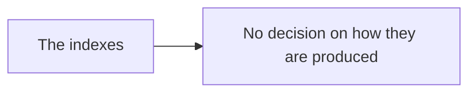
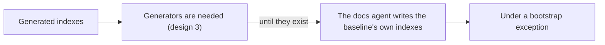

# 0019. Indexes

Status: Proposed

Date: 2026-11-14

Deciders: the Software Engineer

## Context

Not recorded. The trail entry has no Context for this decision. The decision is how the indexes are produced.

## Decision drivers

Not recorded.

## Options

### Option 1: Hand-edited indexes

The indexes are hand-edited.

*An index is edited by hand; notice that no generator produces it.*

- **Pros:** Not recorded.
- **Cons:** Not recorded.
- **Evidence:** Not recorded. The trail's evidence is for the decision as a whole and is given under the pick.

### Option 2: Generated indexes

The indexes are generated: the course index, the file map, the glossaries and the ADR index.

*The course index, the file map, the glossaries and the ADR index are generated; notice that this needs generators (design 3).*

- **Pros:** Not recorded. The reason Appendix A gives for the pick is under Decision.
- **Cons:** Not recorded.
- **Evidence:** Recorded for the decision as a whole and placed here, with the pick: my-quote's cascading rebases conflicted on number lines in shared files; `learn-rust` avoided it by never editing a shared index.

### Option 3: Do nothing

No decision is made on how the indexes are produced, and because the trail entry has no Context the situation before the decision is not recorded.

*Doing nothing leaves the way the indexes are produced undecided; notice that the trail records no Context for this decision.*

- **Pros:** Not recorded.
- **Cons:** Not recorded.
- **Evidence:** Not recorded.

## Comparison

The trail records no drivers for this decision, so the table has no driver columns. The consequences it records for the pick are given under Consequences; the trail does not call them advantages or drawbacks.

| Option | How the indexes are produced | Other trade-offs recorded |
|---|---|---|
| Hand-edited indexes | By hand | Not recorded. |
| Generated indexes | Generated: the course index, the file map, the glossaries and the ADR index | Not recorded. |
| Do nothing | No decision is made | Not recorded. |

## Decision

The pick is generated indexes: the course index, the file map, the glossaries and the ADR index.

Proposed by the agent that wrote design 1; approved by the Software Engineer.

Appendix A states the pick as generated and gives the reason that there are no rebase conflicts on shared files. The trail's evidence, recorded for the decision as a whole and given under the pick: my-quote's cascading rebases conflicted on number lines in shared files; `learn-rust` avoided it by never editing a shared index. The trail does not say which option it bears on. Why generated indexes beat hand-edited ones, beyond that reason and that evidence: Not recorded.

## Consequences

Generators are needed (design 3). Until they exist, the baseline's own indexes are written by the docs agent under a bootstrap exception.

*Generated indexes need generators (design 3); notice that until they exist the docs agent writes the baseline's own indexes under a bootstrap exception.*

## Revisit when

Not recorded.

## Links

- Design 1, Appendix A, 0019: [design 1](../superpowers/specs/2026-11-14-baseline-standard-design.md)
- Decision trail, entry 0019: [decision trail](../superpowers/specs/2026-11-14-baseline-decision-trail.md)
- Added at review: PR 11 of this stack (branch `standard/11-diagrams-and-evidence`), which writes the evidence rule on generated indexes into `standard/17-evidence-and-truth.md`.
- Added at review: PR 14 of this stack (branch `standard/14-revision-1-decisions`), which records the five generated indexes and the place of the course index (revision 1, D7).
- Added at review: PR 15 of this stack (branch `standard/15-revision-1-standard`), which writes the five indexes into `standard/05-project-layout.md`, `standard/10-course-reference-pages.md` and `standard/17-evidence-and-truth.md`.
