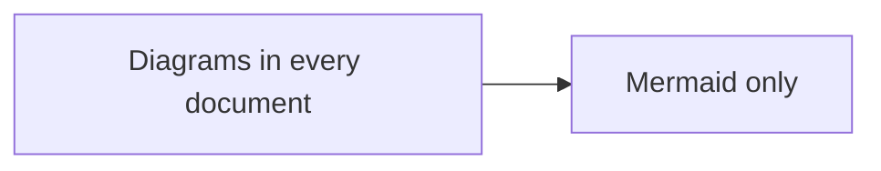
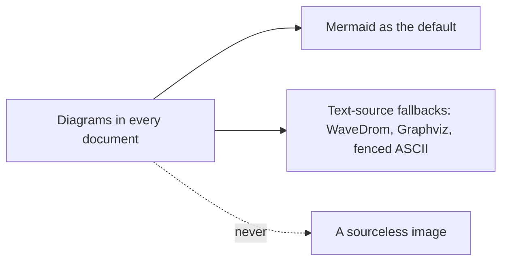
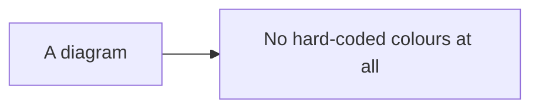
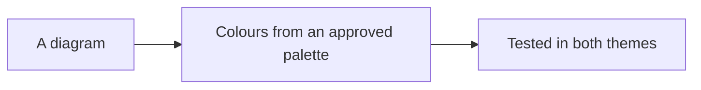
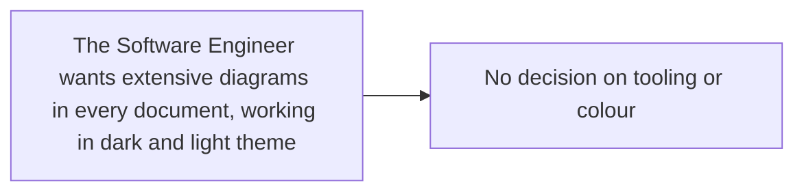
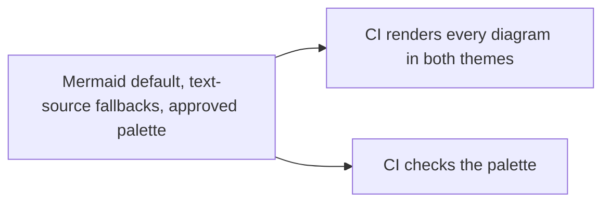

# 0020. Diagram tooling and theme

Status: Proposed

Date: 2026-11-14

Deciders: the Software Engineer

## Context

The Software Engineer wants extensive diagrams in every document, that work in dark and light theme, and always reviews in dark.

## Decision drivers

Not recorded.

## Options

The trail's options answer a question about how diagrams are made and a question about colour. The pick takes an answer to each. Appendix A's row also lists images among the options considered; the trail records them only as the sourceless images that the option of Mermaid as the default with text-source fallbacks never allows, so they have no option of their own.

### Option 1: Mermaid only

Diagrams are made with Mermaid only.

*Every diagram is made with Mermaid; notice that no other tool is allowed.*

- **Pros:** Not recorded.
- **Cons:** Not recorded.
- **Evidence:** Not recorded. The trail's evidence is for the decision as a whole and is given under the approved palette option, the colour part of the pick.

### Option 2: Mermaid as the default, with text-source fallbacks and never a sourceless image

Mermaid is the default. The text-source fallbacks are WaveDrom, Graphviz and fenced ASCII, and a diagram is never a sourceless image.

*Mermaid is the default and the text-source fallbacks are WaveDrom, Graphviz and fenced ASCII; notice that a sourceless image is never allowed.*

- **Pros:** Not recorded.
- **Cons:** Not recorded.
- **Evidence:** Not recorded. The trail's evidence is for the decision as a whole and is given under the approved palette option, the colour part of the pick.

### Option 3: For colour, no hard-coded colours at all

No diagram hard-codes any colour.

*No diagram sets a colour of its own; notice that this option answers the colour question and not the tooling question.*

- **Pros:** Not recorded.
- **Cons:** Not recorded.
- **Evidence:** Not recorded. The trail's evidence is for the decision as a whole and is given under the approved palette option, the colour part of the pick.

### Option 4: For colour, an approved palette tested in both themes

Diagram colours come from an approved palette that is tested in both themes. The pick makes it an approved translucent-tint palette.

*Colours come from an approved palette tested in both themes; notice that the pick makes it a translucent-tint palette.*

- **Pros:** Not recorded.
- **Cons:** Not recorded.
- **Evidence:** Recorded for the decision as a whole and placed here, with the pick: a test render with Mermaid 12.3.0 (the version `learn-rust` pins): a first palette of solid fills with white text looked fine in dark and failed in light (white text on white rows); a translucent tint with a solid coloured border and no text colour worked in both.

### Option 5: Do nothing

No decision is made on diagram tooling or colour, so the baseline sets no rule on how diagrams are made or coloured.

*Doing nothing leaves the want without a rule; notice that the Context records that the Software Engineer always reviews in dark.*

- **Pros:** Not recorded.
- **Cons:** The want in the Context stays without a rule: extensive diagrams in every document, that work in dark and light theme, for a Software Engineer who always reviews in dark.
- **Evidence:** Not recorded.

## Comparison

The trail records no drivers for this decision, so the table has no driver columns. The consequence it records for the pick is given under Consequences; the trail does not call it an advantage or a drawback.

| Option | Question it answers | What it means | Other trade-offs recorded |
|---|---|---|---|
| Mermaid only | How diagrams are made | Every diagram is made with Mermaid | Not recorded. |
| Mermaid as the default, with text-source fallbacks and never a sourceless image | How diagrams are made | Mermaid by default; WaveDrom, Graphviz and fenced ASCII as text-source fallbacks; never a sourceless image | Not recorded. |
| For colour, no hard-coded colours at all | Colour | No diagram sets a colour of its own | Not recorded. |
| For colour, an approved palette tested in both themes | Colour | An approved palette, tested in both themes; the pick makes it a translucent-tint palette | Not recorded. |
| Do nothing | Both | No rule on tooling or colour | The want in the Context stays without a rule, as given under Cons |

## Decision

The Software Engineer approved Mermaid as the default, with text-source fallbacks and never a sourceless image, together with an approved translucent-tint palette for colour. Appendix A states the pick as: Mermaid default, text-source fallbacks, no sourceless images, dark first, approved tinted palette. The Context records that the Software Engineer always reviews in dark.

The trail's evidence, recorded for the decision as a whole and given under the pick: a test render with Mermaid 12.3.0 (the version `learn-rust` pins): a first palette of solid fills with white text looked fine in dark and failed in light (white text on white rows); a translucent tint with a solid coloured border and no text colour worked in both. Why the pick beats Mermaid only and no hard-coded colours at all, beyond that evidence: Not recorded.

## Consequences

CI renders every diagram in both themes and checks the palette.

*CI renders every diagram in both themes and checks the palette; notice that the render covers every diagram.*

## Revisit when

GitHub's bundled Mermaid proves not to render the styling (design 1, V2).

## Links

- Design 1, Appendix A, 0020
- Decision trail, entry 0020
- Added at review: PR 11 of this stack (branch `standard/11-diagrams-and-evidence`), which writes the diagram rules and the approved palette into `standard/16-diagrams.md`.
- Added at review: PR 14 of this stack (branch `standard/14-revision-1-decisions`), which records that mind maps are dropped and that fenced ASCII is its own source (revision 1, D9 and D11).
- Added at review: PR 15 of this stack (branch `standard/15-revision-1-standard`), which writes both into `standard/16-diagrams.md`.
- Added at review: the course chapter [How documents stay true](../course/system/07-how-documents-stay-true.md), which follows this decision at work in the repository.
- Added at review: the lesson [Flowcharts](../course/languages/mermaid/01-flowcharts.md), which teaches what this decision chose.
- Added at review: the lesson [Entity-relationship diagrams and the palette](../course/languages/mermaid/03-entity-relationship-diagrams-and-the-palette.md), which teaches what this decision chose.
