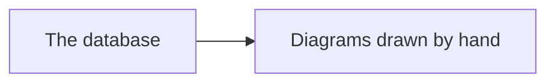
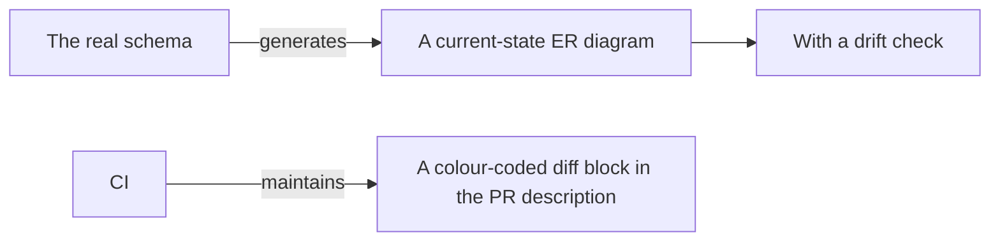
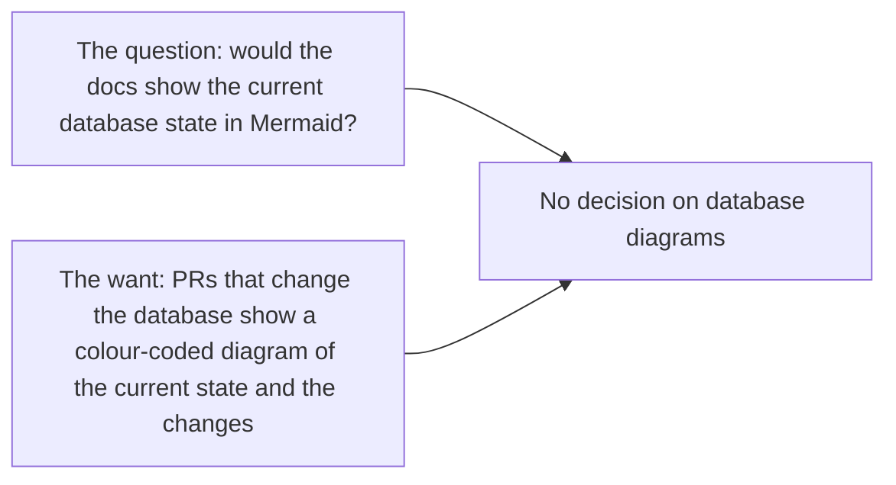
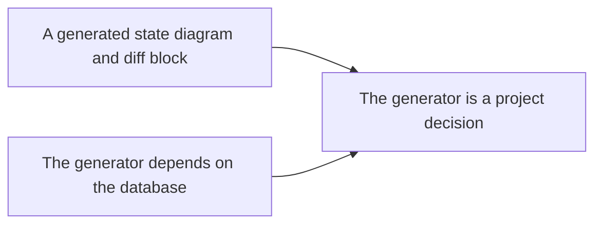

# 0021. Database diagrams

Status: Proposed

Date: 2026-11-14

Deciders: the Software Engineer

## Context

The Software Engineer asked whether the docs would show the current database state in Mermaid and wants PRs that change the database to show a colour-coded diagram of the current state and the changes.

## Decision drivers

Not recorded.

## Options

### Option 1: Hand-drawn diagrams

The database diagrams are drawn by hand.

*The diagrams are drawn by hand; notice that they are not generated.*

- **Pros:** Not recorded.
- **Cons:** Not recorded.
- **Evidence:** Not recorded. The trail's evidence is for the decision as a whole and is given under the pick.

### Option 2: A current-state ER diagram generated from the real schema with a drift check, plus a CI-maintained colour-coded diff block in the PR description

A current-state ER diagram is generated from the real schema, with a drift check, and CI maintains a colour-coded diff block in the PR description.

*The current-state diagram is generated from the real schema with a drift check, and CI maintains the colour-coded diff block in the PR description; notice that the diagram is generated and not drawn.*

- **Pros:** Not recorded.
- **Cons:** Not recorded.
- **Evidence:** Recorded for the decision as a whole and placed here, with the pick: the same test render as in the decision on diagram tooling and theme (Appendix A, 0020): Mermaid colours whole tables only, so column and relationship changes are marked with `+`, `~` and `-` in text.

### Option 3: Do nothing

No decision is made on database diagrams. The Context records the Software Engineer's question, whether the docs would show the current database state in Mermaid, and the want that PRs that change the database show a colour-coded diagram of the current state and the changes.

*Doing nothing leaves the question and the want without an answer; notice that the Context records both.*

- **Pros:** Not recorded.
- **Cons:** The question and the want in the Context stay without an answer: whether the docs would show the current database state in Mermaid, and PRs that change the database showing a colour-coded diagram of the current state and the changes.
- **Evidence:** Not recorded.

## Comparison

The trail records no drivers for this decision, so the table has no driver columns. The consequence it records for the pick is given under Consequences; the trail does not call it an advantage or a drawback.

| Option | How the diagrams are made | Other trade-offs recorded |
|---|---|---|
| Hand-drawn diagrams | Drawn by hand | Not recorded. |
| A current-state ER diagram generated from the real schema with a drift check, plus a CI-maintained colour-coded diff block in the PR description | A current-state ER diagram generated from the real schema, with a drift check; a colour-coded diff block in the PR description, maintained by CI | Not recorded. |
| Do nothing | No decision is made | The question and the want in the Context stay without an answer, as given under Cons |

## Decision

The Software Engineer picked the current-state ER diagram generated from the real schema with a drift check, plus the CI-maintained colour-coded diff block in the PR description. Appendix A states the pick as: generated, drift-checked, with a CI-maintained diff block in PRs. The trail gives no separate reason; the Context records what the Software Engineer asked and wants.

The trail's evidence, recorded for the decision as a whole and given under the pick, is the same test render as in the decision on diagram tooling and theme (Appendix A, 0020): Mermaid colours whole tables only, so column and relationship changes are marked with `+`, `~` and `-` in text. The trail does not say which option it bears on. Why the pick beats hand-drawn diagrams, beyond those words: Not recorded.

## Consequences

The generator is a project decision because it depends on the database.

*The generator is a project decision; notice that the reason is that it depends on the database.*

## Revisit when

The same signal as for the diagram tooling and theme decision (Appendix A, 0020): GitHub's bundled Mermaid proves not to render the styling.

## Links

- Design 1, Appendix A, 0021: [design 1](../superpowers/specs/2026-11-14-baseline-standard-design.md)
- Decision trail, entry 0021: [decision trail](../superpowers/specs/2026-11-14-baseline-decision-trail.md)
- Added at review: PR 7 of this stack (branch `standard/07-feature-and-architecture`), which writes the current-state database diagram into `standard/07-architecture-reference.md`.
- Added at review: PR 10 of this stack (branch `standard/10-pr-descriptions-and-agents`), which writes the schema diagram of a PR into `standard/14-pr-descriptions.md`.
- Added at review: PR 11 of this stack (branch `standard/11-diagrams-and-evidence`), which writes the database diagram rules into `standard/16-diagrams.md`.
- Added at review: the course chapter [How documents stay true](../course/system/07-how-documents-stay-true.md), which follows this decision at work in the repository.
- Added at review: the lesson [Entity-relationship diagrams and the palette](../course/languages/mermaid/03-entity-relationship-diagrams-and-the-palette.md), which teaches what this decision chose.
