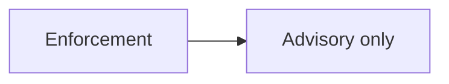
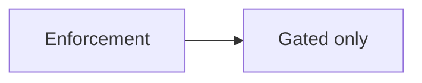
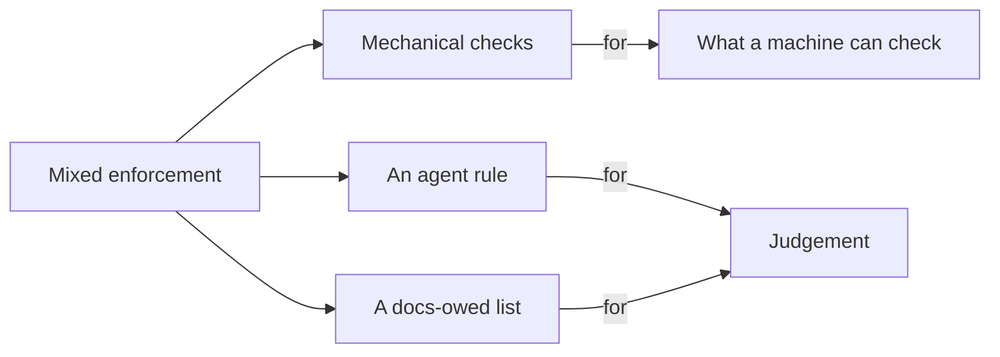
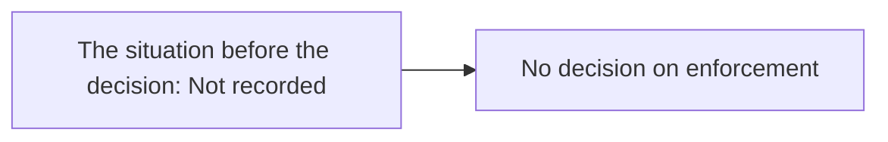
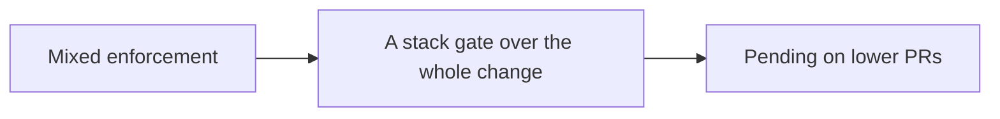

# 0023. Enforcement

Status: Proposed

Date: 2026-11-14

Deciders: the Software Engineer

## Context

Not recorded. The trail entry has no Context for this decision. The decision is which kind of enforcement to use.

## Decision drivers

Not recorded.

## Options

### Option 1: Advisory only

Enforcement is advisory only.

*Enforcement is advisory only; notice that advisory is the only kind in this option.*

- **Pros:** Not recorded.
- **Cons:** Not recorded.
- **Evidence:** Not recorded. The trail's evidence is for the decision as a whole and is given under the pick.

### Option 2: Gated only

Enforcement is gated only.

*Enforcement is gated only; notice that gated is the only kind in this option.*

- **Pros:** Not recorded.
- **Cons:** Not recorded.
- **Evidence:** Not recorded. The trail's evidence is for the decision as a whole and is given under the pick.

### Option 3: Mixed, with mechanical checks, an agent rule and a docs-owed list

Enforcement is mixed: mechanical checks for what a machine can check, and an agent rule and a docs-owed list for judgement.

*Mechanical checks cover what a machine can check, and an agent rule and a docs-owed list cover judgement; notice that the agent rule and the docs-owed list both point at judgement.*

- **Pros:** Not recorded.
- **Cons:** Not recorded.
- **Evidence:** Recorded for the decision as a whole and placed here, with the pick: the-way's docs stay honest by convention only; my-quote's checkers catch drift.

### Option 4: Do nothing

No decision is made on enforcement, and because the trail entry has no Context the situation before the decision is not recorded.

*With no decision, nothing is set on enforcement; notice that the situation before the decision is not recorded.*

- **Pros:** Not recorded.
- **Cons:** Not recorded.
- **Evidence:** Not recorded.

## Comparison

The trail records no drivers for this decision, so the table has no driver columns. The consequence it records for the pick is given under Consequences; the trail does not call it an advantage or a drawback.

| Option | What kind of enforcement it is | Other trade-offs recorded |
|---|---|---|
| Advisory only | Advisory only | Not recorded. |
| Gated only | Gated only | Not recorded. |
| Mixed, with mechanical checks, an agent rule and a docs-owed list | Mechanical checks for what a machine can check; an agent rule and a docs-owed list for judgement | Not recorded. |
| Do nothing | No decision is made | Not recorded. |

## Decision

The Software Engineer picked mixed enforcement: "Mixed is fine. We do want this to be living, breathing docs." The pick was later scoped to what the baseline owns, which is documents and its standards. Appendix A states the pick as mixed, scoped to what the baseline owns, with a stack gate.

The trail's evidence, recorded for the decision as a whole and given under the pick: the-way's docs stay honest by convention only; my-quote's checkers catch drift. The trail does not say which option it bears on. Why mixed beats advisory only and gated only, beyond the Software Engineer's words above: Not recorded.

## Consequences

There is a stack gate over the whole change, pending on lower PRs.

*Mixed enforcement brings a stack gate over the whole change; notice that the gate is pending on lower PRs.*

## Revisit when

The gate cannot be made to work (design 1, V1).

## Links

- Design 1, Appendix A, 0023: [design 1](../superpowers/specs/2026-11-14-baseline-standard-design.md)
- Decision trail, entry 0023: [decision trail](../superpowers/specs/2026-11-14-baseline-decision-trail.md)
- Added at review: PR 13 of this stack (branch `standard/13-seams-tooling-index`), which writes the mechanical checks and the stack gate as requirements into `standard/22-tooling-requirements.md`.
