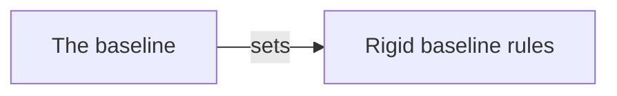
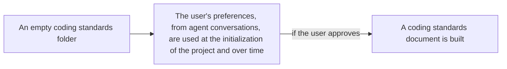
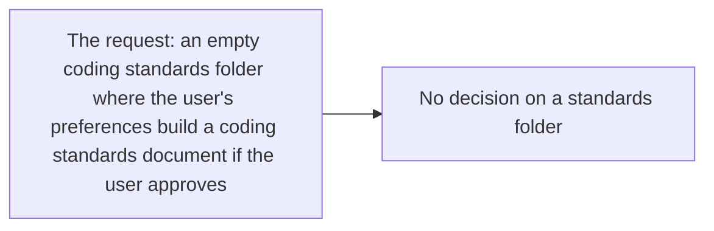
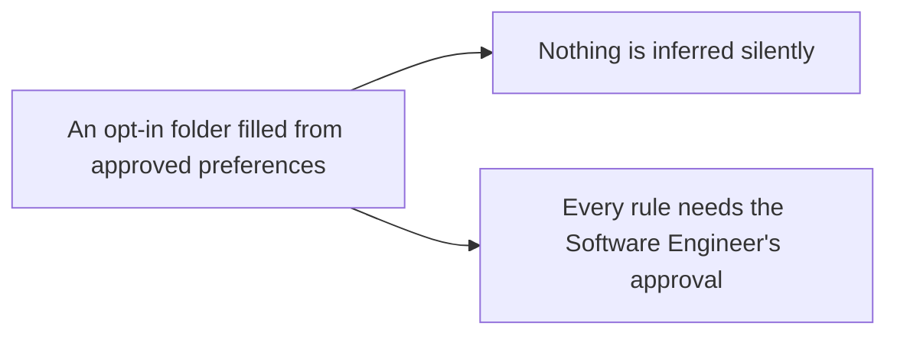

# 0024. Standards folder

Status: Proposed

Date: 2026-11-14

Deciders: the Software Engineer

## Context

The Software Engineer said to put fundamental baselines, then to "create an empty coding standards folder where at the initialization of the project as well as over time the user's preferences are utilized (from agent conversations) to build a coding standards document if the user approves". The Software Engineer also said that standards and ADRs "are the only kind that drive code": when generated code is wrong, they are updated and the code regenerated "in a fresh context".

## Decision drivers

Not recorded.

## Options

### Option 1: Rigid baseline rules

The baseline sets rigid rules.

*The baseline sets rigid rules of its own; notice that the rules are the baseline's.*

- **Pros:** Not recorded.
- **Cons:** Not recorded.
- **Evidence:** Not recorded. The trail's evidence is for the decision as a whole and is given under the pick.

### Option 2: An opt-in folder filled from approved preferences

An opt-in coding standards folder is created empty, and the user's preferences from agent conversations are used in it, at the initialization of the project and over time, to build a coding standards document if the user approves.

*An empty folder is where the user's preferences are used to build a coding standards document; notice that building the document depends on the user's approval.*

- **Pros:** Not recorded.
- **Cons:** Not recorded.
- **Evidence:** Recorded for the decision as a whole and placed here, with the pick: my-quote's `docs/agents/` guides hold lessons with the reason beside each rule.

### Option 3: Do nothing

No decision is made on a standards folder. The Context records the Software Engineer's request for an empty coding standards folder, and with no decision that request stays unmet.

*With no decision the request has no answer; notice that the request makes building the standards document depend on the user's approval.*

- **Pros:** Not recorded.
- **Cons:** The request in the Context stays unmet: an empty coding standards folder where the user's preferences are used to build a coding standards document if the user approves.
- **Evidence:** Not recorded.

## Comparison

The trail records no drivers for this decision, so the table has no driver columns. The consequences it records for the pick are given under Consequences; the trail does not call them advantages or drawbacks.

| Option | How the standards are set | Other trade-offs recorded |
|---|---|---|
| Rigid baseline rules | The baseline sets rigid rules | Not recorded. |
| An opt-in folder filled from approved preferences | An opt-in folder, created empty, where the user's preferences build a coding standards document if the user approves | Not recorded. |
| Do nothing | No decision is made | The request in the Context stays unmet, as given under Cons |

## Decision

The Software Engineer picked an opt-in folder filled from approved preferences. Appendix A states the pick as an opt-in folder filled from approved preferences, and adds "fix standards and regenerate", which matches what the Context records the Software Engineer saying: when generated code is wrong, standards and ADRs are updated and the code regenerated "in a fresh context".

The agent that was writing the design chose the name `docs/standards/` because the folder also holds verification, dependency and security preferences.

The trail's evidence, recorded for the decision as a whole and given under the pick: my-quote's `docs/agents/` guides hold lessons with the reason beside each rule. The trail does not say which option it bears on. The trail gives no separate reason for the pick; the Context records what the Software Engineer asked for and said. Why an opt-in folder beats rigid baseline rules: Not recorded.

## Consequences

Nothing is inferred silently. Every rule needs the Software Engineer's approval.

*Nothing is inferred silently; notice that every rule needs the Software Engineer's approval.*

## Revisit when

Not recorded.

## Links

- Design 1, Appendix A, 0024: [design 1](../superpowers/specs/2026-11-14-baseline-standard-design.md)
- Decision trail, entry 0024: [decision trail](../superpowers/specs/2026-11-14-baseline-decision-trail.md)
- Added at review: PR 12 of this stack (branch `standard/12-docs-agent-standards-rules`), which writes the standards mechanism into `standard/19-standards-mechanism.md`.
- Added at review: PR 17 of this stack (branch `standard/17-revision-2-standard`), which writes that neither record of `standards_enabled` wins into `standard/19-standards-mechanism.md` (revision 2).
- Added at review: the course chapter [A preference becomes a standard](../course/system/05-preference-to-standard.md), which follows this decision at work in the repository.
