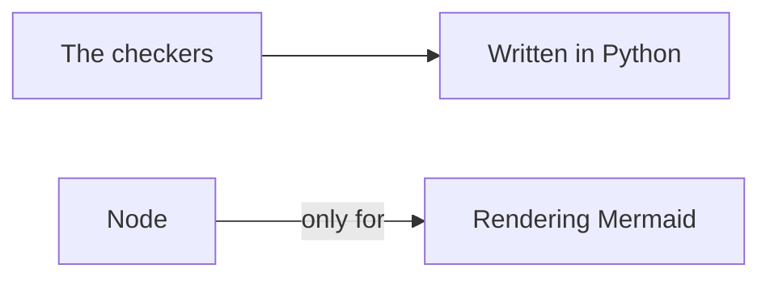
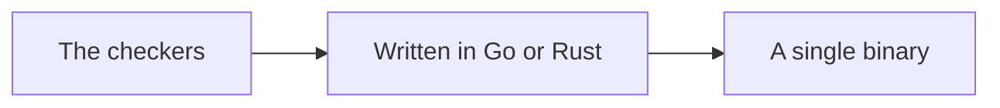
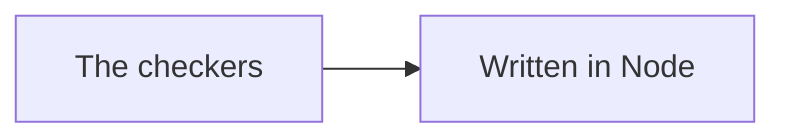
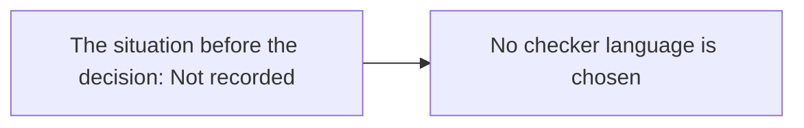
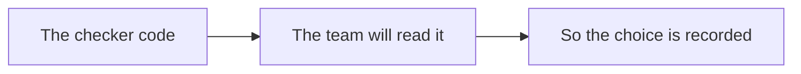

# 0026. Checker language

Status: Proposed

Date: 2026-11-14

Deciders: the Software Engineer

## Context

Not recorded. The trail entry has no Context for this decision. The decision is the language the checkers are written in.

## Decision drivers

Not recorded.

## Options

Appendix A lists Go, Rust, Node and Python as four separate options. The trail groups Go and Rust as one option, so this draft follows the trail.

### Option 1: Python, with Node only for rendering Mermaid

The checkers are written in Python, with Node only for rendering Mermaid.

*The checkers are written in Python and Node is used only for rendering Mermaid; notice that Node has the one job.*

- **Pros:** Not recorded. The reasons recorded with the pick are under Decision.
- **Cons:** Not recorded.
- **Evidence:** Recorded for the decision as a whole and placed here, with the pick: the existing checkers and their tests.

### Option 2: Go or Rust

The checkers are written in Go or Rust.

*The checkers are written in Go or Rust and come as a single binary; notice that the option covers two languages.*

- **Pros:** A single binary.
- **Cons:** More effort.
- **Evidence:** Not recorded. The trail's evidence is for the decision as a whole and is given under the pick.

### Option 3: Node

The checkers are written in Node.

*The checkers are written in Node; notice that here Node is the language of the checkers themselves.*

- **Pros:** Not recorded.
- **Cons:** Not recorded.
- **Evidence:** Not recorded. The trail's evidence is for the decision as a whole and is given under the pick.

### Option 4: Do nothing

No checker language is chosen, and because the trail entry has no Context the situation before the decision is not recorded.

*With no language chosen, nothing says what the checkers are written in; notice that the situation before the decision is not recorded.*

- **Pros:** Not recorded.
- **Cons:** Not recorded.
- **Evidence:** Not recorded.

## Comparison

The trail records no drivers for this decision, so the table has no driver columns; the pros and cons the trail gives for an option are in the last column. The consequence it records for the pick is given under Consequences; the trail does not call it an advantage or a drawback.

| Option | What the checkers are written in | Other trade-offs recorded |
|---|---|---|
| Python, with Node only for rendering Mermaid | Python; Node only for rendering Mermaid | Not recorded. The reasons recorded with the pick are under Decision |
| Go or Rust | Go or Rust | Pro: a single binary. Con: more effort |
| Node | Node | Not recorded. |
| Do nothing | No language is chosen | Not recorded. |

## Decision

The pick is Python, with Node only for rendering Mermaid. Appendix A states the pick the same way: Python, with Node only for Mermaid.

Proposed by the agent that wrote design 1; approved by the Software Engineer.

The trail's reasons for the pick: Python is strong at text processing, fast to change and easy to test, and my-quote's checkers (`check_tutorial.py`, `tutorial_numbers.py`) are already Python. The trail's evidence, recorded for the decision as a whole and given under the pick: the existing checkers and their tests. The trail does not say which option it bears on. Why Python beats Go or Rust and Node, beyond those reasons: Not recorded.

## Consequences

The team will read this code, so the choice is recorded.

*The team will read the checker code; notice that this is why the choice is recorded.*

## Revisit when

A single-binary distribution becomes necessary.

## Links

- Design 1, Appendix A, 0026: [design 1](../superpowers/specs/2026-11-14-baseline-standard-design.md)
- Decision trail, entry 0026: [decision trail](../superpowers/specs/2026-11-14-baseline-decision-trail.md)
- Added at review: PR 13 of this stack (branch `standard/13-seams-tooling-index`), which writes the checker language into `standard/22-tooling-requirements.md`.
