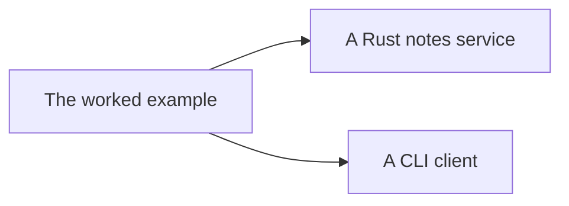
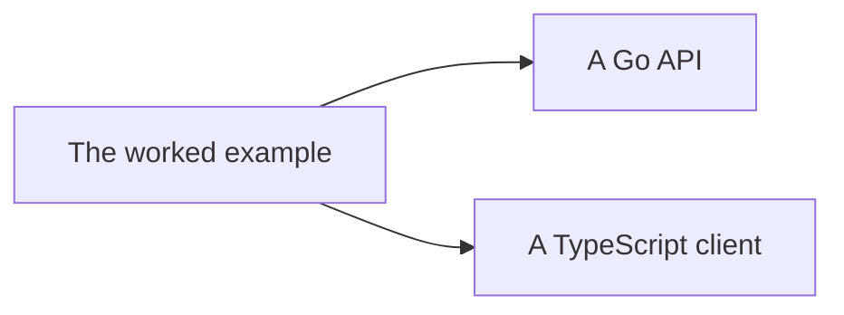
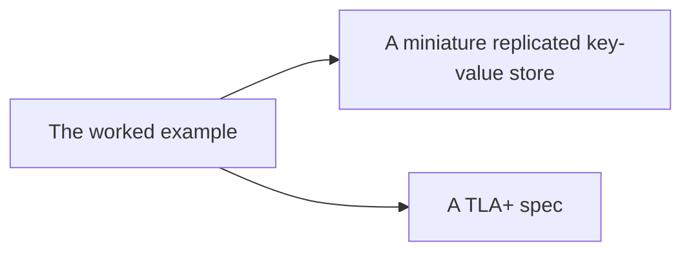
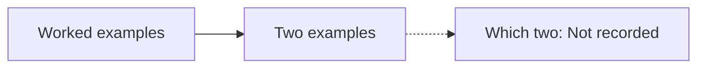
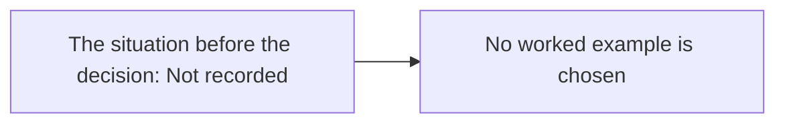
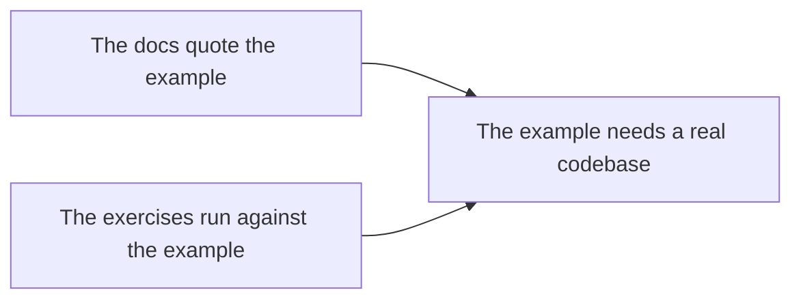

# 0027. The worked example

Status: Proposed

Date: 2026-11-14

Deciders: the Software Engineer

## Context

Not recorded. The trail entry has no Context for this decision. The decision is which worked example to use.

## Decision drivers

Not recorded.

## Options

### Option 1: A Rust notes service with a CLI client

The worked example is a Rust notes service with a CLI client.

*The worked example is a Rust notes service with a CLI client; notice that the client is a CLI.*

- **Pros:** Not recorded. The reasons recorded with the pick are under Decision.
- **Cons:** Not recorded.
- **Evidence:** Not recorded.

### Option 2: A Go API with a TypeScript client

The worked example is a Go API with a TypeScript client.

*The worked example is a Go API with a TypeScript client; notice that the API and the client are in different languages.*

- **Pros:** Not recorded.
- **Cons:** Two language courses, about double the cost.
- **Evidence:** Not recorded.

### Option 3: A miniature replicated key-value store with a TLA+ spec

The worked example is a miniature replicated key-value store with a TLA+ spec.

*The worked example is a miniature replicated key-value store with a TLA+ spec; notice that it comes with a spec.*

- **Pros:** Closest to the Software Engineer's work.
- **Cons:** Much heavier.
- **Evidence:** Not recorded.

### Option 4: Two examples

There are two worked examples.

*There are two worked examples; notice that the trail does not record which two.*

- **Pros:** Not recorded.
- **Cons:** Not recorded.
- **Evidence:** Not recorded.

### Option 5: Do nothing

No worked example is chosen, and because the trail entry has no Context the situation before the decision is not recorded.

*With no example chosen, nothing says which worked example is used; notice that the situation before the decision is not recorded.*

- **Pros:** Not recorded.
- **Cons:** Not recorded.
- **Evidence:** Not recorded.

## Comparison

The trail records no drivers for this decision, so the table has no driver columns; the pros and cons the trail gives for an option are in the last column. The consequence it records for the pick is given under Consequences; the trail does not call it an advantage or a drawback.

| Option | What the worked example is | Other trade-offs recorded |
|---|---|---|
| A Rust notes service with a CLI client | A Rust notes service with a CLI client | Not recorded. The reasons recorded with the pick are under Decision |
| A Go API with a TypeScript client | A Go API with a TypeScript client | Con: two language courses, about double the cost |
| A miniature replicated key-value store with a TLA+ spec | A miniature replicated key-value store with a TLA+ spec | Pro: closest to the Software Engineer's work. Con: much heavier |
| Two examples | Two examples | Not recorded. |
| Do nothing | No worked example is chosen | Not recorded. |

## Decision

The Software Engineer picked a Rust notes service with a CLI client. The reasons recorded with the pick: it is small enough to finish and rich enough to show every document type, and its Rust lessons seed upcoming Rust projects. The trail adds that it is a reference, a test fixture and an end-to-end eval: delete its docs, regenerate them with the docs agent, run the checkers. Appendix A states the pick as the Rust notes service plus CLI, small enough to finish, covering every document type and seeding later Rust projects.

The trail's evidence for the decision: Not recorded. Why the pick beats the other options, beyond the reasons above: Not recorded.

## Consequences

The worked example needs a real codebase, because the docs quote it and the exercises run against it.

*The example needs a real codebase; notice that the reasons are that the docs quote it and the exercises run against it.*

## Revisit when

A second example is wanted.

## Links

- Design 1, Appendix A, 0027: [design 1](../superpowers/specs/2026-11-14-baseline-standard-design.md)
- Decision trail, entry 0027: [decision trail](../superpowers/specs/2026-11-14-baseline-decision-trail.md)
- Added at review: PR 13 of this stack (branch `standard/13-seams-tooling-index`), which names the worked example in the update flow of `standard/22-tooling-requirements.md`.
