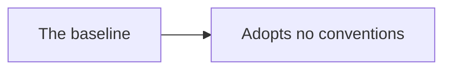
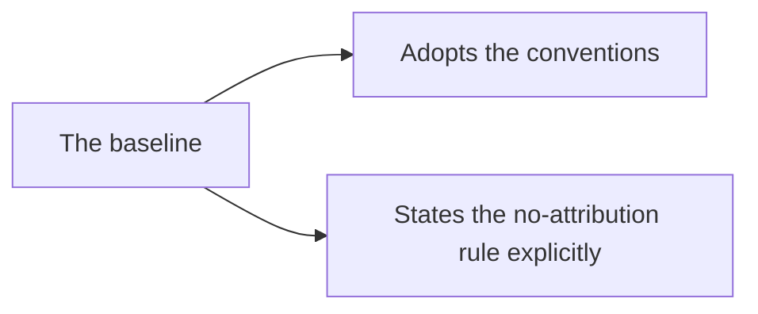
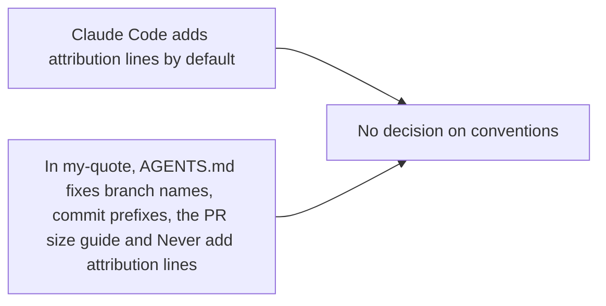
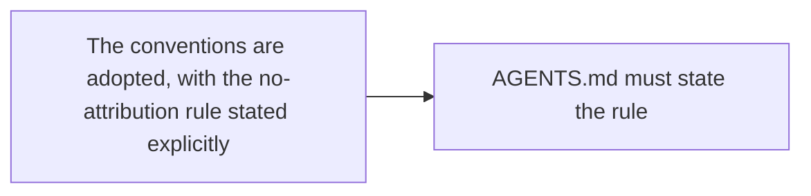

# 0029. Conventions

Status: Proposed

Date: 2026-11-14

Deciders: the Software Engineer

## Context

In my-quote, `AGENTS.md` fixes branch names, commit prefixes, the PR size guide and "Never add attribution lines". Claude Code adds attribution lines by default.

## Decision drivers

Not recorded.

## Options

Appendix A words the second option as stack, branch, commit and attribution rules. The trail words it as adopting the conventions with the no-attribution rule stated explicitly, so this draft follows the trail.

### Option 1: None

The baseline adopts no conventions.

*The baseline adopts no conventions; notice that nothing is adopted.*

- **Pros:** Not recorded.
- **Cons:** Not recorded.
- **Evidence:** Not recorded. The trail's evidence is for the decision as a whole and is given under the pick.

### Option 2: Adopt the conventions, with the no-attribution rule stated explicitly

The baseline adopts the conventions, with the no-attribution rule stated explicitly.

*The baseline adopts the conventions and states the no-attribution rule explicitly; notice that the rule is stated explicitly.*

- **Pros:** Not recorded.
- **Cons:** Not recorded.
- **Evidence:** Recorded for the decision as a whole and placed here, with the pick: my-quote's `AGENTS.md`.

### Option 3: Do nothing

No decision is made on conventions. With no decision, the problem the Context states stays: Claude Code adds attribution lines by default.

*Doing nothing leaves the conventions undecided; notice that Claude Code adds attribution lines by default.*

- **Pros:** Not recorded.
- **Cons:** The problem the Context states stays: Claude Code adds attribution lines by default.
- **Evidence:** Not recorded.

## Comparison

The trail records no drivers for this decision, so the table has no driver columns. The consequence it records for the pick is given under Consequences; the trail does not call it an advantage or a drawback.

| Option | What the baseline does about conventions | Other trade-offs recorded |
|---|---|---|
| None | Adopts no conventions | Not recorded. |
| Adopt the conventions, with the no-attribution rule stated explicitly | Adopts the conventions and states the no-attribution rule explicitly | Not recorded. |
| Do nothing | No decision is made | The problem the Context states stays, as given under Cons |

## Decision

The Software Engineer approved adopting the conventions, with the no-attribution rule stated explicitly. The trail does not say who made the proposal. Appendix A states the pick as adopted, with no attribution lines.

The trail's evidence, recorded for the decision as a whole and given under the pick: my-quote's `AGENTS.md`. The trail does not say which option it bears on. The trail gives no separate reason for the pick; the Context records what my-quote's `AGENTS.md` fixes and that Claude Code adds attribution lines by default. Why the pick beats adopting no conventions: Not recorded.

## Consequences

`AGENTS.md` must state the rule.

*Adopting the conventions means AGENTS.md must state the rule; notice that the pick has the no-attribution rule stated explicitly.*

## Revisit when

Not recorded.

## Links

- Design 1, Appendix A, 0029: [design 1](../superpowers/specs/2026-11-14-baseline-standard-design.md)
- Decision trail, entry 0029: [decision trail](../superpowers/specs/2026-11-14-baseline-decision-trail.md)
- Added at review: PR 4 of this stack (branch `standard/04-playbooks`), which writes the conventions into `AGENTS.md` and `docs/agents/stacks.md`.
- Added at review: PR 5 of this stack (branch `standard/05-foundations`), which writes the seven conventions into `standard/03-stack-model.md`.
- Added at review: the course chapter [A feature goes from brainstorm to merged stack](../course/system/02-brainstorm-to-merged-stack.md), which follows this decision at work in the repository.
- Added at review: the lesson [A stack of pull requests](../course/stacks/gh-stack/01-a-stack-of-pull-requests.md), which teaches what this decision chose.
