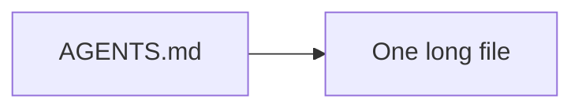
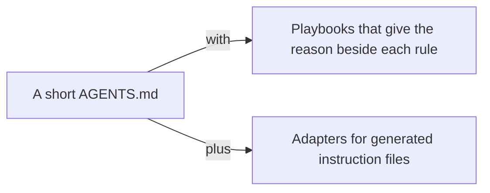
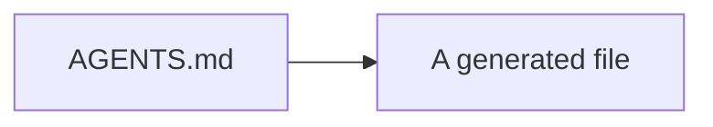
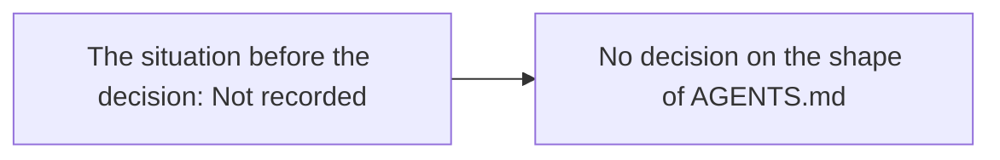
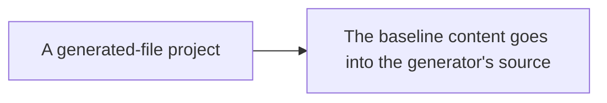

# 0030. Shape of AGENTS.md

Status: Proposed

Date: 2026-11-14

Deciders: the Software Engineer

## Context

Not recorded. The trail entry has no Context for this decision. The decision is the shape of `AGENTS.md`.

## Decision drivers

Not recorded.

## Options

### Option 1: One long file

`AGENTS.md` is one long file.

*AGENTS.md is one long file; notice that the trail describes it only as one long file.*

- **Pros:** Not recorded.
- **Cons:** Not recorded.
- **Evidence:** Not recorded. The trail's evidence is for the decision as a whole and is given under the pick.

### Option 2: A short file with playbooks that give the reason beside each rule, plus adapters for generated instruction files

`AGENTS.md` is a short file, with playbooks that give the reason beside each rule, plus adapters for generated instruction files.

*A short AGENTS.md comes with playbooks that give the reason beside each rule, plus adapters for generated instruction files; notice that the reasons live in the playbooks.*

- **Pros:** Not recorded.
- **Cons:** Not recorded.
- **Evidence:** Recorded for the decision as a whole and placed here, with the pick: my-quote's `AGENTS.md` is 90 lines with a two-line `CLAUDE.md` and nine guides; the-way's `AGENTS.md` is 182 lines identical to its `CLAUDE.md` and appears generated by Laravel Boost (unconfirmed).

### Option 3: A generated file

`AGENTS.md` is a generated file.

*AGENTS.md is a generated file; notice that the file is generated.*

- **Pros:** Not recorded.
- **Cons:** Not recorded.
- **Evidence:** Not recorded. The trail's evidence is for the decision as a whole and is given under the pick.

### Option 4: Do nothing

No decision is made on the shape of `AGENTS.md`, and because the trail entry has no Context the situation before the decision is not recorded.

*With no decision, nothing is set on the shape of AGENTS.md; notice that the situation before the decision is not recorded.*

- **Pros:** Not recorded.
- **Cons:** Not recorded.
- **Evidence:** Not recorded.

## Comparison

The trail records no drivers for this decision, so the table has no driver columns. The consequence it records for the pick is given under Consequences; the trail does not call it an advantage or a drawback.

| Option | The shape of `AGENTS.md` | Other trade-offs recorded |
|---|---|---|
| One long file | One long file | Not recorded. |
| A short file with playbooks that give the reason beside each rule, plus adapters for generated instruction files | A short file; playbooks that give the reason beside each rule; adapters for generated instruction files | Not recorded. |
| A generated file | A generated file | Not recorded. |
| Do nothing | No decision is made | Not recorded. |

## Decision

The Software Engineer approved a short file with playbooks that give the reason beside each rule, plus adapters for generated instruction files. The trail does not say who made the proposal. Appendix A states the pick as a short file plus playbooks, with adapters for generated instruction files.

The trail's evidence, recorded for the decision as a whole and given under the pick: my-quote's `AGENTS.md` is 90 lines with a two-line `CLAUDE.md` and nine guides; the-way's `AGENTS.md` is 182 lines identical to its `CLAUDE.md` and appears generated by Laravel Boost (unconfirmed). The trail does not say which option it bears on. The trail gives no reason for the pick. Why the pick beats one long file and a generated file: Not recorded.

## Consequences

In generated-file projects the baseline content goes into the generator's source.

*In a generated-file project the baseline content goes into the generator's source; notice that the generator's source is where it goes.*

## Revisit when

The Boost behaviour is confirmed (design 1, V3).

## Links

- Design 1, Appendix A, 0030: [design 1](../superpowers/specs/2026-11-14-baseline-standard-design.md)
- Decision trail, entry 0030: [decision trail](../superpowers/specs/2026-11-14-baseline-decision-trail.md)
- Added at review: PR 4 of this stack (branch `standard/04-playbooks`), which writes `AGENTS.md`, `CLAUDE.md` and the six playbooks.
- Added at review: PR 10 of this stack (branch `standard/10-pr-descriptions-and-agents`), which writes their standard into `standard/15-agents-md-and-playbooks.md`.
- Added at review: the course chapter [A feature goes from brainstorm to merged stack](../course/system/02-brainstorm-to-merged-stack.md), which follows this decision at work in the repository.
