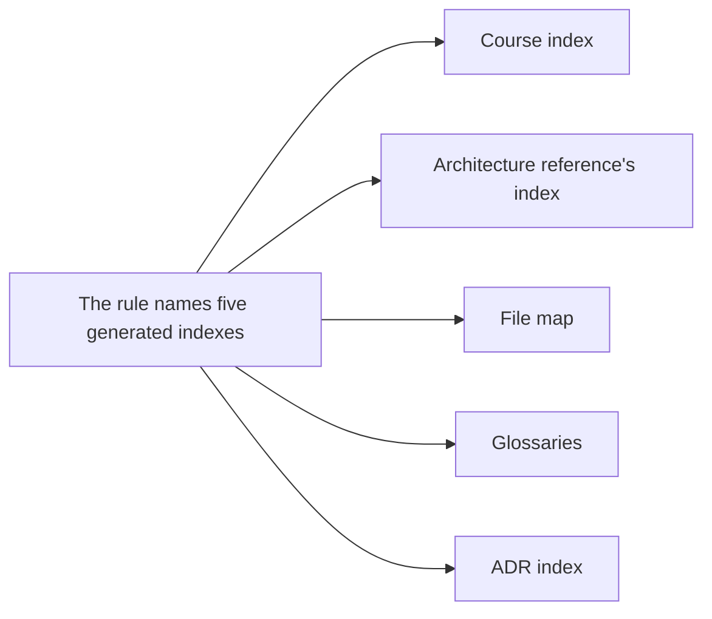
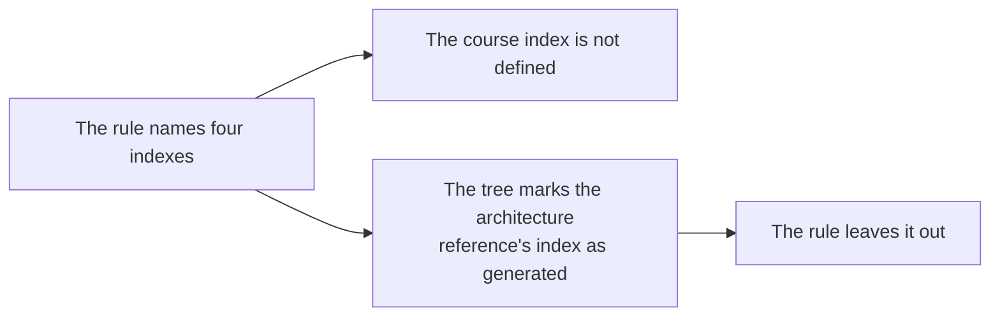
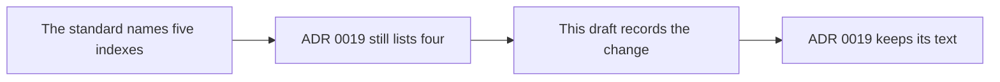

# 0032. Five generated indexes

Status: Proposed

Date: 2026-11-18

Deciders: the Software Engineer

## Context

ADR 0019 (Indexes) decided that the indexes are generated and never edited by hand, and it names four: the course index, the file map, the glossaries and the ADR index. Design 1 never defines the course index, and its tree shows none. Its rule also leaves out the index of the architecture reference, which its tree marks as generated (revision 1, D7, Situation).

When the standard was built from design 1, its files disagreed on this point. On 2026-11-18 the Software Engineer accepted revision 1's recommendation, and the standard has named five indexes since. On the same day the docs agent found that ADR 0019 still lists four while the built standard names five, and put that to the Software Engineer, who approved a new draft (revision 3, D1). A change to a decision is a new ADR draft (`stacks.md`, rule 8), so this draft records it, and ADR 0019 is not edited.

This draft was written after the decision, on 2026-11-18, from the record that revision 1 made when the decision was taken. It adds no option, pro, con or reason that the record does not hold.

## Decision drivers

1. The files of the standard agree with one another. This is the reason revision 1 gives for the pick ("So that the files agree"), and the record gives no other driver.

## Options

### Option 1: Name five indexes and define the course index

Define the course index as the index of the guided course, and add the architecture reference's index to the rule, so that the files agree. The rule then names five generated indexes: the course index, the architecture reference's index, the file map, the glossaries and the ADR index. The course index is the generated `README.md` of `docs/course/`, the same place as the indexes of `docs/architecture/` and `docs/adr/`. The standard sets no shape for it beyond "generated", because the generators are for the tooling's design (design 3) to specify. Revision 1 records three points as calls of the agent that wrote the revision, which the Software Engineer had not seen in that form: the place of the course index, that the standard sets no shape for it beyond "generated", and that the docs agent writes the architecture reference's index in the reference PR where no generator exists yet.

*The rule names five generated indexes; notice that the architecture reference's index is added to the four of ADR 0019 and that the course index is now defined.*

- **Pros:** The files agree. This is the reason revision 1 gives for the pick.
- **Cons:** Not recorded.
- **Evidence:** Not recorded.

### Option 2: Do nothing

Leave the standard as it is, with design 1's rule: four indexes named, the course index undefined, and the architecture reference's index marked generated in the tree but left out of the rule.

*Doing nothing keeps the rule at four; notice that the tree and the rule disagree about the architecture reference's index.*

- **Pros:** Not recorded.
- **Cons:** The files disagree: the rule names four, the course index is undefined, and the architecture reference's index is marked generated in the tree but left out of the rule (revision 1, D7, Situation).
- **Evidence:** Not recorded.

Revision 1 records one real option and this one, which it calls "leave the standard as it is". It records no other real option, and none is added here.

## Comparison

| Option | The files of the standard agree | Other trade-offs recorded |
|---|---|---|
| Option 1: Name five indexes and define the course index | Yes: this is the reason revision 1 gives for the pick | Not recorded. |
| Option 2: Do nothing | No: revision 1's Situation records the disagreement | Not recorded. |

## Decision

The Software Engineer picked option 1 on 2026-11-18, when they accepted revision 1's recommendation on D7 ("Accept recommendations on all above"), and they approved writing a new draft for it the same day (revision 3, D1, "Approved on all recommendations"). The recorded reason is revision 1's: "So that the files agree." Why the pick beats leaving the standard as it is, beyond that reason: Not recorded.

The pick extends ADR 0019. The indexes are still generated and never edited by hand, and the list of them is five.

## Consequences

ADR 0019 keeps its text and lists four, so read with this draft the list is five. Where no generator exists yet, the docs agent writes the architecture reference's index in the reference PR, with the architecture reference. Revision 1 records that as a call of the agent that wrote the revision. Revision 3 (D5) later made the product glossary a page that the docs agent writes, so the glossary among the five indexes is the technical glossary. Whether the status of ADR 0019 changes when both ADRs are accepted: Not recorded.

*The standard and ADR 0019 differ on the number of indexes; notice that this draft records the change and ADR 0019 is not edited.*

## Revisit when

Not recorded.

## Links

- Revision 1, D7
- Revision 3, D1
- PR 14 of this stack (branch `standard/14-revision-1-decisions`) records the decision, and PR 15 (branch `standard/15-revision-1-standard`) writes the five indexes into the standard.
- The decision it extends: ADR 0019, Indexes (design 1, Appendix A, 0019).
- Added at review: [ADR 0019](0019-generated-indexes.md), the decision this one extends.
- Added at review: PR 19 of this stack (branch `standard/19-revision-3-adr-drafts`), which holds this draft (revision 3, D1).
- Added at review: PR 20 of this stack (branch `standard/20-revision-3-standard`), which names the technical glossary among the five indexes in `standard/10-course-reference-pages.md`, `standard/17-evidence-and-truth.md`, `standard/20-working-rules.md` and `standard/22-tooling-requirements.md` (revision 3, D5).
- Added at review: the course chapter [How documents stay true](../course/system/07-how-documents-stay-true.md), which follows this decision at work in the repository.
- Added at review: the course chapter [A decision becomes an ADR](../course/system/03-decision-to-adr.md), which follows this decision at work in the repository.
