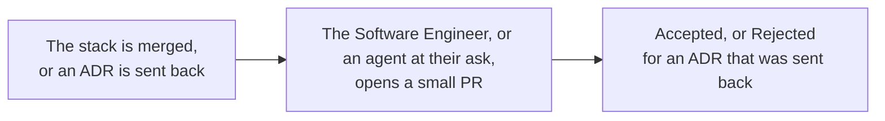
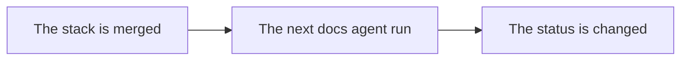
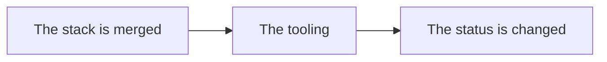
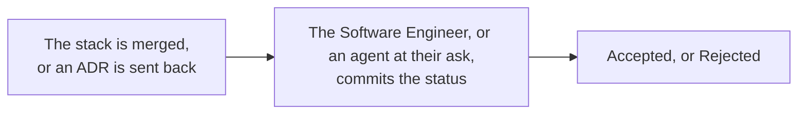
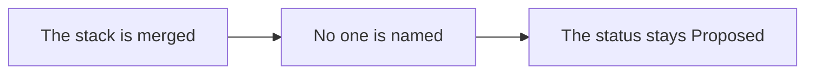
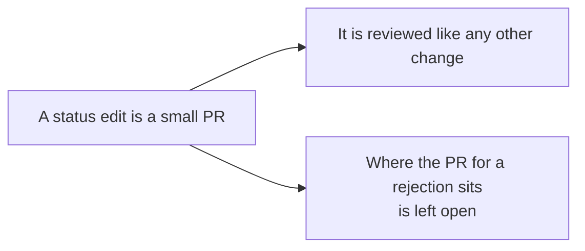

# 0033. Who records an ADR's acceptance and rejection

Status: Proposed

Date: 2026-11-18

Deciders: the Software Engineer

## Context

ADR 0011 (ADR authorship and approval) decided that the Software Engineer's merge of the stack is the acceptance of the ADRs in it. The status in the file is text, though, and design 1 names no one who changes it from Proposed to Accepted after the merge, while its "valid status" check needs someone to make that edit (revision 1, D5, Situation).

On 2026-11-18 the Software Engineer decided who records Accepted (revision 1, D5). Later the same day they decided who records Rejected and which PR carries the status edit (revision 2, D5 extended). The docs agent then found that ADR 0011 does not hold either decision, and put that to the Software Engineer, who approved a new draft (revision 3, D2). A change to a decision is a new ADR draft (`stacks.md`, rule 8), so this draft records it, and ADR 0011 is not edited.

This draft was written after the decisions, on 2026-11-18, from the records that revisions 1 and 2 made when they were taken. It adds no option, pro, con or reason that the records do not hold.

## Decision drivers

In the order the records give them:

1. Accepting or rejecting an ADR is the Software Engineer's call, and design 1 names no one else (revision 1, D5, and revision 2, D5 extended).
2. A status edit is a change like any other, so it goes in a PR (revision 2, D5 extended).

## Options

### Option 1: The Software Engineer, or an agent at their ask, records each acceptance and each rejection, in a small PR

After the merge they change the status of each ADR in the merged stack from Proposed to Accepted, and for an ADR that the Software Engineer sent back they change it from Proposed to Rejected. Each edit goes in a small PR, like any other change.

*The people who accept an ADR also record the status, in a PR; notice that the edit is a change like any other.*

- **Pros:** Not recorded.
- **Cons:** Not recorded.
- **Evidence:** Not recorded.

### Option 2: The next docs agent run records it

The next run of the docs agent changes the status (revision 1, D5, option b).

*The docs agent would record the status on its next run; notice that the edit is made by an agent and not by the Software Engineer.*

- **Pros:** Not recorded.
- **Cons:** Not recorded.
- **Evidence:** Not recorded.

### Option 3: The tooling records it

The baseline's tooling changes the status (revision 1, D5, option c).

*The tooling would record the status; notice that no person or agent makes the edit.*

- **Pros:** Not recorded.
- **Cons:** Not recorded.
- **Evidence:** Not recorded.

### Option 4: The same people record it as a direct commit

The Software Engineer, or an agent at their ask, records each acceptance and each rejection, and the edit is a direct commit and not a PR (revision 2, D5 extended, option b).

*The same people record the status as a direct commit; notice that no PR is opened for the edit.*

- **Pros:** Not recorded.
- **Cons:** Not recorded.
- **Evidence:** Not recorded.

### Option 5: Do nothing

No one is named. Design 1 names no one who changes the status after the merge (revision 1, D5, Situation).

*Doing nothing leaves the status as it is; notice that the "valid status" check then has no one to make the edit it needs.*

- **Pros:** Not recorded.
- **Cons:** The "valid status" check of design 1 needs someone to make the edit, and nobody is named (revision 1, D5, Situation).
- **Evidence:** Not recorded.

Revision 1 records options a, b and c for Accepted, and revision 2 records options a and b for Rejected and the PR. The five options above are those, with "do nothing". Option 1 joins the picks of the two revisions, revision 1's option a and revision 2's option a, which were put as separate decisions: options 2 and 3 were put against the decision on who records Accepted only, and option 4 against the decision on the PR only. The records name no other option, and none is added here.

## Comparison

The records give no ranking of the options against the drivers, apart from the reasons they give for the pick, so the other cells read Not recorded.

| Option | The Software Engineer's call, and no one else is named | A status edit goes in a PR | Other trade-offs recorded |
|---|---|---|---|
| Option 1: Small PR by the Software Engineer or an agent at their ask | Yes: the reason revisions 1 and 2 give for the pick | Yes: the reason revision 2 gives for the pick | Not recorded. |
| Option 2: The next docs agent run | Not recorded. | Not recorded. | Not recorded. |
| Option 3: The tooling | Not recorded. | Not recorded. | Not recorded. |
| Option 4: A direct commit by the same people | Yes: the same people as option 1 | No: the edit is a direct commit and not a PR | Not recorded. |
| Option 5: Do nothing | No: nobody is named | Not recorded. | The "valid status" check has no one to make its edit |

## Decision

The Software Engineer picked option 1. They accepted revision 1's recommendation for who records Accepted on 2026-11-18 ("Accept recommendations on all above"), and revision 2's recommendation for Rejected and the PR later the same day ("All recommendations approved"). They approved writing a new draft for it the same day (revision 3, D2, "Approved on all recommendations").

The recorded reasons are those of the revisions. Revision 1: "Acceptance is the Software Engineer's call, and design 1 names no one else." Revision 2: "The people are those who accept an ADR, because accepting and rejecting are both the Software Engineer's call, and a status edit is a change like any other." Why the pick beats the other options, beyond those reasons: Not recorded.

The pick extends ADR 0011. The merge of the stack is still the acceptance, and the edit that records it is made by the Software Engineer or an agent at their ask.

## Consequences

`docs/agents/adrs.md` and `standard/11-adrs.md` say it, for both statuses. Left open by revision 2: where the small PR that records an ADR's rejection sits. An ADR that was sent back is still in a stack that has not merged, and the files state no timing and no base for that PR.

*Each status edit is a small PR; notice that the place of the PR that records a rejection is left open.*

## Revisit when

Not recorded.

## Links

- Revision 1, D5: [revision 1](../superpowers/specs/2026-11-18-baseline-standard-revision-1-design.md)
- Revision 2, D5 extended: [revision 2](../superpowers/specs/2026-11-18-baseline-standard-revision-2-design.md)
- Revision 3, D2: [revision 3](../superpowers/specs/2026-11-18-baseline-standard-revision-3-design.md)
- PRs 14 and 15 (branches `standard/14-revision-1-decisions` and `standard/15-revision-1-standard`) record and write the decision for Accepted, and PRs 16 and 17 (branches `standard/16-revision-2-decisions` and `standard/17-revision-2-standard`) do the same for Rejected and the PR.
- The decision it extends: ADR 0011, ADR authorship and approval (design 1, Appendix A, 0011).
- Added at review: [ADR 0011](0011-adr-authorship-and-approval.md), the decision this one extends.
- Added at review: PR 19 of this stack (branch `standard/19-revision-3-adr-drafts`), which holds this draft (revision 3, D2).
- Added at review: the course chapter [A decision becomes an ADR](../course/system/03-decision-to-adr.md), which follows this decision at work in the repository.
