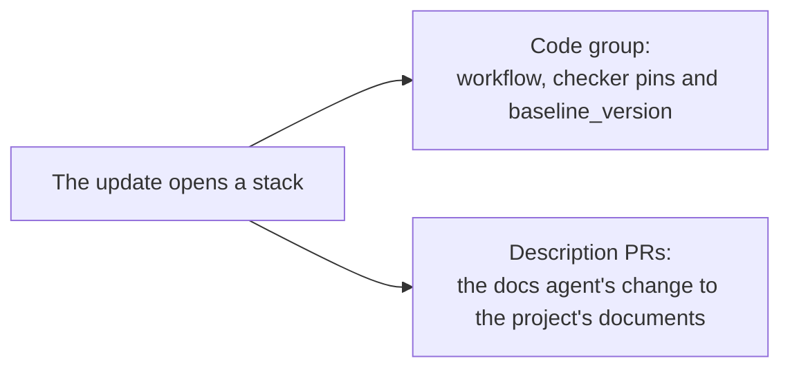
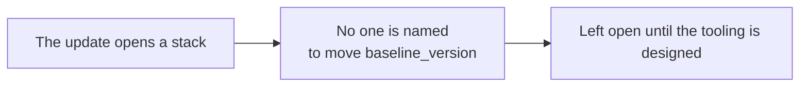
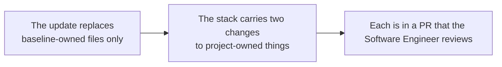

# 0034. The update's code group moves baseline_version

Status: Proposed

Date: 2026-11-18

Deciders: the Software Engineer

## Context

ADR 0025 (Update mechanism) decided on an ownership split with a versioned `/baseline:update` that opens a normal stack. Design 1 says that an update never touches project-owned files, and it lists the reader profile, the standards, the ADRs and all the documents as project-owned. It does not list `baseline.yml` as baseline-owned, and the standard counts it among the project-owned files, as the project's own configuration. Design 1 also says that the update opens a stack whose third PR onwards are description PRs, for existing documents that the new standard makes non-compliant. It does not say who moves `baseline_version` (revision 1, D8, Situation).

On 2026-11-18 the Software Engineer decided it (revision 1, D8). The docs agent then found that ADR 0025 does not hold the decision, and put that to the Software Engineer, who approved a new draft (revision 3, D2). A change to a decision is a new ADR draft (`stacks.md`, rule 8), so this draft records it, and ADR 0025 is not edited.

This draft was written after the decision, on 2026-11-18, from the record that revision 1 made when the decision was taken. It adds no option, pro, con or reason that the record does not hold.

## Decision drivers

1. "Never touches" stays true of the update itself: what the update replaces is only baseline-owned, and the project's own files change only in PRs that the Software Engineer reviews like any other. This is the reason revision 1 gives for the pick, and the record gives no other driver.

## Options

### Option 1: The update's code group moves baseline_version

The code group of the update's stack moves `baseline_version`, together with the workflow and the checker pins. The description PRs of the stack are the docs agent's own change to the project's documents, reviewed like any other.

*The update's code group moves the version; notice that the description PRs are the docs agent's change and not the update's.*

- **Pros:** "Never touches" stays true of the update itself, because what the update replaces is only baseline-owned. This is the reason revision 1 gives for the pick.
- **Cons:** Not recorded.
- **Evidence:** Not recorded.

### Option 2: Do nothing

Leave it open until the tooling is designed (revision 1, D8, option b).

*Doing nothing leaves the move of the version unsaid; notice that it waits for the tooling's design.*

- **Pros:** Not recorded.
- **Cons:** Design 1 says that an update never touches project-owned files and also describes description PRs in the update's stack, and it names no one who moves `baseline_version` (revision 1, D8, Situation).
- **Evidence:** Not recorded.

Revision 1 records one real option and this one. It records no other real option, and none is added here.

## Comparison

| Option | "Never touches" stays true of the update itself | Other trade-offs recorded |
|---|---|---|
| Option 1: The update's code group moves baseline_version | Yes: this is the reason revision 1 gives for the pick | Not recorded. |
| Option 2: Do nothing | Not recorded. | The move of the version stays unsaid until the tooling is designed |

## Decision

The Software Engineer picked option 1 on 2026-11-18, when they accepted revision 1's recommendation on D8 ("Accept recommendations on all above"), and they approved writing a new draft for it the same day (revision 3, D2, "Approved on all recommendations"). The recorded reason is revision 1's: "It keeps 'never touches' true of the update itself: what the update replaces is only baseline-owned, and the project's own files change only in PRs that the Software Engineer reviews like any other." Why the pick beats leaving it open, beyond that reason: Not recorded.

The pick extends ADR 0025. The ownership split and the versioned update stand, and the update's code group moves `baseline_version`.

## Consequences

`standard/05-project-layout.md` and `standard/22-tooling-requirements.md` say it: the group that holds the workflow and the checker pins also holds the new `baseline_version`. The update itself never touches a project-owned file, and its stack carries two changes to project-owned things, each in a PR that the Software Engineer reviews like any other. Revision 1 records the wording that reconciles the two as a call of the agent that wrote the revision.

*The update replaces only what the baseline owns; notice that the two changes to project-owned things each ride in a PR that is reviewed like any other.*

## Revisit when

Not recorded.

## Links

- Revision 1, D8
- Revision 3, D2
- PR 14 of this stack (branch `standard/14-revision-1-decisions`) records the decision, and PR 15 (branch `standard/15-revision-1-standard`) writes it into the standard.
- The decision it extends: ADR 0025, Update mechanism (design 1, Appendix A, 0025).
- Added at review: [ADR 0025](0025-update-mechanism.md), the decision this one extends.
- Added at review: PR 19 of this stack (branch `standard/19-revision-3-adr-drafts`), which holds this draft (revision 3, D2).
