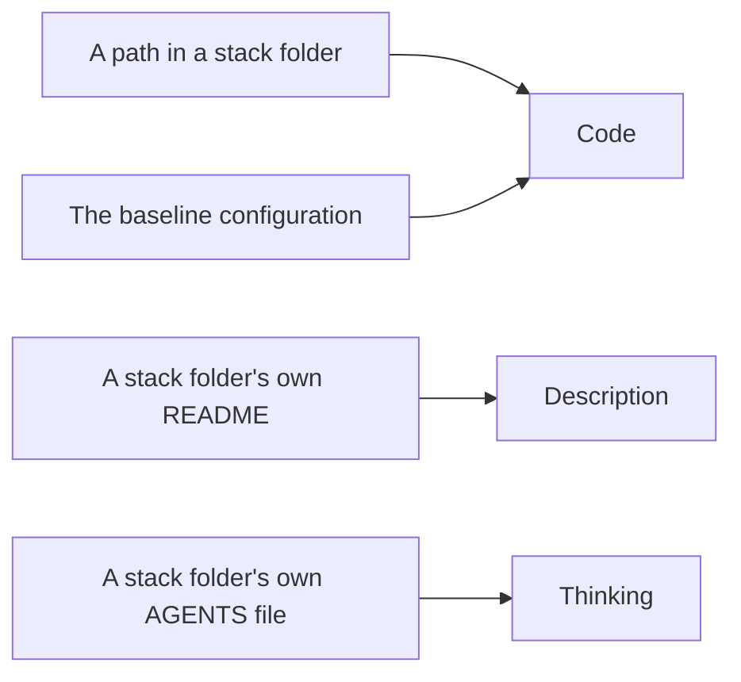
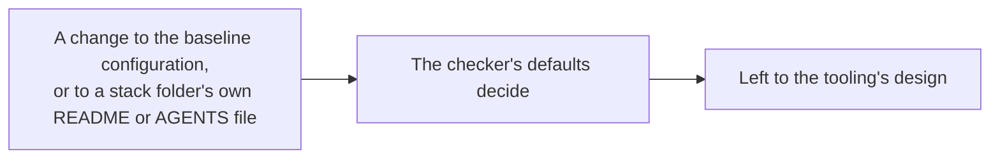
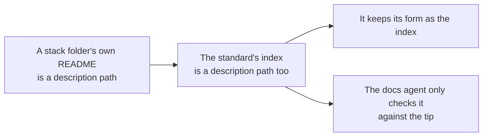

# 0035. The PR kinds of baseline.yml and of a stack folder's README.md and AGENTS.md

Status: Proposed

Date: 2026-11-18

Deciders: the Software Engineer

## Context

ADR 0009 (One kind per PR) decided on three kinds of PR, thinking, code and description, with the kind inferred from the paths a PR touches. The standard works that out with two lists in `baseline.yml`: `artifact_map` lists where skills write their documents (thinking), and `stack_folders` lists the folders whose changes are code. Design 1 gives no kind for a change to `baseline.yml` or to a stack folder's own `README.md` or `AGENTS.md`. By the rule alone a stack folder's `README.md` would be code, although the standard counts it among the descriptive documents, which only the docs agent writes, and counts a stack folder's `AGENTS.md` among the prescriptive documents. Revision 1 (D8) put the move of `baseline_version` in the update's code group, which gave one change to `baseline.yml` a kind (revision 2, D11, Situation).

On 2026-11-18 the Software Engineer decided the kinds (revision 2, D11). The docs agent then found that ADR 0009 does not hold the decision, and put that to the Software Engineer, who approved a new draft (revision 3, D2). A change to a decision is a new ADR draft (`stacks.md`, rule 8), so this draft records it, and ADR 0009 is not edited.

This draft was written after the decision, on 2026-11-18, from the record that revision 2 made when the decision was taken. It adds no option, pro, con or reason that the record does not hold.

## Decision drivers

In the order the record gives them:

1. The update's code group moves `baseline_version` in `baseline.yml` (revision 2's reason for the kind of `baseline.yml`).
2. A stack folder's `README.md` is a descriptive document and its `AGENTS.md` is a prescriptive one. Revision 2 gives this as the reason for the two files, and records that it is the standard's own classification of the two documents and not a reason that the Software Engineer gave.

## Options

### Option 1: baseline.yml is code, and a stack folder's README.md and AGENTS.md take the kind of their document

`baseline.yml` is code. A stack folder's own `README.md` is a description path, and its own `AGENTS.md` is a thinking path. Every other path in a stack folder is code.

*Each path has a kind; notice that the two files of a stack folder take the kind of their document and not the kind of the folder.*

- **Pros:** For `baseline.yml`, the update's code group moves its `baseline_version`. For the two files of a stack folder, the standard already counts the README among the descriptive documents and the AGENTS.md among the prescriptive ones. Revision 2 records the reason for those two as a call of the agent that wrote the revision.
- **Cons:** Not recorded.
- **Evidence:** Not recorded.

### Option 2: Do nothing

Leave the kinds to the checker's defaults, which are for the tooling's design to settle (revision 2, D11, option b).

*Doing nothing leaves the kinds to the checker's defaults; notice that by the rule alone a stack folder's README would be code.*

- **Pros:** Not recorded.
- **Cons:** By the rule alone a stack folder's `README.md` would be code, although the standard counts it among the descriptive documents (revision 2, D11, Situation).
- **Evidence:** Not recorded.

Revision 2 records one real option and this one. It records no other real option, and none is added here.

## Comparison

| Option | The update's code group moves `baseline_version` in `baseline.yml` | The README is descriptive and the AGENTS.md prescriptive | Other trade-offs recorded |
|---|---|---|---|
| Option 1: baseline.yml is code, and the two files take the kind of their document | Yes: `baseline.yml` is code | Yes: the README is description and the AGENTS.md is thinking | Not recorded. |
| Option 2: Do nothing | Not recorded. | No: by the rule alone the README would be code | The kinds wait for the tooling's design |

## Decision

The Software Engineer picked option 1 on 2026-11-18 ("All recommendations approved", revision 2, D11), and approved writing a new draft for it the same day (revision 3, D2, "Approved on all recommendations"). The recorded reasons are revision 2's. For `baseline.yml`: the update's code group moves its `baseline_version`. For the two files of a stack folder: the recommendation gave no reason, and the files give the one that is already in the standard. Why the pick beats the checker's defaults, beyond those reasons: Not recorded.

The pick extends ADR 0009. There are still three kinds and the kind is still inferred from paths, and these three paths now have a kind.

## Consequences

The kinds are stated in `docs/agents/stacks.md`, in `standard/03-stack-model.md` and in `standard/05-project-layout.md`, and the comment above `stack_folders` in `baseline.yml` names the two exceptions.

`standard/README.md`, the standard's index, is a stack folder's own `README.md`. It was committed in a code PR before the rule existed, and it stays as committed. A change to it from now on goes in a description PR. It keeps its form as the standard's index, so it does not take the run, test and build parts that the standard gives a stack folder's README, and the docs agent only checks it against the tip. Revision 2 records the case as a call of the agent that wrote the revision, and revision 3 records that the Software Engineer confirmed it on 2026-11-18.

*The rule reaches the standard's own index; notice that the index keeps its form and is checked and not rewritten.*

## Revisit when

Not recorded.

## Links

- Revision 2, D11: [revision 2](../superpowers/specs/2026-11-18-baseline-standard-revision-2-design.md)
- Revision 3, D2: [revision 3](../superpowers/specs/2026-11-18-baseline-standard-revision-3-design.md)
- PR 16 of this stack (branch `standard/16-revision-2-decisions`) records the decision, and PR 17 (branch `standard/17-revision-2-standard`) writes it into the standard.
- The decision it extends: ADR 0009, One kind per PR (design 1, Appendix A, 0009).
- Added at review: [ADR 0009](0009-one-kind-per-pr.md), the decision this one extends.
- Added at review: PR 18 of this stack (branch `standard/18-revision-3-decisions`), which adds `standard/AGENTS.md`, the first stack folder's own `AGENTS.md`, as a thinking path (revision 3, D6).
- Added at review: PR 19 of this stack (branch `standard/19-revision-3-adr-drafts`), which holds this draft (revision 3, D2).
