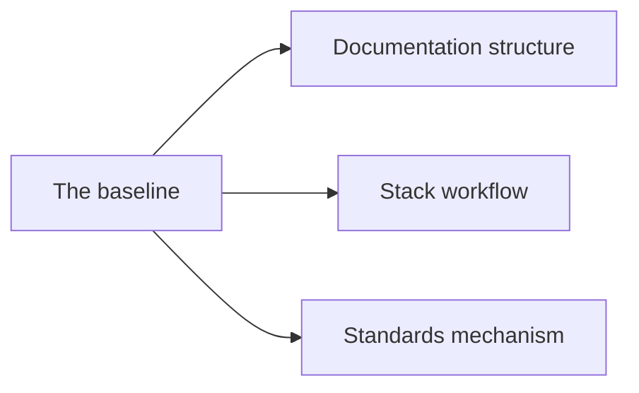
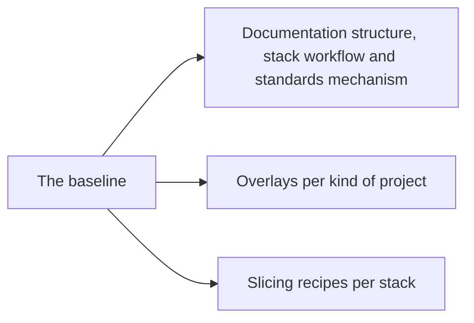
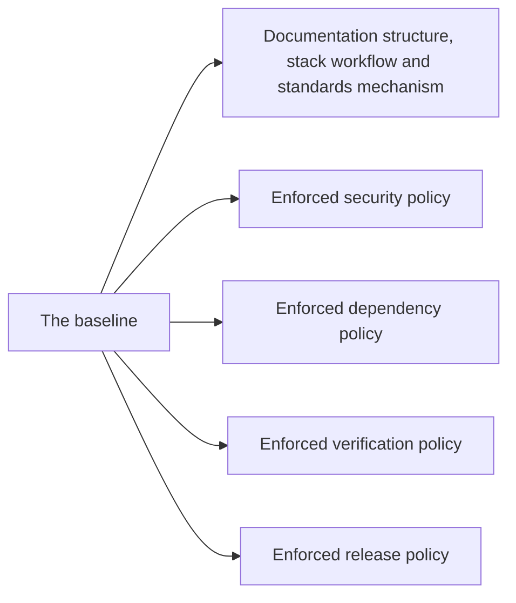
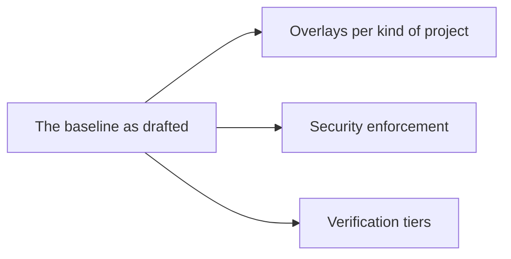
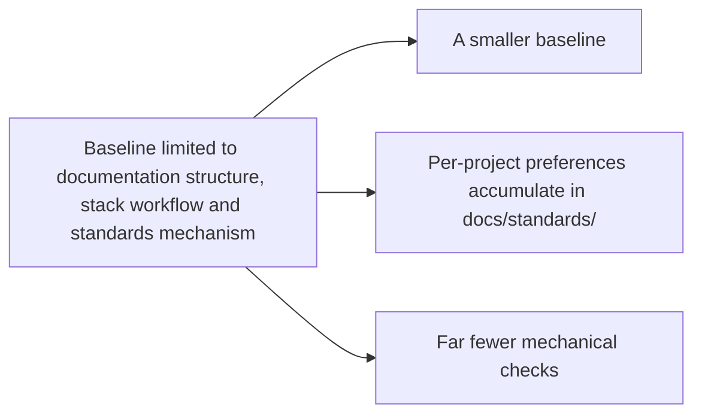

# Baseline scope

Status: Draft
Date: 2026-11-14
Deciders: the Software Engineer

## Context

After the agent that was writing the design had added overlays per kind of project, security enforcement and verification tiers, the Software Engineer said the baseline is "more so the documentation structure that any project should follow", plus coding standards, "which are also nothing but documentation". Vulnerability checks, secrets handling and the like are "per project decisions" and often cannot be enforced.

## Decision drivers

In the order the trail records them:

- Avoid rigidity: "we can't be overly rigid without knowing the project type, kind and goal".
- Keep the baseline the same for every kind.

## Options

### Option 1: Documentation structure, stack workflow and standards mechanism

The baseline is a documentation structure, a stack workflow and a standards mechanism.

*The baseline is these three parts; notice that none of them changes with the kind of project, because what differs is what the docs say.*

- **Pros:** It passes the Software Engineer's test: asked how the baseline changes between an AI application and a web application, the answer is that it does not, and what differs is what the docs say.
- **Cons:** Not recorded.
- **Evidence:** None beyond the Software Engineer's reasoning.

### Option 2: Documentation structure, stack workflow and standards mechanism, plus per-kind overlays and per-stack slicing recipes

Overlays for each kind of project and slicing recipes for each stack are added to the documentation structure, the stack workflow and the standards mechanism.

*This option adds two things to the baseline; notice that both vary, one by kind of project and one by stack.*

- **Pros:** Not recorded.
- **Cons:** The Context records the Software Engineer's reply once overlays per kind of project had been added: the baseline is "more so the documentation structure that any project should follow".
- **Evidence:** None beyond the Software Engineer's reasoning.

### Option 3: Documentation structure, stack workflow and standards mechanism, plus enforced security, dependency, verification and release policy

Enforced security, dependency, verification and release policy is added to the documentation structure, the stack workflow and the standards mechanism.

*This option adds enforced policy to the baseline; notice that the Context calls vulnerability checks and secrets handling per-project decisions that often cannot be enforced.*

- **Pros:** Not recorded.
- **Cons:** Vulnerability checks, secrets handling and the like are "per project decisions" and often cannot be enforced.
- **Evidence:** None beyond the Software Engineer's reasoning.

### Option 4: Do nothing

The scope stays as it stood when the Software Engineer replied, with the overlays per kind of project, the security enforcement and the verification tiers that the agent writing the design had added.

*Doing nothing keeps the scope as it stood before the Software Engineer replied; notice that it already holds overlays, enforcement and tiers.*

- **Pros:** Not recorded.
- **Cons:** The problem the Context states: the Software Engineer said the baseline is "more so the documentation structure that any project should follow", and vulnerability checks, secrets handling and the like are "per project decisions" and often cannot be enforced.
- **Evidence:** Not recorded.

## Comparison

| Option | Avoid rigidity | Keep the baseline the same for every kind | Other trade-offs recorded |
|---|---|---|---|
| Documentation structure, stack workflow and standards mechanism | Not recorded. | The baseline does not change; what differs is what the docs say | A smaller baseline; per-project preferences accumulate in `docs/standards/`; far fewer mechanical checks |
| Documentation structure, stack workflow and standards mechanism, plus per-kind overlays and per-stack slicing recipes | Not recorded. | It adds overlays per kind of project | The Software Engineer's reply once the overlays had been added, quoted under Cons |
| Documentation structure, stack workflow and standards mechanism, plus enforced security, dependency, verification and release policy | Not recorded. | Not recorded. | Vulnerability checks, secrets handling and the like are "per project decisions" and often cannot be enforced |
| Do nothing | Not recorded. | Not recorded. | The problem the Context states, quoted under Cons |

## Decision

The Software Engineer picked the documentation structure, stack workflow and standards mechanism. The recorded reason is the Software Engineer's test: "Whether I build an AI application or a web application, how is the baseline going to change?" The answer is that it does not; what differs is what the docs say. The summary in Appendix A adds that per-kind content and policy belong to the project.

## Consequences

The baseline is smaller. Per-project preferences accumulate in `docs/standards/`. There are far fewer mechanical checks.

*Limiting the baseline to documentation makes it smaller and leaves far fewer mechanical checks; notice that per-project preferences collect in docs/standards/.*

## Revisit when

A rule recurs in most projects, which would promote it into the baseline through a baseline ADR.

## Links

- Design 1, Appendix A, 0002: [design 1](../superpowers/specs/2026-11-14-baseline-standard-design.md)
- Decision trail, entry 0002: [decision trail](../superpowers/specs/2026-11-14-baseline-decision-trail.md)
