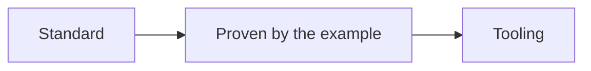
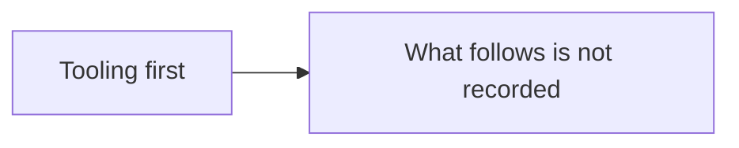
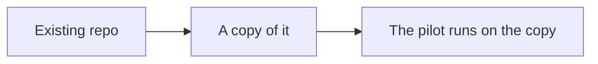
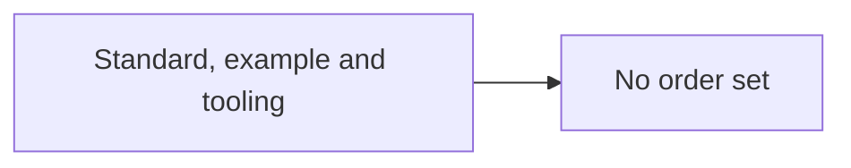
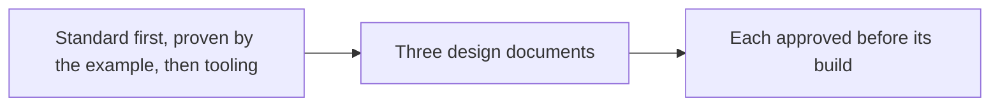

# Build order

Status: Draft

Date: 2026-11-14

Deciders: the Software Engineer

## Context

Not recorded. The trail entry has no Context for this decision. The decision is the order in which the baseline is built.

## Decision drivers

Not recorded.

## Options

### Option 1: Standard first, proven by the example, then tooling

The standard is built first, the example proves it, and tooling comes last.

*The standard comes first and tooling last; notice that the example sits between them as the proof.*

- **Pros:** Not recorded.
- **Cons:** Not recorded.
- **Evidence:** Not recorded.

### Option 2: Tooling first

Tooling is built first.

*Tooling comes first; notice that the trail records nothing about what follows it.*

- **Pros:** Not recorded.
- **Cons:** Not recorded.
- **Evidence:** Not recorded.

### Option 3: A pilot on a copy of an existing repo

A pilot is run on a copy of an existing repo.

*The pilot runs on a copy and not on the original repo; notice that the trail records nothing more about how it proceeds.*

- **Pros:** Not recorded.
- **Cons:** Not recorded.
- **Evidence:** Not recorded.

### Option 4: Do nothing

No build order is set, and because the trail entry has no Context the situation before the decision is not recorded.

*With no order chosen, nothing says which part comes first; notice that the trail records no Context for this decision.*

- **Pros:** Not recorded.
- **Cons:** Not recorded.
- **Evidence:** Not recorded.

## Comparison

| Option | Order of work | Recorded driver or trade-off |
|---|---|---|
| Standard first, proven by the example, then tooling | The standard, then the example as its proof, then tooling | Not recorded. |
| Tooling first | Tooling first; what follows is not recorded | Not recorded. |
| A pilot on a copy of an existing repo | A pilot on a copy of an existing repo | Not recorded. |
| Do nothing | No order set | Not recorded. |

## Decision

The Software Engineer picked standard first, proven by the example, then tooling. Why it beats tooling first and the pilot: Not recorded.

## Consequences

Three design documents, each approved before its build.

*The chosen order leads to three design documents; notice that each is approved before its build.*

## Revisit when

Not recorded.

## Links

- Design 1, Appendix A, 0028: [design 1](../superpowers/specs/2026-11-14-baseline-standard-design.md)
- Decision trail, entry 0028: [decision trail](../superpowers/specs/2026-11-14-baseline-decision-trail.md)
