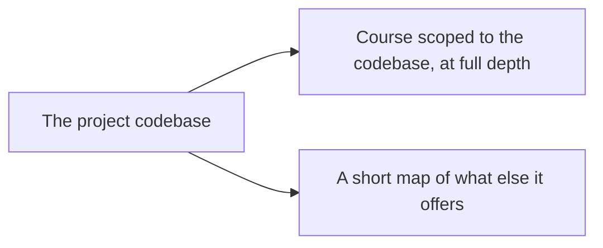
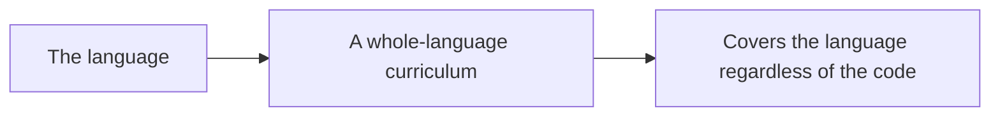
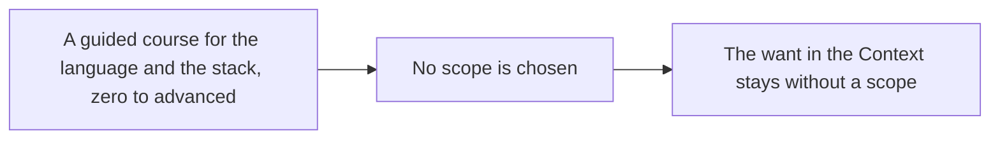
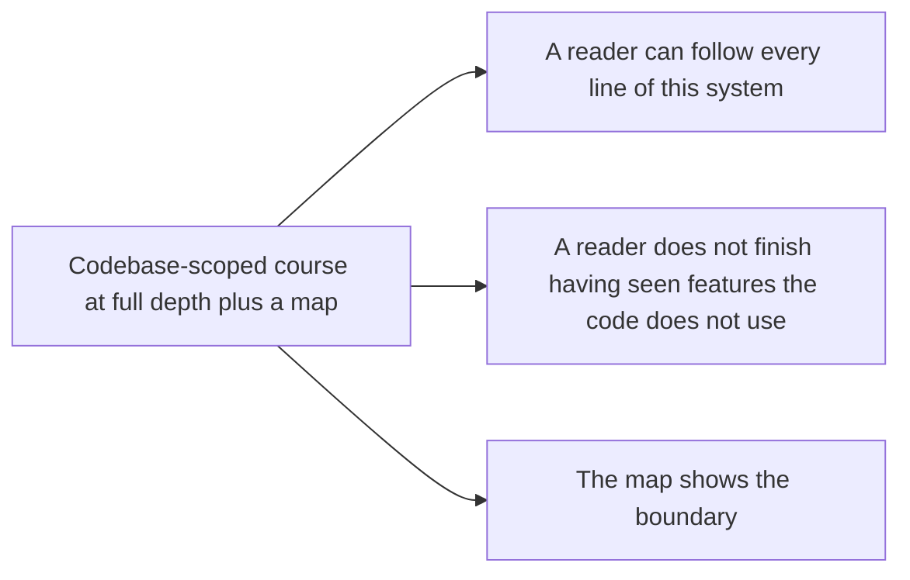

# Course scope

Status: Draft

Date: 2026-11-14

Deciders: the Software Engineer

## Context

The Software Engineer wants a guided course for the language and the stack, "zero to advanced", and one that "lives and grows along with the project codebase".

## Decision drivers

Not recorded.

## Options

### Option 1: Codebase-scoped at full depth plus a short "what else it offers" map

The course is scoped to the codebase at full depth, with a short "what else it offers" map added.

*The course goes to full depth on the codebase and adds a short map of what else it offers; notice that the code, and not the language, sets the scope.*

- **Pros:** A reader can follow every line of this system (recorded as a consequence).
- **Cons:** A reader does not finish having seen features the code does not use (recorded as a consequence; the map shows the boundary).
- **Evidence:** Not recorded.

### Option 2: A whole-language curriculum regardless of the code

The course is a whole-language curriculum, whatever the code uses.

*The curriculum covers the whole language whatever the code uses; notice that the code does not set its scope.*

- **Pros:** Not recorded.
- **Cons:** Not recorded.
- **Evidence:** The trail's evidence for the decision: `learn-rust` is already a standalone curriculum. It is given here because the trail names `learn-rust` as its example of a whole-language course.

### Option 3: Do nothing

No scope is chosen for the course.

*Doing nothing leaves the course without a scope; notice that the Context asks for a course that lives and grows along with the project codebase.*

- **Pros:** Not recorded.
- **Cons:** The want in the Context stays without a scope: a guided course for the language and the stack, "zero to advanced", that "lives and grows along with the project codebase".
- **Evidence:** Not recorded.

## Comparison

| Option | What the reader can follow | What the reader does not finish having seen | Other trade-offs recorded |
|---|---|---|---|
| Codebase-scoped at full depth plus a short "what else it offers" map | Every line of this system | Features the code does not use; the map shows the boundary | Not recorded. |
| A whole-language curriculum regardless of the code | Not recorded. | Not recorded. | Whole-language courses (like `learn-rust`, 74 lessons) stay a separate product (from the Pick) |
| Do nothing | Not recorded. | Not recorded. | The want in the Context stays without a scope, as quoted under Cons |

## Decision

The Software Engineer picked the codebase-scoped course at full depth plus a short "what else it offers" map. The recorded reason is the Software Engineer's own: "They will be code-based scoped." Whole-language courses (like `learn-rust`, 74 lessons) stay a separate product, and lessons seed the next project in that language.

Appendix A states the pick as: codebase-scoped at full depth plus a "what else it offers" map; whole-language courses are separate. Why it beats a whole-language curriculum, beyond the Software Engineer's words: Not recorded.

## Consequences

A reader can follow every line of this system but does not finish having seen features the code does not use. The map shows the boundary.

*A codebase-scoped course lets a reader follow every line of the system but not see features the code does not use; notice that the map shows the boundary.*

## Revisit when

Not recorded.

## Links

- Design 1, Appendix A, 0014: [design 1](../superpowers/specs/2026-11-14-baseline-standard-design.md)
- Decision trail, entry 0014: [decision trail](../superpowers/specs/2026-11-14-baseline-decision-trail.md)
