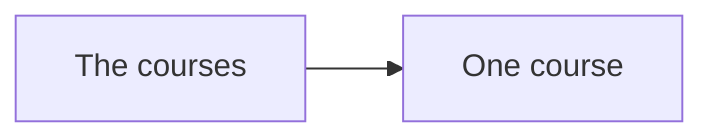
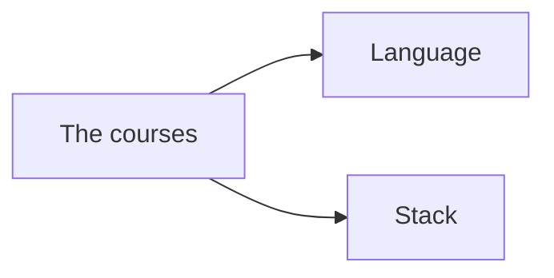
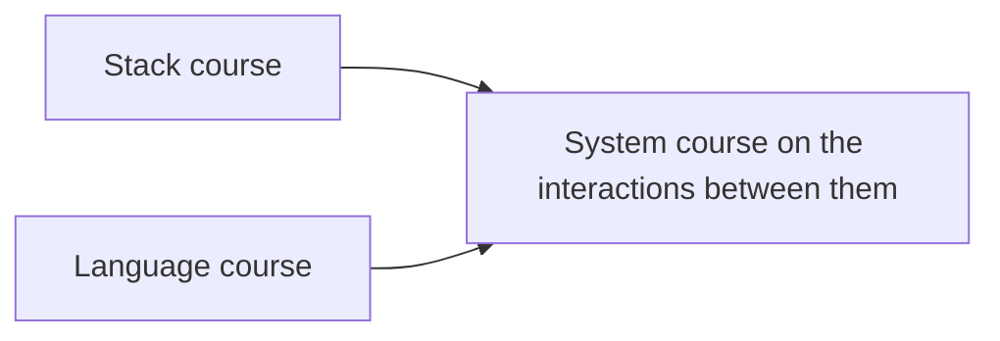
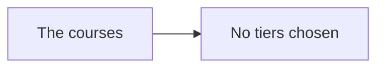
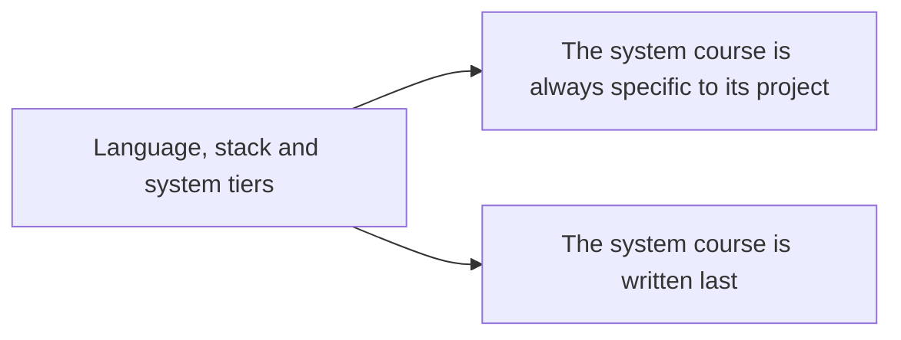

# Course tiers

Status: Draft

Date: 2026-11-14

Deciders: the Software Engineer

## Context

Not recorded. The trail entry has no Context for this decision. The decision is which tiers the courses have.

## Decision drivers

Not recorded.

## Options

### Option 1: One course

There is a single course.

*A single course stands alone; notice that it is not split into tiers.*

- **Pros:** Not recorded.
- **Cons:** Not recorded.
- **Evidence:** Not recorded.

### Option 2: Language and stack

There are tiers for the language and for the stack.

*The tiers are the language and the stack; notice that no tier covers the system.*

- **Pros:** Not recorded.
- **Cons:** Not recorded.
- **Evidence:** Not recorded.

### Option 3: Language, stack and system

There is a course for the stack, one for the language and a system course on the interactions between them: "then finally, all together combined, interactions between them will be a guided course."

*The system course follows the stack and language courses; notice that its subject is the interactions between them.*

- **Pros:** Not recorded.
- **Cons:** Not recorded.
- **Evidence:** Not recorded.

### Option 4: Do nothing

No course tiers are set, and because the trail entry has no Context the situation before the decision is not recorded.

*With no tiers chosen, nothing says how the courses are divided; notice that the trail records no Context for this decision.*

- **Pros:** Not recorded.
- **Cons:** Not recorded.
- **Evidence:** Not recorded.

## Comparison

| Option | Tiers | Recorded driver or trade-off |
|---|---|---|
| One course | A single course | Not recorded. |
| Language and stack | The language and the stack | Not recorded. |
| Language, stack and system | Three tiers (Appendix A): the stack, the language and the system | The system course is always specific to its project and is written last (recorded as a consequence) |
| Do nothing | No tiers chosen | Not recorded. |

## Decision

The Software Engineer picked language, stack and system tiers: one for the stack, the language as well, "then finally, all together combined, interactions between them will be a guided course." Appendix A states the pick as three tiers. Why it beats a single course and the language and stack tiers, beyond those words: Not recorded.

## Consequences

The system course is always specific to its project and is written last.

*Adding a system tier makes the last course specific to its project; notice that it is written last.*

## Revisit when

Not recorded.

## Links

- Design 1, Appendix A, 0015: [design 1](../superpowers/specs/2026-11-14-baseline-standard-design.md)
- Decision trail, entry 0015: [decision trail](../superpowers/specs/2026-11-14-baseline-decision-trail.md)
