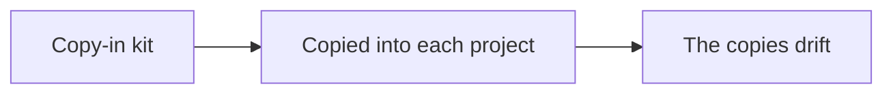
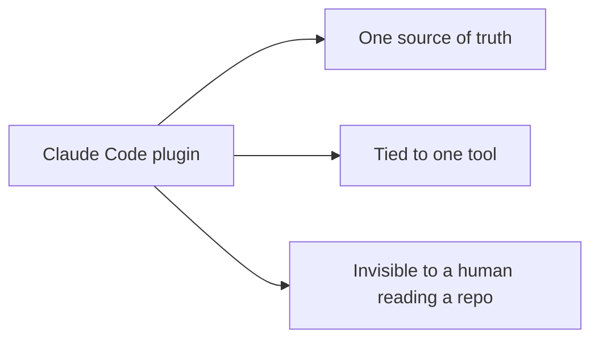
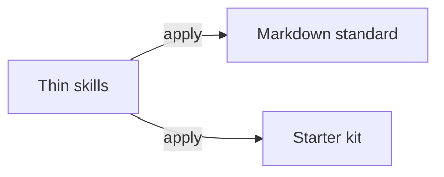
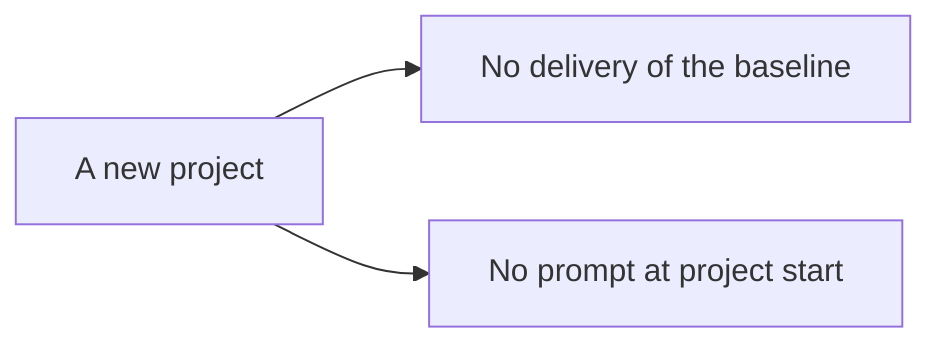
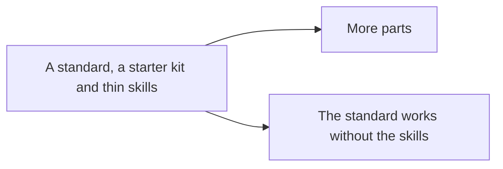

# Delivery

Status: Draft
Date: 2026-11-14
Deciders: the Software Engineer

## Context

The Software Engineer wants the baseline to be reusable for every new project, with a prompt at project start.

## Decision drivers

In the order the trail records them:

- Reusable.
- No lock-in to one tool.
- Updates must propagate.
- The intake needs something that asks questions.

## Options

### Option 1: A copy-in kit only

The baseline is delivered as a kit that is copied into each project.

*A copy-in kit is simple and agent-neutral; notice that once it is copied into projects the copies drift.*

- **Pros:** Simple; agent-neutral.
- **Cons:** Copies drift.
- **Evidence:** Not recorded.

### Option 2: A Claude Code plugin only

The baseline is delivered as a Claude Code plugin and in no other form.

*A plugin gives one source of truth; notice that it is tied to one tool and invisible to a human reading a repo.*

- **Pros:** One source of truth.
- **Cons:** Tied to one tool; invisible to a human reading a repo.
- **Evidence:** Not recorded.

### Option 3: A Markdown standard, a starter kit and thin skills

The baseline is delivered as a Markdown standard, a starter kit and thin skills that apply them.

*The thin skills apply the standard and the kit; notice that the standard works without the skills.*

- **Pros:** No lock-in and updates propagate (the reason Appendix A gives for the pick); the standard works without the skills (recorded as a consequence).
- **Cons:** More parts (recorded as a consequence).
- **Evidence:** Not recorded.

### Option 4: Do nothing

No delivery mechanism is chosen for the baseline.

*Without a delivery mechanism a new project gets neither the baseline nor a prompt; notice that this leaves the Software Engineer's want unmet.*

- **Pros:** Not recorded.
- **Cons:** The want in the Context goes unmet: the baseline reusable for every new project, with a prompt at project start.
- **Evidence:** Not recorded.

## Comparison

| Option | Reusable | No lock-in to one tool | Updates must propagate | The intake needs something that asks questions | Other trade-offs recorded |
|---|---|---|---|---|---|
| A copy-in kit only | Not recorded. | Agent-neutral | Copies drift | Not recorded. | Simple |
| A Claude Code plugin only | Not recorded. | Tied to one tool | One source of truth | Not recorded. | Invisible to a human reading a repo |
| A Markdown standard, a starter kit and thin skills | Not recorded. | No lock-in (Appendix A) | Updates propagate (Appendix A) | The Software Engineer proceeded on it after "this should be a prompt when starting a project" | More parts; the standard works without the skills |
| Do nothing | The want in the Context for reuse goes unmet | Not recorded. | Not recorded. | The want in the Context for a prompt at project start goes unmet | Not recorded. |

## Decision

The pick is a Markdown standard, a starter kit and thin skills that apply them.

Proposed by the agent that wrote design 1; approved by the Software Engineer.

The Software Engineer proceeded on it after saying "this should be a prompt when starting a project". The reason Appendix A gives is no lock-in and updates that propagate. The other two options each carry a recorded drawback: for the copy-in kit, copies drift; for the plugin, a tie to one tool and invisibility to a human reading a repo.

## Consequences

There are more parts, and the standard works without the skills.

*Delivering as a standard, a kit and skills means more parts; notice that the standard still works without the skills.*

## Revisit when

The skills become the only consumers, which would justify collapsing the kit into them.

## Links

- Design 1, Appendix A, 0003: [design 1](../superpowers/specs/2026-11-14-baseline-standard-design.md)
- Decision trail, entry 0003: [decision trail](../superpowers/specs/2026-11-14-baseline-decision-trail.md)
