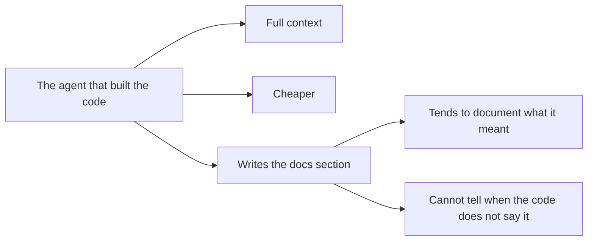
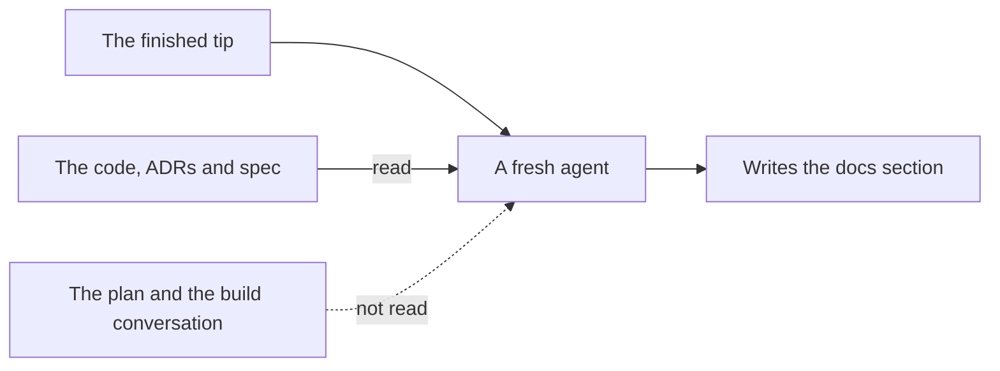
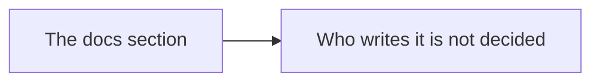
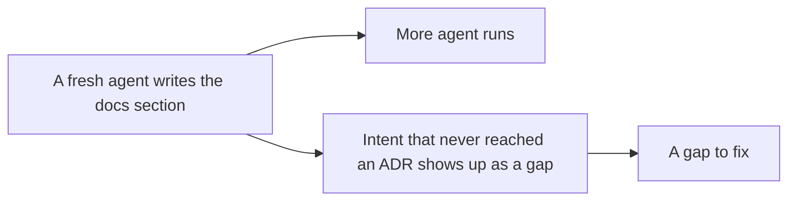

# The docs author

Status: Draft

Date: 2026-11-14

Deciders: the Software Engineer

## Context

Following the decision on where the descriptive documents go (Appendix A, 0007), the agent that was writing the design asked who writes the docs section.

## Decision drivers

Not recorded.

## Options

### Option 1: The agent that built the code

The agent that built the code writes the docs section.

*The building agent writes the docs section with full context and at lower cost; notice that it tends to document what it meant.*

- **Pros:** Cheaper; full context.
- **Cons:** Tends to document what it meant and cannot tell when the code does not say it.
- **Evidence:** Not recorded. The trail's evidence is for the decision as a whole and is given under the pick.

### Option 2: A fresh agent working from the finished tip

A fresh agent works from the finished tip, reading the code, ADRs and spec but not the plan or the build conversation.

*A fresh agent writes the docs section from the finished tip; notice that it reads the code, ADRs and spec but not the plan or the build conversation.*

- **Pros:** Not recorded. The reason Appendix A gives for the pick is under Decision.
- **Cons:** More agent runs (recorded as a consequence).
- **Evidence:** Recorded for the decision as a whole and placed here, with the pick: the execution skills already dispatch fresh subagents with crafted context.

### Option 3: Do nothing

No author is named for the docs section. The Context records only the question, who writes it.

*Doing nothing leaves the docs section without an author; notice that the Context records the question and no answer.*

- **Pros:** Not recorded.
- **Cons:** What stays unmet is the question in the Context: who writes the docs section.
- **Evidence:** Not recorded.

## Comparison

| Option | Who writes the docs section | Recorded driver or trade-off |
|---|---|---|
| The agent that built the code | The agent that built the code | Cheaper; full context; tends to document what it meant and cannot tell when the code does not say it |
| A fresh agent working from the finished tip | A fresh agent that reads the code, ADRs and spec but not the plan or the build conversation | More agent runs; intent that never reached an ADR shows up as a gap to fix (recorded as consequences) |
| Do nothing | Not decided | The question in the Context goes unanswered |

## Decision

The Software Engineer picked a fresh agent working from the finished tip: "the documents need to be written by a fresh agent." Appendix A states the pick as a fresh agent and gives the reason that the building agent documents what it meant, which matches the drawback the trail records for the agent that built the code.

The trail's evidence, recorded for the decision as a whole and given under the pick, is that the execution skills already dispatch fresh subagents with crafted context. Why the pick beats the agent that built the code, beyond the recorded reasons above: Not recorded.

## Consequences

There are more agent runs. Intent that never reached an ADR shows up as a gap to fix.

*A fresh agent means more agent runs; notice that intent which never reached an ADR shows up as a gap to fix.*

## Revisit when

Not recorded.

## Links

- Design 1, Appendix A, 0008: [design 1](../superpowers/specs/2026-11-14-baseline-standard-design.md)
- Decision trail, entry 0008: [decision trail](../superpowers/specs/2026-11-14-baseline-decision-trail.md)
