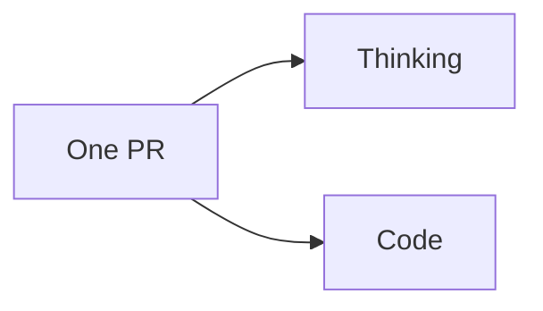
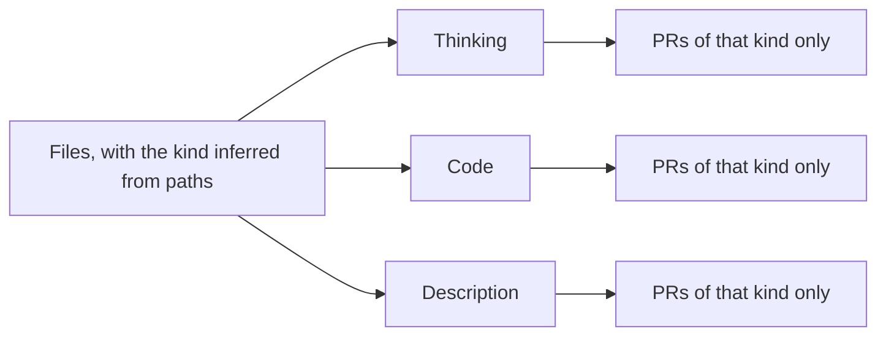
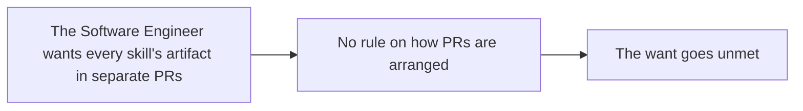
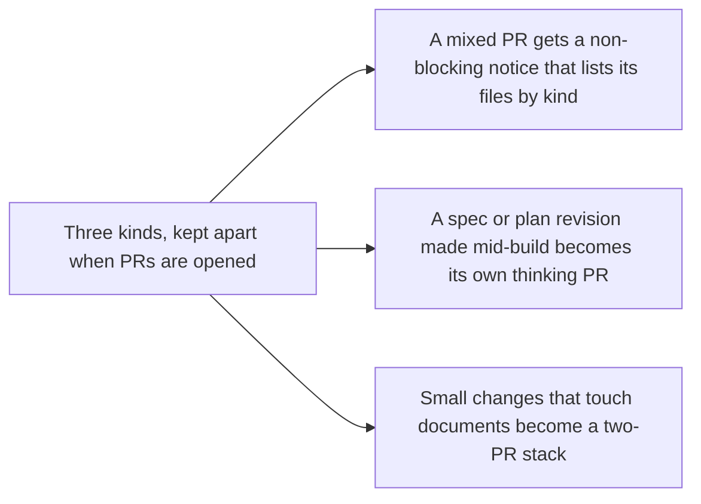

# One kind per PR, for easier review

Status: Draft

Date: 2026-11-14

Deciders: the Software Engineer

## Context

The Software Engineer wants every skill's artifact "to go out as separate PRs. That way it's easier to review for the reviewer who is a person to look at it, understand, make sense of it, and then go to the code in the stack." Later the Software Engineer corrected an overstated version of this in the design: a PR that holds both thinking and code is not wrong. The kinds are separated because that is easier to review, and a skill that revises its spec or plan in a later loop is free to; the point is that when PRs are opened, the revision is separated out into its own PR.

## Decision drivers

Not recorded.

## Options

### Option 1: Mixed PRs

A PR may hold more than one kind of document, such as both thinking and code.

*A mixed PR holds both thinking and code; notice that the Context records this as not wrong.*

- **Pros:** Not recorded. The Context records that a PR that holds both thinking and code is not wrong.
- **Cons:** Not recorded. The Software Engineer's reason for separating the kinds, easier review, is given under Decision.
- **Evidence:** Not recorded.

### Option 2: Three kinds, kept apart when PRs are opened: thinking, code, description

The kinds are thinking, code and description. Kinds are inferred from paths, and they are kept apart when PRs are opened.

*The three kinds are inferred from paths and kept apart when PRs are opened; notice that the separation happens at the point the PRs are opened.*

- **Pros:** Not recorded. The Software Engineer's reason for the pick, easier review, is given under Decision.
- **Cons:** Small changes that touch documents become a two-PR stack (recorded as a consequence).
- **Evidence:** Not recorded.

### Option 3: Do nothing

The baseline sets no rule on how the skills' artifacts go out in PRs. The Context records the Software Engineer's want that every skill's artifact go out as separate PRs.

*Doing nothing leaves the want without a rule; notice that the want is for easier review by a person.*

- **Pros:** Not recorded.
- **Cons:** The want in the Context goes unmet: the Software Engineer wants every skill's artifact "to go out as separate PRs".
- **Evidence:** Not recorded.

## Comparison

| Option | How PRs are shaped | Recorded driver or trade-off |
|---|---|---|
| Mixed PRs | A PR may hold both thinking and code | The Context records that a PR that holds both thinking and code is not wrong |
| Three kinds, kept apart when PRs are opened: thinking, code, description | Kinds are inferred from paths; a mixed PR gets a non-blocking notice that lists its files by kind; a spec or plan revision made mid-build becomes its own thinking PR | Small changes that touch documents become a two-PR stack (recorded as a consequence) |
| Do nothing | No rule on separating the kinds | The want in the Context goes unmet, as given under Cons |

## Decision

The Software Engineer picked three kinds, kept apart when PRs are opened: thinking, code and description. Kinds are inferred from paths. The recorded reason is the Software Engineer's own, from the Context: "it's easier to review for the reviewer who is a person to look at it, understand, make sense of it, and then go to the code in the stack". Appendix A states the pick as three kinds, kept apart when PRs are opened because each is easier to review alone, and adds that the kind is inferred from paths and a mixed PR gets a notice, not a failure.

The earlier drafts of the agent that was writing the design listed mixed PRs as an anti-goal and had a check fail them; both were withdrawn. The Software Engineer's later correction is recorded in the Context. Why the pick beats mixed PRs, beyond that reason: Not recorded.

## Consequences

A mixed PR gets a non-blocking notice that lists its files by kind; the notice is a call of the agent that was writing the design. A spec or plan revision made mid-build becomes its own thinking PR instead of riding in a code PR. Small changes that touch documents become a two-PR stack.

*Keeping the kinds apart has three effects; notice that the notice on a mixed PR is non-blocking.*

## Revisit when

Not recorded.

## Links

- Design 1, Appendix A, 0009: [design 1](../superpowers/specs/2026-11-14-baseline-standard-design.md)
- Decision trail, entry 0009: [decision trail](../superpowers/specs/2026-11-14-baseline-decision-trail.md)
