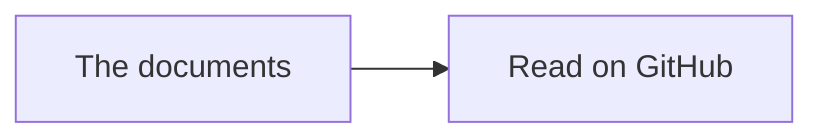
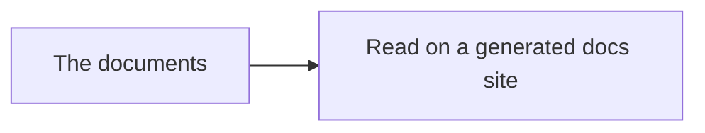
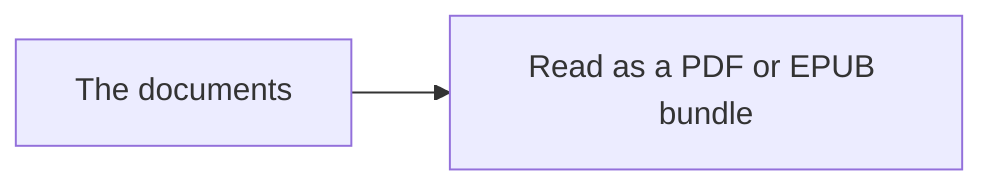
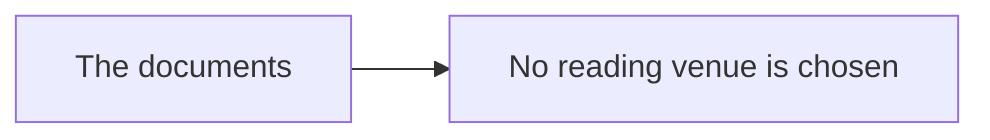
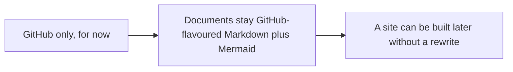

# Reading venue

Status: Draft

Date: 2026-11-14

Deciders: the Software Engineer

## Context

Not recorded. The trail entry has no Context for this decision. The decision is where the documents are read.

## Decision drivers

Not recorded.

## Options

### Option 1: GitHub

The documents are read on GitHub.

*The documents are read on GitHub; notice that the pick is GitHub only, for now.*

- **Pros:** Not recorded.
- **Cons:** Not recorded.
- **Evidence:** Not recorded.

### Option 2: A generated docs site

The documents are read on a generated docs site.

*The documents are read on a generated docs site; notice that the pick keeps a site possible later.*

- **Pros:** Not recorded.
- **Cons:** Not recorded.
- **Evidence:** Not recorded.

### Option 3: A PDF or EPUB bundle

The documents are read as a PDF or EPUB bundle.

*The documents are read as a bundle; notice that the bundle is a PDF or an EPUB.*

- **Pros:** Not recorded.
- **Cons:** Not recorded.
- **Evidence:** Not recorded.

### Option 4: Do nothing

No reading venue is chosen for the documents, and because the trail entry has no Context the situation before the decision is not recorded.

*With no venue chosen, nothing says where the documents are read; notice that the trail records no Context for this decision.*

- **Pros:** Not recorded.
- **Cons:** Not recorded.
- **Evidence:** Not recorded.

## Comparison

The trail records no drivers for this decision, so the table has no driver columns. The consequence it records for the pick is given under Consequences; the trail does not call it an advantage or a drawback.

| Option | Where the documents are read | Other trade-offs recorded |
|---|---|---|
| GitHub | On GitHub | Not recorded. |
| A generated docs site | On a generated docs site | Not recorded. |
| A PDF or EPUB bundle | As a PDF or EPUB bundle | Not recorded. |
| Do nothing | No venue is chosen | Not recorded. |

## Decision

The Software Engineer picked GitHub, only for now, with a site possible later. Appendix A states the pick the same way: GitHub only, a site possible later. The trail's evidence for the decision: Not recorded. Why GitHub beats a generated docs site and a PDF or EPUB bundle, beyond those words: Not recorded.

## Consequences

Documents stay GitHub-flavoured Markdown plus Mermaid, so a site can be built later without a rewrite.

*Staying on GitHub keeps the documents in GitHub-flavoured Markdown plus Mermaid; notice that a site can then be built later without a rewrite.*

## Revisit when

The Software Engineer wants a site.

## Links

- Design 1, Appendix A, 0022: [design 1](../superpowers/specs/2026-11-14-baseline-standard-design.md)
- Decision trail, entry 0022: [decision trail](../superpowers/specs/2026-11-14-baseline-decision-trail.md)
